<div align="center">
  <br>
  <a href="https://socialacolyte.github.io/stylefeatures/">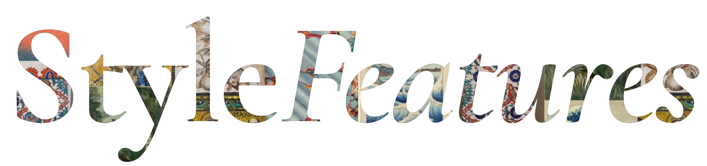</a>
  <br>
  <br>
  <p><b>Living web components, drawn from paintings, plates, water, cloth and stone.</b></p>
<!-- count -->
<p>87 pieces, 18 demo sites and 10 personal sites. Each one downloads as a folder you drop into a page.</p>
<!-- /count -->
  <a href="https://socialacolyte.github.io/stylefeatures/"></a>
  
  
  
</div>

<br>

<p align="center">
  <a href="https://socialacolyte.github.io/stylefeatures/">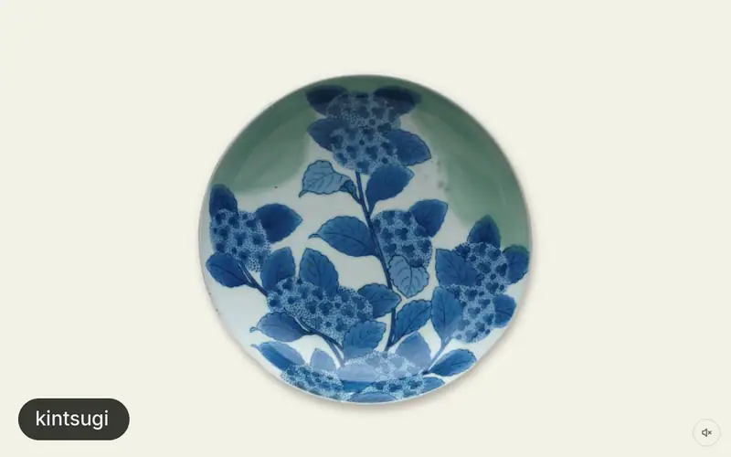</a>
  <br>
  <sub>kintsugi · peony-print · marbling · botticelli-primavera · mimosa-switch · koi-pond · stitch-type.<br>Real pieces in a browser, tapped, dragged and scrolled. Nothing here is a video.</sub>
</p>

```
kintsugi/
├── demo.html       open this
├── kintsugi.js     the piece: one ES module
├── kintsugi.css
├── tilt.js         helpers it imports
├── sound.js
├── sounds.json
├── assets/         the dishes it breaks
├── README.md       markup and options
├── CREDITS.md      every picture and sound, with its licence
└── LICENSE         MIT, for the code
```

<sub>What one download holds. No framework, no npm, no build step: serve the folder over
`http://` and `demo.html` runs. Any library a piece leans on comes vendored inside it.</sub>

## Install

Open a piece on [the site](https://socialacolyte.github.io/stylefeatures/) and press **Download**.
Or from the shell, by name:

```sh
curl -LO https://socialacolyte.github.io/stylefeatures/downloads/kintsugi.zip
unzip kintsugi.zip && cd kintsugi
python3 -m http.server      # then open http://localhost:8000/demo.html
```

Copy the folder into your project and keep the files together; the module finds its assets
next to itself.

## Usage

A stylesheet, an element marked with a `data-` attribute, one module. This is kintsugi: a dish
that cracks where you tap it, then mends with gold along every seam.

```html
<link rel="stylesheet" href="kintsugi.css">
<figure data-kintsugi>
  
</figure>
<script type="module" src="kintsugi.js"></script>

<!-- already mended: the gold seams only, nothing breaks -->
<figure data-kintsugi data-state="mended" data-pieces="9">
  
</figure>
```

Or drive it yourself:

```js
import { kintsugi } from './kintsugi.js';
const destroy = kintsugi(figure, { pieces: 18, mend: 'tap' });
figure.addEventListener('kintsugi:state', (e) => { /* e.detail.state, .from, .event */ });
destroy.strike(0.2, -0.3);   // break it, the blow at that point (dish radius = 1); no args = anywhere
destroy.mend();              // gather and gild now
destroy();                   // remove everything, the plain  again
```

Every piece's `README.md` has its own markup, options and events.

- **Real sources.** The paintings, plates and objects are museum and library scans, mostly
  public domain or CC0, each credited in `CREDITS.md` with its source.
- **Made in the order they were made.** A woodblock prints block by block, a watercolour goes
  pencil, washes, blooms, a tempera panel starts as bare gesso. The last frame is the original.
- **Real elements underneath.** A switch is a switch, pagination is a `<nav><ol>` of links, a
  heading is still text. Without JavaScript most fall back to the plain picture or markup.
- **Quiet by default.** Sound is off until the visitor turns it on, and most pieces calm down
  under `prefers-reduced-motion`.
- **Demo and personal sites** come with an `AGENT.md`: hand the folder to your coding agent and
  it builds the page from your own product, screens and words. Open it with `?record` and it
  plays as a film, ready to record in [Monet Shot](https://monetshot.pages.dev/).

## The collection

Every picture opens the live piece.

<!-- gallery -->
### Images & materials <sub>14</sub>

Artwork you look into: lenses, water, veils, frames.

<table>
<tr>
<td width="33%" valign="top"><a href="https://socialacolyte.github.io/stylefeatures/#/gold-ground">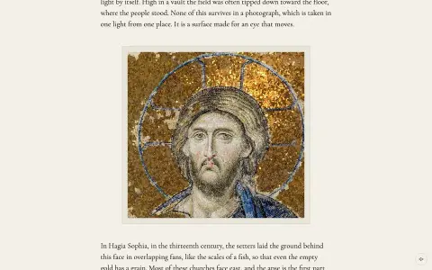</a><br><a href="https://socialacolyte.github.io/stylefeatures/#/gold-ground"><b>gold-ground</b></a><br><sub>A Byzantine gold mosaic that glints the way the real wall does.</sub></td>
<td width="33%" valign="top"><a href="https://socialacolyte.github.io/stylefeatures/#/hanging-tapestry">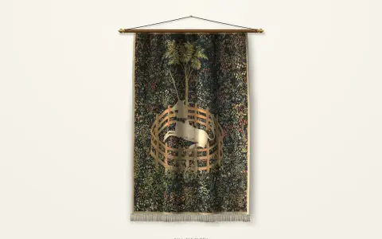</a><br><a href="https://socialacolyte.github.io/stylefeatures/#/hanging-tapestry"><b>hanging-tapestry</b></a><br><sub>A woven hanging on a turned wooden rod with brass finials, hung by a cord from one nail.</sub></td>
<td width="33%" valign="top"><a href="https://socialacolyte.github.io/stylefeatures/#/raking-light">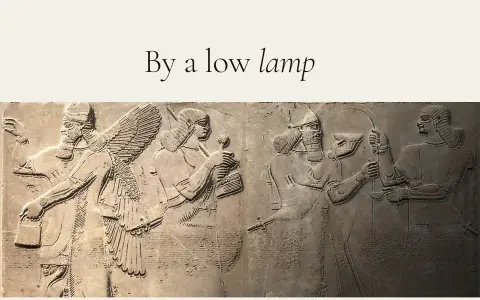</a><br><a href="https://socialacolyte.github.io/stylefeatures/#/raking-light"><b>raking-light</b></a><br><sub>A carved surface relit by a low lamp. Epigraphers read worn inscriptions and cuneiform by raking light.</sub></td>
</tr>
<tr>
<td width="33%" valign="top"><a href="https://socialacolyte.github.io/stylefeatures/#/loupe">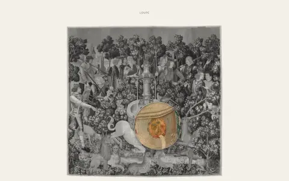</a><br><a href="https://socialacolyte.github.io/stylefeatures/#/loupe"><b>loupe</b></a><br><sub>A round reading glass lying on a print.</sub></td>
<td width="33%" valign="top"><a href="https://socialacolyte.github.io/stylefeatures/#/peony-print"></a><br><a href="https://socialacolyte.github.io/stylefeatures/#/peony-print"><b>peony-print</b></a><br><sub>Hokusai's Peonies and Canary is printed in front of you as you scroll, block by block.</sub></td>
<td width="33%" valign="top"><a href="https://socialacolyte.github.io/stylefeatures/#/marble-relight">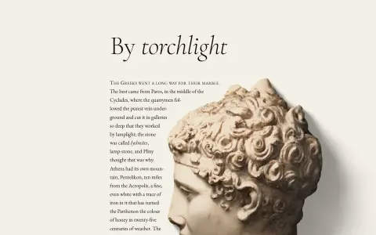</a><br><a href="https://socialacolyte.github.io/stylefeatures/#/marble-relight"><b>marble-relight</b></a><br><sub>A marble head standing in the page, lit by a candle you carry.</sub></td>
</tr>
<tr>
<td width="33%" valign="top"><a href="https://socialacolyte.github.io/stylefeatures/#/window-pane">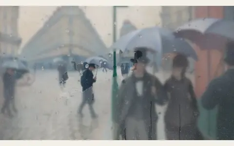</a><br><a href="https://socialacolyte.github.io/stylefeatures/#/window-pane"><b>window-pane</b></a><br><sub>A painting seen through a cold window on a wet day.</sub></td>
<td width="33%" valign="top"><a href="https://socialacolyte.github.io/stylefeatures/#/ripple-pool">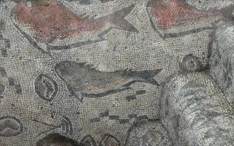</a><br><a href="https://socialacolyte.github.io/stylefeatures/#/ripple-pool"><b>ripple-pool</b></a><br><sub>A Roman marine mosaic seen through a shallow pool of clear water, after Evan Wallace's WebGL Water.</sub></td>
<td width="33%" valign="top"><a href="https://socialacolyte.github.io/stylefeatures/#/candle-light">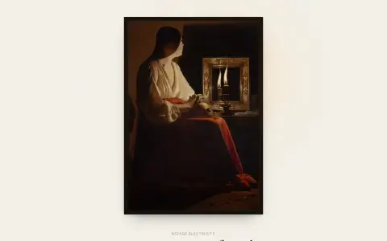</a><br><a href="https://socialacolyte.github.io/stylefeatures/#/candle-light"><b>candle-light</b></a><br><sub>A candlelit painting whose candle is alive.</sub></td>
</tr>
<tr>
<td width="33%" valign="top"><a href="https://socialacolyte.github.io/stylefeatures/#/details-wheel">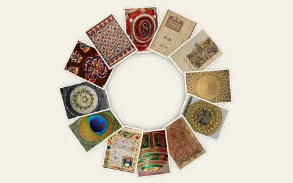</a><br><a href="https://socialacolyte.github.io/stylefeatures/#/details-wheel"><b>details-wheel</b></a><br><sub>Any set of images starts as a pile at the centre of a pinned stage, spirals out through a full turn.</sub></td>
<td width="33%" valign="top"><a href="https://socialacolyte.github.io/stylefeatures/#/marbling">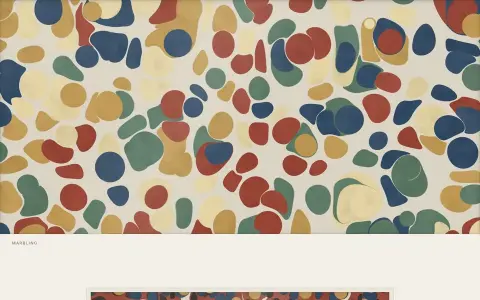</a><br><a href="https://socialacolyte.github.io/stylefeatures/#/marbling"><b>marbling</b></a><br><sub>A marbler's bath. Tap to drop ink and it opens on the size, pushing every earlier colour aside.</sub></td>
<td width="33%" valign="top"><a href="https://socialacolyte.github.io/stylefeatures/#/jali-light">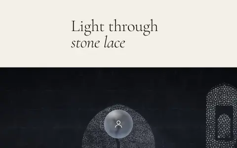</a><br><a href="https://socialacolyte.github.io/stylefeatures/#/jali-light"><b>jali-light</b></a><br><sub>A row of real stone windows and the sun that crosses them.</sub></td>
</tr>
<tr>
<td width="33%" valign="top"><a href="https://socialacolyte.github.io/stylefeatures/#/woodblock-print">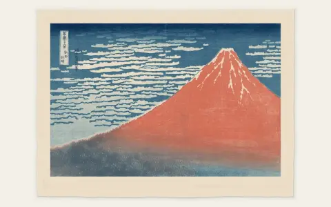</a><br><a href="https://socialacolyte.github.io/stylefeatures/#/woodblock-print"><b>woodblock-print</b></a><br><sub>A real Japanese colour woodblock print, printed in front of you as you scroll.</sub></td>
<td width="33%" valign="top"><a href="https://socialacolyte.github.io/stylefeatures/#/shadow-puppet">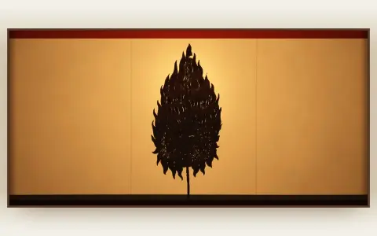</a><br><a href="https://socialacolyte.github.io/stylefeatures/#/shadow-puppet"><b>shadow-puppet</b></a><br><sub>Wayang kulit, seen from the shadow side.</sub></td>
<td width="33%"></td>
</tr>
</table>

### Objects you handle <sub>6</sub>

Things with weight that you pull, throw, spin and tear.

<table>
<tr>
<td width="33%" valign="top"><a href="https://socialacolyte.github.io/stylefeatures/#/kintsugi">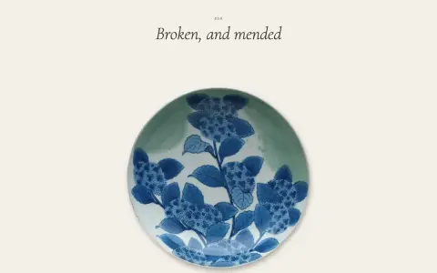</a><br><a href="https://socialacolyte.github.io/stylefeatures/#/kintsugi"><b>kintsugi</b></a><br><sub>A porcelain dish lying on the paper. Tap it and it cracks from where you tapped.</sub></td>
<td width="33%" valign="top"><a href="https://socialacolyte.github.io/stylefeatures/#/moodboard">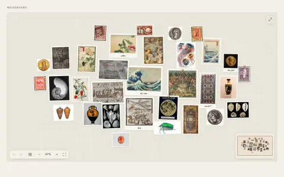</a><br><a href="https://socialacolyte.github.io/stylefeatures/#/moodboard"><b>moodboard</b></a><br><sub>A pinboard for collecting pictures.</sub></td>
<td width="33%" valign="top"><a href="https://socialacolyte.github.io/stylefeatures/#/specimen-tray">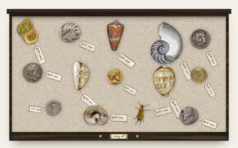</a><br><a href="https://socialacolyte.github.io/stylefeatures/#/specimen-tray"><b>specimen-tray</b></a><br><sub>A naturalist's cabinet drawer of shells and coins you can handle.</sub></td>
</tr>
<tr>
<td width="33%" valign="top"><a href="https://socialacolyte.github.io/stylefeatures/#/page-turn">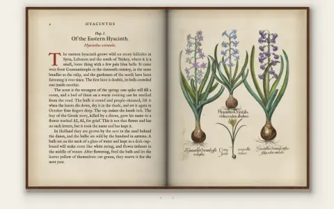</a><br><a href="https://socialacolyte.github.io/stylefeatures/#/page-turn"><b>page-turn</b></a><br><sub>An old printed herbal lying open, and you turn its leaves.</sub></td>
<td width="33%" valign="top"><a href="https://socialacolyte.github.io/stylefeatures/#/brass-rubbing">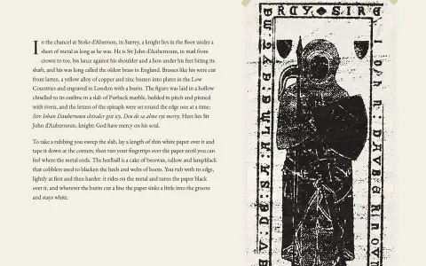</a><br><a href="https://socialacolyte.github.io/stylefeatures/#/brass-rubbing"><b>brass-rubbing</b></a><br><sub>A sheet of thin paper taped over a memorial brass.</sub></td>
<td width="33%" valign="top"><a href="https://socialacolyte.github.io/stylefeatures/#/excavation">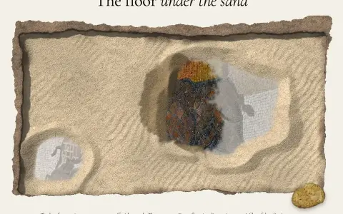</a><br><a href="https://socialacolyte.github.io/stylefeatures/#/excavation"><b>excavation</b></a><br><sub>A Roman floor at the bottom of a trench, under a skin of sand and dust, and you uncover it with a brush.</sub></td>
</tr>
</table>

### Buttons <sub>6</sub>

Toggles, switches and loaders: a leaf that folds, steel that colours, a ring that knocks, a key that sends, a pen box that opens, an orbit that waits.

<table>
<tr>
<td width="33%" valign="top"><a href="https://socialacolyte.github.io/stylefeatures/#/qalamdan">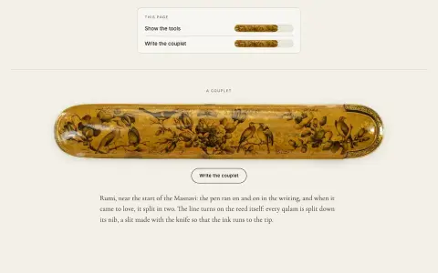</a><br><a href="https://socialacolyte.github.io/stylefeatures/#/qalamdan"><b>qalamdan</b></a><br><sub>A toggle switch that is a Persian pen box.</sub></td>
<td width="33%" valign="top"><a href="https://socialacolyte.github.io/stylefeatures/#/hohmann-button">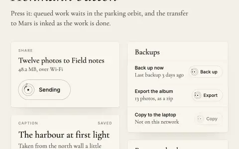</a><br><a href="https://socialacolyte.github.io/stylefeatures/#/hohmann-button"><b>hohmann-button</b></a><br><sub>A button that waits in a parking orbit while its work is queued.</sub></td>
<td width="33%" valign="top"><a href="https://socialacolyte.github.io/stylefeatures/#/pushou">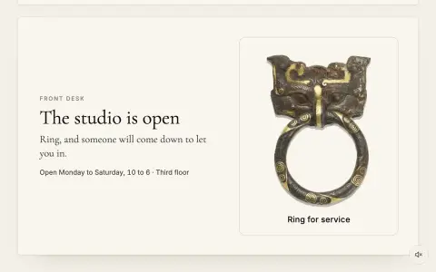</a><br><a href="https://socialacolyte.github.io/stylefeatures/#/pushou"><b>pushou</b></a><br><sub>A press button for actions that knock or ring.</sub></td>
</tr>
<tr>
<td width="33%" valign="top"><a href="https://socialacolyte.github.io/stylefeatures/#/mimosa-switch">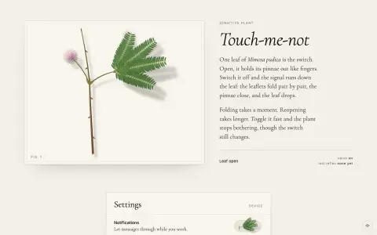</a><br><a href="https://socialacolyte.github.io/stylefeatures/#/mimosa-switch"><b>mimosa-switch</b></a><br><sub>A switch that is one leaf of Mimosa pudica, the sensitive plant.</sub></td>
<td width="33%" valign="top"><a href="https://socialacolyte.github.io/stylefeatures/#/telegraph-key">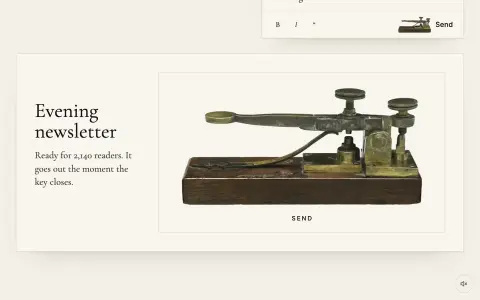</a><br><a href="https://socialacolyte.github.io/stylefeatures/#/telegraph-key"><b>telegraph-key</b></a><br><sub>A Send button that is the Morse–Vail key of 1844.</sub></td>
<td width="33%" valign="top"><a href="https://socialacolyte.github.io/stylefeatures/#/temper-button">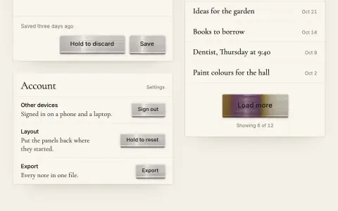</a><br><a href="https://socialacolyte.github.io/stylefeatures/#/temper-button"><b>temper-button</b></a><br><sub>A button with a face of ground steel.</sub></td>
</tr>
</table>

### Type & text <sub>9</sub>

Words set, sewn, poured and assembled.

<table>
<tr>
<td width="33%" valign="top"><a href="https://socialacolyte.github.io/stylefeatures/#/pretext-calligram">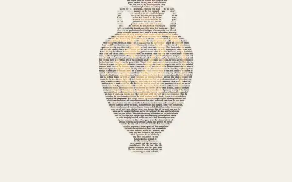</a><br><a href="https://socialacolyte.github.io/stylefeatures/#/pretext-calligram"><b>pretext-calligram</b></a><br><sub>A paragraph poured into a vessel. The text is set inside the silhouette of a real object.</sub></td>
<td width="33%" valign="top"><a href="https://socialacolyte.github.io/stylefeatures/#/canon-tables">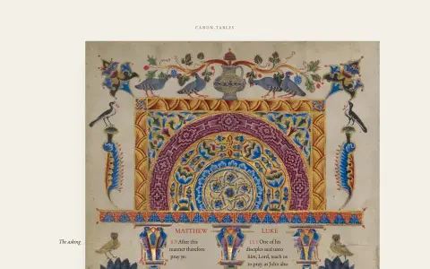</a><br><a href="https://socialacolyte.github.io/stylefeatures/#/canon-tables"><b>canon-tables</b></a><br><sub>A comparison table set in the canon pages of a Gospel book.</sub></td>
<td width="33%" valign="top"><a href="https://socialacolyte.github.io/stylefeatures/#/pretext-burn">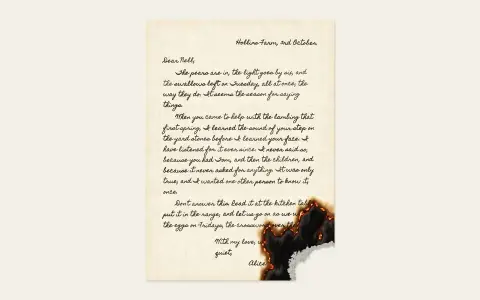</a><br><a href="https://socialacolyte.github.io/stylefeatures/#/pretext-burn"><b>pretext-burn</b></a><br><sub>A handwritten letter burning slowly from one corner as you scroll, the way paper burns.</sub></td>
</tr>
<tr>
<td width="33%" valign="top"><a href="https://socialacolyte.github.io/stylefeatures/#/pretext-spiral">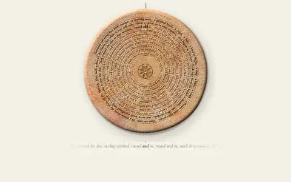</a><br><a href="https://socialacolyte.github.io/stylefeatures/#/pretext-spiral"><b>pretext-spiral</b></a><br><sub>A paragraph wound onto a disc of fired clay, like the Phaistos Disc.</sub></td>
<td width="33%" valign="top"><a href="https://socialacolyte.github.io/stylefeatures/#/pretext-inscription">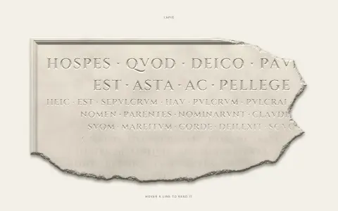</a><br><a href="https://socialacolyte.github.io/stylefeatures/#/pretext-inscription"><b>pretext-inscription</b></a><br><sub>A Roman inscription cut into a broken stone.</sub></td>
<td width="33%" valign="top"><a href="https://socialacolyte.github.io/stylefeatures/#/drop-cap-gilt">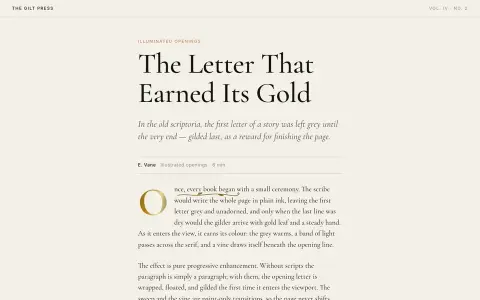</a><br><a href="https://socialacolyte.github.io/stylefeatures/#/drop-cap-gilt"><b>drop-cap-gilt</b></a><br><sub>An illuminated-manuscript drop cap for article openings.</sub></td>
</tr>
<tr>
<td width="33%" valign="top"><a href="https://socialacolyte.github.io/stylefeatures/#/pretext-gloss">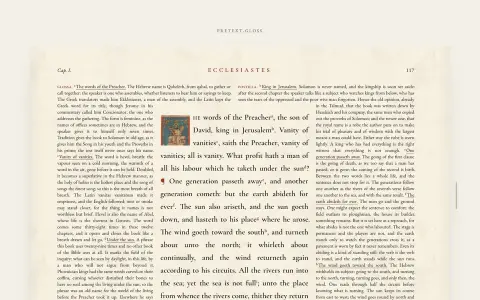</a><br><a href="https://socialacolyte.github.io/stylefeatures/#/pretext-gloss"><b>pretext-gloss</b></a><br><sub>The glossed page: a medieval glossed Bible, a Talmud folio or a Renaissance commentary page.</sub></td>
<td width="33%" valign="top"><a href="https://socialacolyte.github.io/stylefeatures/#/pretext-weathering">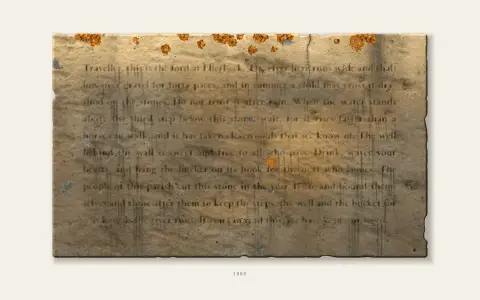</a><br><a href="https://socialacolyte.github.io/stylefeatures/#/pretext-weathering"><b>pretext-weathering</b></a><br><sub>A paragraph cut into a block of sandstone, and three hundred years of weather, scrubbed by the scroll.</sub></td>
<td width="33%" valign="top"><a href="https://socialacolyte.github.io/stylefeatures/#/stitch-type">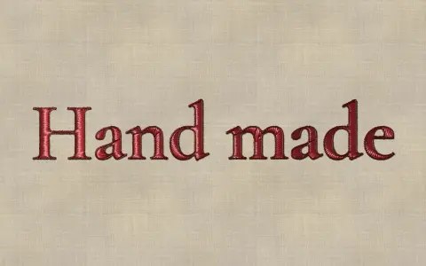</a><br><a href="https://socialacolyte.github.io/stylefeatures/#/stitch-type"><b>stitch-type</b></a><br><sub>A heading sewn in silk on linen. The text is rasterised offscreen and turned into real embroidery.</sub></td>
</tr>
</table>

### Controls & forms <sub>8</sub>

Buttons and fields that behave like the real thing.

<table>
<tr>
<td width="33%" valign="top"><a href="https://socialacolyte.github.io/stylefeatures/#/elephant-clock">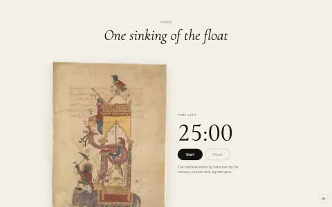</a><br><a href="https://socialacolyte.github.io/stylefeatures/#/elephant-clock"><b>elephant-clock</b></a><br><sub>A countdown that is al-Jazari's Elephant Clock, simulated.</sub></td>
<td width="33%" valign="top"><a href="https://socialacolyte.github.io/stylefeatures/#/dragon-volvelle">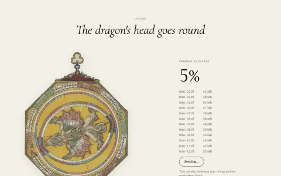</a><br><a href="https://socialacolyte.github.io/stylefeatures/#/dragon-volvelle"><b>dragon-volvelle</b></a><br><sub>A loader / progress indicator that is Peter Apian's lunar dragon volvelle.</sub></td>
<td width="33%" valign="top"><a href="https://socialacolyte.github.io/stylefeatures/#/ink-pad">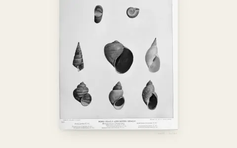</a><br><a href="https://socialacolyte.github.io/stylefeatures/#/ink-pad"><b>ink-pad</b></a><br><sub>A signature field, or a page of margin notes, that writes like a pointed dip pen on good paper.</sub></td>
</tr>
<tr>
<td width="33%" valign="top"><a href="https://socialacolyte.github.io/stylefeatures/#/lustre-stars">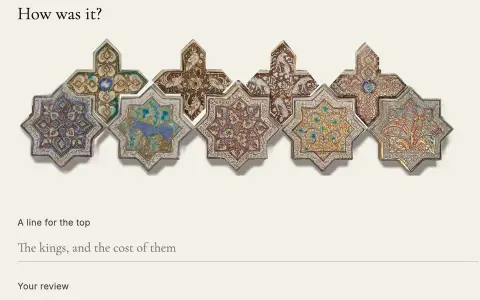</a><br><a href="https://socialacolyte.github.io/stylefeatures/#/lustre-stars"><b>lustre-stars</b></a><br><sub>A rating made of real Kashan lustre tiles.</sub></td>
<td width="33%" valign="top"><a href="https://socialacolyte.github.io/stylefeatures/#/badbezan">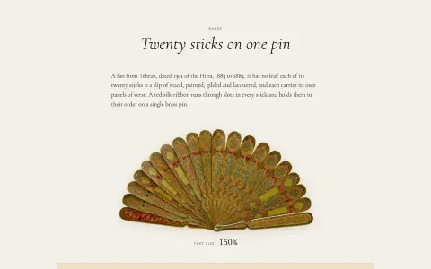</a><br><a href="https://socialacolyte.github.io/stylefeatures/#/badbezan"><b>badbezan</b></a><br><sub>A range input that is a Persian brisé fan.</sub></td>
<td width="33%" valign="top"><a href="https://socialacolyte.github.io/stylefeatures/#/jubako">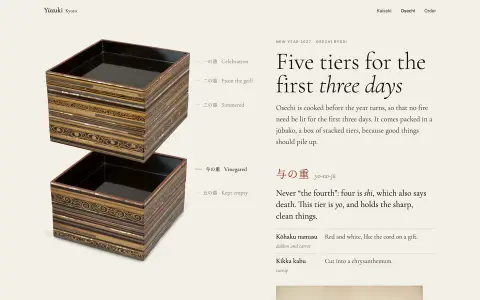</a><br><a href="https://socialacolyte.github.io/stylefeatures/#/jubako"><b>jubako</b></a><br><sub>Tabs that are the tiers of a Japanese food box.</sub></td>
</tr>
<tr>
<td width="33%" valign="top"><a href="https://socialacolyte.github.io/stylefeatures/#/senet">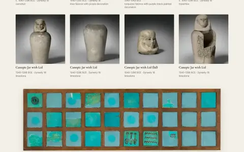</a><br><a href="https://socialacolyte.github.io/stylefeatures/#/senet"><b>senet</b></a><br><sub>Pagination on a senet board. The control is a real &lt;nav&gt;&lt;ol&gt; of page links.</sub></td>
<td width="33%" valign="top"><a href="https://socialacolyte.github.io/stylefeatures/#/tamra-nuat">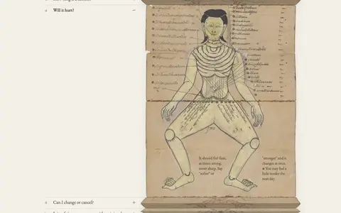</a><br><a href="https://socialacolyte.github.io/stylefeatures/#/tamra-nuat"><b>tamra-nuat</b></a><br><sub>An accordion that is a Thai folding book.</sub></td>
<td width="33%"></td>
</tr>
</table>

### Rainforest <sub>3</sub>

Trees, vines, leaves and flowers that grow, drip and open as you read.

<table>
<tr>
<td width="33%" valign="top"><a href="https://socialacolyte.github.io/stylefeatures/#/drip-tip">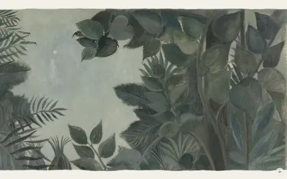</a><br><a href="https://socialacolyte.github.io/stylefeatures/#/drip-tip"><b>drip-tip</b></a><br><sub>Rain in Henri Rousseau's The Equatorial Jungle (1909).</sub></td>
<td width="33%" valign="top"><a href="https://socialacolyte.github.io/stylefeatures/#/pretext-vine">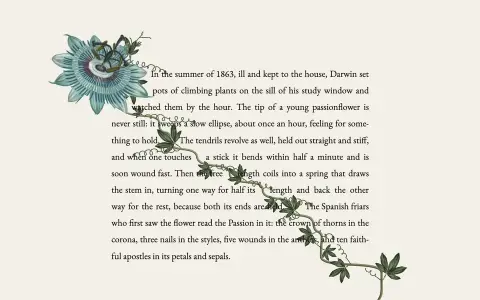</a><br><a href="https://socialacolyte.github.io/stylefeatures/#/pretext-vine"><b>pretext-vine</b></a><br><sub>A passionflower climbs a paragraph, and the paragraph makes room for it.</sub></td>
<td width="33%" valign="top"><a href="https://socialacolyte.github.io/stylefeatures/#/branch-growth">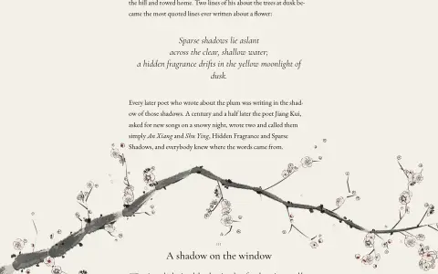</a><br><a href="https://socialacolyte.github.io/stylefeatures/#/branch-growth"><b>branch-growth</b></a><br><sub>A flowering plum branch, painted in ink, that grows down a long page as you read it.</sub></td>
</tr>
</table>

### Water <sub>6</sub>

Rivers, rain, drops and fish: water you watch, touch and scroll through.

<table>
<tr>
<td width="33%" valign="top"><a href="https://socialacolyte.github.io/stylefeatures/#/meander">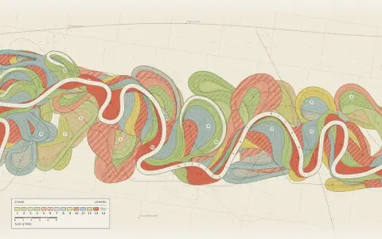</a><br><a href="https://socialacolyte.github.io/stylefeatures/#/meander"><b>meander</b></a><br><sub>A river seen from above wanders across its floodplain as you scroll.</sub></td>
<td width="33%" valign="top"><a href="https://socialacolyte.github.io/stylefeatures/#/lotus-leaf">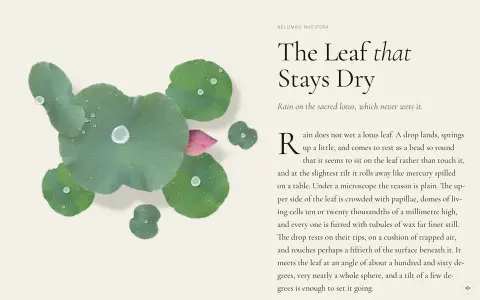</a><br><a href="https://socialacolyte.github.io/stylefeatures/#/lotus-leaf"><b>lotus-leaf</b></a><br><sub>Rain on a cluster of lotus leaves.</sub></td>
<td width="33%" valign="top"><a href="https://socialacolyte.github.io/stylefeatures/#/koi-pond">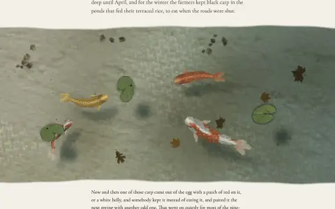</a><br><a href="https://socialacolyte.github.io/stylefeatures/#/koi-pond"><b>koi-pond</b></a><br><sub>Koi from a woodblock print swimming under water you can touch.</sub></td>
</tr>
<tr>
<td width="33%" valign="top"><a href="https://socialacolyte.github.io/stylefeatures/#/waterfall-print"></a><br><a href="https://socialacolyte.github.io/stylefeatures/#/waterfall-print"><b>waterfall-print</b></a><br><sub>A descent down a Hokusai waterfall, with his painted water pouring.</sub></td>
<td width="33%" valign="top"><a href="https://socialacolyte.github.io/stylefeatures/#/pretext-rain"></a><br><a href="https://socialacolyte.github.io/stylefeatures/#/pretext-rain"><b>pretext-rain</b></a><br><sub>A handwritten letter left out on a garden table, and a shower coming over it as you scroll.</sub></td>
<td width="33%" valign="top"><a href="https://socialacolyte.github.io/stylefeatures/#/rain-pond"></a><br><a href="https://socialacolyte.github.io/stylefeatures/#/rain-pond"><b>rain-pond</b></a><br><sub>A summer squall crossing Corot's willows, scrolled through as one weather event.</sub></td>
</tr>
</table>

### Watercolour <sub>6</sub>

Paintings and plates rebuilt in the order they were made: pencil, washes, blooms, the last frame the original.

<table>
<tr>
<td width="33%" valign="top"><a href="https://socialacolyte.github.io/stylefeatures/#/hand-colouring"></a><br><a href="https://socialacolyte.github.io/stylefeatures/#/hand-colouring"><b>hand-colouring</b></a><br><sub>A plate from Maria Sibylla Merian's Metamorphosis insectorum Surinamensium coloured by hand as you read.</sub></td>
<td width="33%" valign="top"><a href="https://socialacolyte.github.io/stylefeatures/#/flower-border"></a><br><a href="https://socialacolyte.github.io/stylefeatures/#/flower-border"><b>flower-border</b></a><br><sub>A leaf from a Flemish book of hours, the Spinola Hours, painted in front of you as you scroll.</sub></td>
<td width="33%" valign="top"><a href="https://socialacolyte.github.io/stylefeatures/#/wet-on-wet"></a><br><a href="https://socialacolyte.github.io/stylefeatures/#/wet-on-wet"><b>wet-on-wet</b></a><br><sub>Winslow Homer's Sloop, Nassau (1899) painted in front of you as you scroll, in the order Homer worked.</sub></td>
</tr>
<tr>
<td width="33%" valign="top"><a href="https://socialacolyte.github.io/stylefeatures/#/florilegium"></a><br><a href="https://socialacolyte.github.io/stylefeatures/#/florilegium"><b>florilegium</b></a><br><sub>A colourist's bench.</sub></td>
<td width="33%" valign="top"><a href="https://socialacolyte.github.io/stylefeatures/#/stipple-rose"></a><br><a href="https://socialacolyte.github.io/stylefeatures/#/stipple-rose"><b>stipple-rose</b></a><br><sub>A plate from Redouté's Les Roses, Rosa lucida, made in front of you as you scroll.</sub></td>
<td width="33%" valign="top"><a href="https://socialacolyte.github.io/stylefeatures/#/vellum-study"></a><br><a href="https://socialacolyte.github.io/stylefeatures/#/vellum-study"><b>vellum-study</b></a><br><sub>Pancrace Bessa's waratah, a botanical watercolour on vellum from about 1830.</sub></td>
</tr>
</table>

### Scroll & navigation <sub>1</sub>

Pinned scenes, progress, and ways through long pages.

<table>
<tr>
<td width="33%" valign="top"><a href="https://socialacolyte.github.io/stylefeatures/#/paper-theatre"></a><br><a href="https://socialacolyte.github.io/stylefeatures/#/paper-theatre"><b>paper-theatre</b></a><br><sub>A Victorian toy theatre set in front of you as you scroll.</sub></td>
<td width="33%"></td>
<td width="33%"></td>
</tr>
</table>

### Renaissance <sub>1</sub>

Old masters remade in their own order: drawing, tempera, light, sinopia.

<table>
<tr>
<td width="33%" valign="top"><a href="https://socialacolyte.github.io/stylefeatures/#/botticelli-primavera"></a><br><a href="https://socialacolyte.github.io/stylefeatures/#/botticelli-primavera"><b>botticelli-primavera</b></a><br><sub>Botticelli's Primavera painted in front of you as you scroll, in the order of egg tempera.</sub></td>
<td width="33%"></td>
<td width="33%"></td>
</tr>
</table>

### Biodiversity <sub>4</sub>

Plates of living things, coloured as you scroll: insects, anemones, radiolaria, a heron.

<table>
<tr>
<td width="33%" valign="top"><a href="https://socialacolyte.github.io/stylefeatures/#/haeckel-radiolaria"></a><br><a href="https://socialacolyte.github.io/stylefeatures/#/haeckel-radiolaria"><b>haeckel-radiolaria</b></a><br><sub>Haeckel's radiolaria plate inks in radially as you scroll.</sub></td>
<td width="33%" valign="top"><a href="https://socialacolyte.github.io/stylefeatures/#/coral-biodiversity"></a><br><a href="https://socialacolyte.github.io/stylefeatures/#/coral-biodiversity"><b>coral-biodiversity</b></a><br><sub>Haeckel's sea anemones arrive as line and bloom into full colour as you scroll.</sub></td>
<td width="33%" valign="top"><a href="https://socialacolyte.github.io/stylefeatures/#/merian-metamorphosis"></a><br><a href="https://socialacolyte.github.io/stylefeatures/#/merian-metamorphosis"><b>merian-metamorphosis</b></a><br><sub>Merian's pomegranate plate arrives as bare engraving and takes its hand-colouring as you scroll.</sub></td>
</tr>
<tr>
<td width="33%" valign="top"><a href="https://socialacolyte.github.io/stylefeatures/#/audubon-heron"></a><br><a href="https://socialacolyte.github.io/stylefeatures/#/audubon-heron"><b>audubon-heron</b></a><br><sub>John James Audubon's Great Blue Heron, Plate 211 of The Birds of America, coloured by hand as you scroll.</sub></td>
<td width="33%"></td>
<td width="33%"></td>
</tr>
</table>

### Demo sites <sub>18</sub>

Launch pages your coding agent builds from your product's own code: a scripted cursor plays your real screens. Record one in Monet Shot for your launch video.

<table>
<tr>
<td width="33%" valign="top"><a href="https://socialacolyte.github.io/stylefeatures/#/product-tour"></a><br><a href="https://socialacolyte.github.io/stylefeatures/#/product-tour"><b>Product tour</b></a><br><sub>The Monet Shot shape. Your product plays as a film.</sub></td>
<td width="33%" valign="top"><a href="https://socialacolyte.github.io/stylefeatures/#/chapters"></a><br><a href="https://socialacolyte.github.io/stylefeatures/#/chapters"><b>Chapters</b></a><br><sub>A long page where each feature gets its own short tour beside a few words, played as you scroll to it.</sub></td>
<td width="33%" valign="top"><a href="https://socialacolyte.github.io/stylefeatures/#/playground"></a><br><a href="https://socialacolyte.github.io/stylefeatures/#/playground"><b>Playground</b></a><br><sub>The tour plays once, then hands your product to the visitor.</sub></td>
</tr>
<tr>
<td width="33%" valign="top"><a href="https://socialacolyte.github.io/stylefeatures/#/terminal"></a><br><a href="https://socialacolyte.github.io/stylefeatures/#/terminal"><b>Terminal</b></a><br><sub>Commands typed with a human rhythm, real output streaming in, then the result opening in a window.</sub></td>
<td width="33%" valign="top"><a href="https://socialacolyte.github.io/stylefeatures/#/split"></a><br><a href="https://socialacolyte.github.io/stylefeatures/#/split"><b>Split</b></a><br><sub>A prompt or code typed on one side, your product reacting live on the other.</sub></td>
<td width="33%" valign="top"><a href="https://socialacolyte.github.io/stylefeatures/#/phone"></a><br><a href="https://socialacolyte.github.io/stylefeatures/#/phone"><b>Phone</b></a><br><sub>Your app in a phone, a fingertip tapping and swiping through it.</sub></td>
</tr>
<tr>
<td width="33%" valign="top"><a href="https://socialacolyte.github.io/stylefeatures/#/launch-note"></a><br><a href="https://socialacolyte.github.io/stylefeatures/#/launch-note"><b>Launch note</b></a><br><sub>A "we just shipped this" page: one feature, one short tour, a before and after, three notes.</sub></td>
<td width="33%" valign="top"><a href="https://socialacolyte.github.io/stylefeatures/#/chat"></a><br><a href="https://socialacolyte.github.io/stylefeatures/#/chat"><b>Chat</b></a><br><sub>The page is the conversation.</sub></td>
<td width="33%" valign="top"><a href="https://socialacolyte.github.io/stylefeatures/#/mcp"></a><br><a href="https://socialacolyte.github.io/stylefeatures/#/mcp"><b>MCP</b></a><br><sub>A spare text chat between a person and their agent, one real tool call per example.</sub></td>
</tr>
<tr>
<td width="33%" valign="top"><a href="https://socialacolyte.github.io/stylefeatures/#/versus"></a><br><a href="https://socialacolyte.github.io/stylefeatures/#/versus"><b>Versus</b></a><br><sub>A race: the old tangle of tabs and copy-paste in one window, your product in the other.</sub></td>
<td width="33%" valign="top"><a href="https://socialacolyte.github.io/stylefeatures/#/deck"></a><br><a href="https://socialacolyte.github.io/stylefeatures/#/deck"><b>Deck</b></a><br><sub>A keynote instead of a scroll.</sub></td>
<td width="33%" valign="top"><a href="https://socialacolyte.github.io/stylefeatures/#/agentic"></a><br><a href="https://socialacolyte.github.io/stylefeatures/#/agentic"><b>Agentic</b></a><br><sub>Your agent does one real task, start to finish.</sub></td>
</tr>
<tr>
<td width="33%" valign="top"><a href="https://socialacolyte.github.io/stylefeatures/#/cinema"></a><br><a href="https://socialacolyte.github.io/stylefeatures/#/cinema"><b>Cinema</b></a><br><sub>A tour loops full-bleed above the name and one line.</sub></td>
<td width="33%" valign="top"><a href="https://socialacolyte.github.io/stylefeatures/#/reel"></a><br><a href="https://socialacolyte.github.io/stylefeatures/#/reel"><b>Reel</b></a><br><sub>Five short feature tours down the page, each beside one line, each playing as you reach it.</sub></td>
<td width="33%" valign="top"><a href="https://socialacolyte.github.io/stylefeatures/#/scrub"></a><br><a href="https://socialacolyte.github.io/stylefeatures/#/scrub"><b>Scrub</b></a><br><sub>One tour pinned to the page; scrolling moves it forward and back through its chapters.</sub></td>
</tr>
<tr>
<td width="33%" valign="top"><a href="https://socialacolyte.github.io/stylefeatures/#/stories"></a><br><a href="https://socialacolyte.github.io/stylefeatures/#/stories"><b>Stories</b></a><br><sub>Phone tours with a fingertip, tapped through like stories.</sub></td>
<td width="33%" valign="top"><a href="https://socialacolyte.github.io/stylefeatures/#/chapters-film"></a><br><a href="https://socialacolyte.github.io/stylefeatures/#/chapters-film"><b>Chapters film</b></a><br><sub>A long tour with a chapter list, captions and a transcript that follows along.</sub></td>
<td width="33%" valign="top"><a href="https://socialacolyte.github.io/stylefeatures/#/trailer"></a><br><a href="https://socialacolyte.github.io/stylefeatures/#/trailer"><b>Trailer</b></a><br><sub>A looping tour up top, then a grid of mini tours that play on hover and open bigger.</sub></td>
</tr>
</table>

### Personal sites <sub>10</sub>

Your own site, built by your coding agent from your real work, links and writing: a scripted cursor plays it like a film. Record one in Monet Shot to post it.

<table>
<tr>
<td width="33%" valign="top"><a href="https://socialacolyte.github.io/stylefeatures/#/portfolio"></a><br><a href="https://socialacolyte.github.io/stylefeatures/#/portfolio"><b>Portfolio</b></a><br><sub>Your name and one line, then your projects as a shelf of spines.</sub></td>
<td width="33%" valign="top"><a href="https://socialacolyte.github.io/stylefeatures/#/link-in-bio"></a><br><a href="https://socialacolyte.github.io/stylefeatures/#/link-in-bio"><b>Link in bio</b></a><br><sub>Your link-in-bio page plays as a short film.</sub></td>
<td width="33%" valign="top"><a href="https://socialacolyte.github.io/stylefeatures/#/writer"></a><br><a href="https://socialacolyte.github.io/stylefeatures/#/writer"><b>Writer</b></a><br><sub>A personal site in type: a name and one line, then the site plays itself.</sub></td>
</tr>
<tr>
<td width="33%" valign="top"><a href="https://socialacolyte.github.io/stylefeatures/#/cv"></a><br><a href="https://socialacolyte.github.io/stylefeatures/#/cv"><b>CV</b></a><br><sub>A one-page CV on a desk where every line opens.</sub></td>
<td width="33%" valign="top"><a href="https://socialacolyte.github.io/stylefeatures/#/speaker"></a><br><a href="https://socialacolyte.github.io/stylefeatures/#/speaker"><b>Speaker</b></a><br><sub>Your talk is on: slides, a lower third and a running clock on an event page.</sub></td>
<td width="33%" valign="top"><a href="https://socialacolyte.github.io/stylefeatures/#/canvas"></a><br><a href="https://socialacolyte.github.io/stylefeatures/#/canvas"><b>Canvas</b></a><br><sub>Your whole site is one board.</sub></td>
</tr>
<tr>
<td width="33%" valign="top"><a href="https://socialacolyte.github.io/stylefeatures/#/changelog"></a><br><a href="https://socialacolyte.github.io/stylefeatures/#/changelog"><b>Changelog</b></a><br><sub>What you are doing now, then your life as release notes, newest first.</sub></td>
<td width="33%" valign="top"><a href="https://socialacolyte.github.io/stylefeatures/#/office-hours"></a><br><a href="https://socialacolyte.github.io/stylefeatures/#/office-hours"><b>Office hours</b></a><br><sub>A week of your diary. A visitor picks an offer and a time.</sub></td>
<td width="33%" valign="top"><a href="https://socialacolyte.github.io/stylefeatures/#/contact-sheet"></a><br><a href="https://socialacolyte.github.io/stylefeatures/#/contact-sheet"><b>Contact sheet</b></a><br><sub>Your work as a contact sheet on paper.</sub></td>
</tr>
<tr>
<td width="33%" valign="top"><a href="https://socialacolyte.github.io/stylefeatures/#/scholar"></a><br><a href="https://socialacolyte.github.io/stylefeatures/#/scholar"><b>Scholar</b></a><br><sub>Your site set as a paper: your name as the title, the abstract is your bio.</sub></td>
<td width="33%"></td>
<td width="33%"></td>
</tr>
</table>

<details>
<summary><b>Also kept</b> · 23 more, from outside the catalogue</summary>

<table>
<tr>
<td width="33%" valign="top"><a href="https://socialacolyte.github.io/stylefeatures/#/murmuration-v1"></a><br><a href="https://socialacolyte.github.io/stylefeatures/#/murmuration-v1"><b>murmuration-v1</b></a><br><sub>A dusk sky over a wetland with a few thousand starlings in it.</sub></td>
<td width="33%" valign="top"><a href="https://socialacolyte.github.io/stylefeatures/#/hohmann-loader"></a><br><a href="https://socialacolyte.github.io/stylefeatures/#/hohmann-loader"><b>hohmann-loader</b></a><br><sub>A page loader drawn as an engraved plate of a Hohmann transfer from Earth to Mars.</sub></td>
<td width="33%" valign="top"><a href="https://socialacolyte.github.io/stylefeatures/#/chladni-slider"></a><br><a href="https://socialacolyte.github.io/stylefeatures/#/chladni-slider"><b>chladni-slider</b></a><br><sub>Ernst Chladni's own sand figures, made again as you scroll.</sub></td>
</tr>
<tr>
<td width="33%" valign="top"><a href="https://socialacolyte.github.io/stylefeatures/#/plums-and-custard"></a><br><a href="https://socialacolyte.github.io/stylefeatures/#/plums-and-custard"><b>plums-and-custard</b></a><br><sub>James Sowerby's plate of the "plums and custard" fungus, made in front of you as you scroll.</sub></td>
<td width="33%" valign="top"><a href="https://socialacolyte.github.io/stylefeatures/#/glowworm-grotto"></a><br><a href="https://socialacolyte.github.io/stylefeatures/#/glowworm-grotto"><b>glowworm-grotto</b></a><br><sub>A glowworm cave as a dark plate on the page.</sub></td>
<td width="33%" valign="top"><a href="https://socialacolyte.github.io/stylefeatures/#/cera-tablet"></a><br><a href="https://socialacolyte.github.io/stylefeatures/#/cera-tablet"><b>cera-tablet</b></a><br><sub>A text field that is a real wax tablet.</sub></td>
</tr>
<tr>
<td width="33%" valign="top"><a href="https://socialacolyte.github.io/stylefeatures/#/mimosa-toggle"></a><br><a href="https://socialacolyte.github.io/stylefeatures/#/mimosa-toggle"><b>mimosa-toggle</b></a><br><sub>A switch that is a leaf of a real botanical plate.</sub></td>
<td width="33%" valign="top"><a href="https://socialacolyte.github.io/stylefeatures/#/temper-run"></a><br><a href="https://socialacolyte.github.io/stylefeatures/#/temper-run"><b>temper-run</b></a><br><sub>Ground steel that tempers, cut into a small kit for real pages.</sub></td>
<td width="33%" valign="top"><a href="https://socialacolyte.github.io/stylefeatures/#/crt-ident"></a><br><a href="https://socialacolyte.github.io/stylefeatures/#/crt-ident"><b>crt-ident</b></a><br><sub>Any logo, shown on a colour television of about 1985.</sub></td>
</tr>
<tr>
<td width="33%" valign="top"><a href="https://socialacolyte.github.io/stylefeatures/#/coral-reef"></a><br><a href="https://socialacolyte.github.io/stylefeatures/#/coral-reef"><b>coral-reef</b></a><br><sub>The Great Barrier Reef as William Saville-Kent showed it to London in 1893.</sub></td>
<td width="33%" valign="top"><a href="https://socialacolyte.github.io/stylefeatures/#/reedbed"></a><br><a href="https://socialacolyte.github.io/stylefeatures/#/reedbed"><b>reedbed</b></a></td>
<td width="33%" valign="top"><a href="https://socialacolyte.github.io/stylefeatures/#/murmuration"></a><br><a href="https://socialacolyte.github.io/stylefeatures/#/murmuration"><b>murmuration</b></a><br><sub>George Inness's A Winter Sky, a frozen marsh at the end of a December afternoon.</sub></td>
</tr>
<tr>
<td width="33%" valign="top"><a href="https://socialacolyte.github.io/stylefeatures/#/temper-run-previous"></a><br><a href="https://socialacolyte.github.io/stylefeatures/#/temper-run-previous"><b>temper-run-previous</b></a><br><sub>A progress bar that is a ground steel chisel being tempered.</sub></td>
<td width="33%" valign="top"><a href="https://socialacolyte.github.io/stylefeatures/#/seagrass-meadow-previous"></a><br><a href="https://socialacolyte.github.io/stylefeatures/#/seagrass-meadow-previous"><b>seagrass-meadow-previous</b></a><br><sub>A hero band five metres down in a Mediterranean Posidonia meadow on a sunny day.</sub></td>
<td width="33%" valign="top"><a href="https://socialacolyte.github.io/stylefeatures/#/autoscroll-drift"></a><br><a href="https://socialacolyte.github.io/stylefeatures/#/autoscroll-drift"><b>autoscroll-drift</b></a></td>
</tr>
<tr>
<td width="33%" valign="top"><a href="https://socialacolyte.github.io/stylefeatures/#/denarii"></a><br><a href="https://socialacolyte.github.io/stylefeatures/#/denarii"><b>denarii</b></a><br><sub>A bar chart counted out in Roman silver on a real cloth.</sub></td>
<td width="33%" valign="top"><a href="https://socialacolyte.github.io/stylefeatures/#/handscroll"></a><br><a href="https://socialacolyte.github.io/stylefeatures/#/handscroll"><b>handscroll</b></a><br><sub>A Chinese handscroll that you read the way one is read: right to left, an arm's length at a time.</sub></td>
<td width="33%" valign="top"><a href="https://socialacolyte.github.io/stylefeatures/#/ink"></a><br><a href="https://socialacolyte.github.io/stylefeatures/#/ink"><b>ink</b></a></td>
</tr>
<tr>
<td width="33%" valign="top"><a href="https://socialacolyte.github.io/stylefeatures/#/khipu-button"></a><br><a href="https://socialacolyte.github.io/stylefeatures/#/khipu-button"><b>khipu-button</b></a><br><sub>A "next option" button for anything that steps through a few alternatives.</sub></td>
<td width="33%" valign="top"><a href="https://socialacolyte.github.io/stylefeatures/#/medallion"></a><br><a href="https://socialacolyte.github.io/stylefeatures/#/medallion"><b>medallion</b></a></td>
<td width="33%" valign="top"><a href="https://socialacolyte.github.io/stylefeatures/#/pyramid-steps"></a><br><a href="https://socialacolyte.github.io/stylefeatures/#/pyramid-steps"><b>pyramid-steps</b></a><br><sub>A stepper that lays limestone.</sub></td>
</tr>
<tr>
<td width="33%" valign="top"><a href="https://socialacolyte.github.io/stylefeatures/#/stamp"></a><br><a href="https://socialacolyte.github.io/stylefeatures/#/stamp"><b>stamp</b></a></td>
<td width="33%" valign="top"><a href="https://socialacolyte.github.io/stylefeatures/#/volvelle-button"></a><br><a href="https://socialacolyte.github.io/stylefeatures/#/volvelle-button"><b>volvelle-button</b></a><br><sub>A button with Peter Apian's paper volvelle in it.</sub></td>
<td width="33%"></td>
</tr>
</table>

</details>
<!-- /gallery -->

## Licence

The code is MIT. The paintings, plates and sounds keep their own licences, credited with each
piece in `CREDITS.md`.

Made something with a piece? [Show us](https://github.com/SocialAcolyte/stylefeatures/issues/new?title=Made%20with%20StyleFeatures%3A%20&body=Link%3A%20%0APieces%20used%3A%20%0A).
