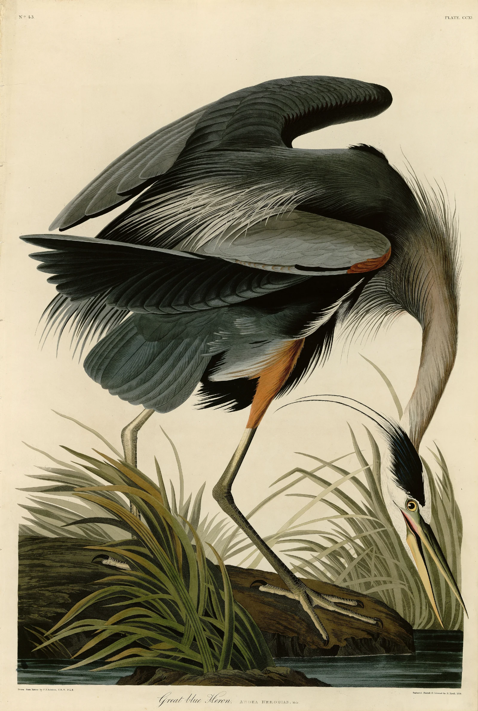

# audubon-heron

John James Audubon's Great Blue Heron, Plate 211 of *The Birds of America*,
coloured by hand as you scroll, the way a subscriber's sheet was finished in
Robert Havell's London shop. It arrives uncoloured: Havell's etched line and
aquatint grain, warm black on cream paper. Then the colourists lay their
watercolour in passes, area by area: the blue-grey planes of the body, the neck
and the dark of the wing with the rufous at the bend and thighs, the marsh
(water, the log, the grass, climbing from the water up), and the fine touches
last: the legs, the black crest, the filamented breast plumes, the bill and,
last of all, the yellow eye. Each wash spreads as a wet front from where the
brush went down, held back by the engraved lines; it is darker and faintly
glossy while wet, dries from the edges with its pigment drawn to the rim, and
ends as exactly the real plate. Scroll back and it un-colours.

```html
<link rel="stylesheet" href="audubon-heron.css">
<section data-audubon-heron data-src="assets/heron.json">
  <div class="ah-stage">
    
  </div>
</section>
<script type="module" src="audubon-heron.js"></script>
```

Or `import { audubonHeron } from './audubon-heron.js'` and call
`audubonHeron(section, { src, mode, runway, webgl })`. It returns
`{ destroy }`.

## Options

| attribute     | option   | default                 | what it does |
|---------------|----------|-------------------------|--------------|
| `data-src`    | `src`    | `assets/heron.json` next to the script | The plate's JSON (size, paper, the washes in painting order). Next to it: `heron.webp` (the coloured plate), `-bare.webp` (the uncoloured impression), `-flat.webp` (each wash blurred inside its area: the pigment in suspension) and `-map.webp` (lossless: wash index, arrival time, distance to edge, distance to a damp neighbour). |
| `data-mode`   | `mode`   | `scroll`                | `scroll`: a pinned stage on a runway. `static`: the finished plate in the flow. |
| `data-runway` | `runway` | `400`                   | Section height in svh. The passes are laid out in svh of travel and scaled to fit. |
| `data-webgl`  | `webgl`  | `on`                    | `off` forces the 2D fallback (a plain cross-fade from bare to coloured). |

Events (bubbling, for sound later): `audubon-heron:wash` with
`detail: { index, kind }` each time a wash goes down while scrolling forward
(kinds: `body`, `neck`, `wing`, `rufous`, `water`, `ground`, `grass`, `legs`,
`crest`, `breast`, `bill`, `eye`), and `audubon-heron:done` when the last wash
is dry.

## The real thing

The 435 plates of *The Birds of America* (1827–1838) were etched and
aquatinted by Havell from Audubon's watercolours, printed in one dark ink, and
coloured by hand by a team of colourists working from a pattern plate.
Aquatint gave the tone (the grey of the heron's body is partly printed, a fine
grain); watercolour gave the colour, flat washes laid up to the engraved line
and modelled where needed, the small, exact touches last.

Modelled: the uncoloured impression with its aquatint tone; washes laid in
passes, each spreading as a wet front slowed by the line, darker and glossy
while wet, drying edge first with a rim, granulation and, against a still-damp
neighbour, a bloom (the transients settle into the plate's own washes).
Simplified: one wash per area, no glazing in layers; the grey body is one long
passage and its darks follow, rather than dark laid over grey; the order of
passes is a colourist's logic, not a documented one.

## How it works

**Offline (Python; the pipeline is hand-colouring's, from
`tools/watercolour-kit/hand-colouring/`, adapted).** From the Commons scan,
cropped inside the sheet and worked at 2400 px:

1. *The uncoloured impression.* Densities are taken in linear light against
   a paper estimate. A neutral ink accounts for the least-absorbed channel;
   on the line-free layer (a grey closing) that density, compressed, becomes
   the aquatint tone, and the scan's own neutral detail above it (hatching,
   stipple, the grain) is added back at full strength, inked in a warm
   black-brown. Where no colour was ever laid (the lettering, the margins)
   the bare image is the scan itself.
2. *Where the colour is.* The watercolour's own density (scan minus
   impression, per channel) or its chroma marks the painted areas.
3. *What each colourist washed.* A kind map, drawn by eye for this plate
   (polygons for the neck, breast plumes, crest and bill; capsules along the
   legs; a disc for the eye; colour and place for body, wing darks, rufous,
   grass, log and water), splits SLIC superpixels of the colour layer; each
   connected part of a kind becomes one wash (the grass in clumps). 106
   washes.
4. *Arrival.* For each wash a brush runs down its long axis; the wet front's
   arrival time is the minimum over the path of (when the brush got there +
   geodesic travel time) through low-frequency noise slowed 75% on engraved
   lines (scikit-image `MCP_Geometric`). Plus the distance to the wash's edge
   and to a wash laid just before it.

**In the browser.** One quad, one fragment shader (hand-colouring's, with the
wet darkening eased for dense washes, so the wet body reads as wet grey, not
black). A 256×1 state texture carries each wash's fill and drying progress,
computed from scroll on the CPU in five passes. When every wash is dry the
shader computes `bare × (coloured / bare)`: the plate itself.

- Scroll is followed on a critically damped spring (quicker going back).
- On a narrow screen the view zooms in (up to 1.6×) and drifts after the wet
  washes, a camera path computed from the schedule, so a pure function of
  scroll; it zooms out to the whole sheet at the end.
- Start-up never blocks for long: images decode off the main thread, the
  paper noise is built in slices, the shader links in parallel where the
  driver allows (`KHR_parallel_shader_compile`), and the three pictures are
  resampled and uploaded one per frame (also on resize).

## Theming

| variable      | default         | used for |
|---------------|-----------------|----------|
| `--paper`     | `#f3efe6`       | the page around the sheet |
| `--ah-gutter` | `var(--gutter)` | side padding of the stage (the demo uses 5px on phones) |
| `--ah-runway` | set by the script | section height in scroll mode |

## Accessibility and motion

- Without JS the finished plate stays as an ``; the canvas is
  `aria-hidden`. The art is ornament (`alt=""`); credits are in
  `assets/credits.json`.
- Reduced motion: no runway, the finished plate, still.
- Nothing is interactive, so a swipe always scrolls.

## Cost

- Assets 3.1 MB: coloured 0.8 MB, bare 1.0 MB, flat 0.2 MB, map 1.2 MB
  (lossless), JSON 9 KB.
- Measured in headless Chrome (M-series Mac): a scroll through the whole
  runway at DPR 2 holds 16.7 ms frames (p95 16.8, max 16.8) on desktop and
  phone sizes, with no long tasks; the longest task at start-up is 60–85 ms.
  No animation frames run off-screen or in a hidden tab (IntersectionObserver
  plus `document.hidden`), also inside a scaled iframe. DPR capped at 2.

## Making a new plate

Scripts (in `tools/watercolour-kit/audubon-heron/`: `p1_layers.py`, `p2_segment.py`, `p3_schedule.py`,
`kinds.py`) are hand-colouring's `s1`–`s4` with the aquatint impression and a
hand-drawn kind map. A new Havell plate needs its own `kinds.py`; look at the
bare image and the kind map at full size before exporting.

## Credits

John James Audubon, *Great Blue Heron*, Plate 211 of *The Birds of America*,
engraved, printed and coloured by Robert Havell Jr., London (this impression
lettered 1834). Scan: University of Pittsburgh, via Wikimedia Commons
(`File:211_Great_blue_Heron.jpg`). Public domain. The separation is ours. No
third-party code.
