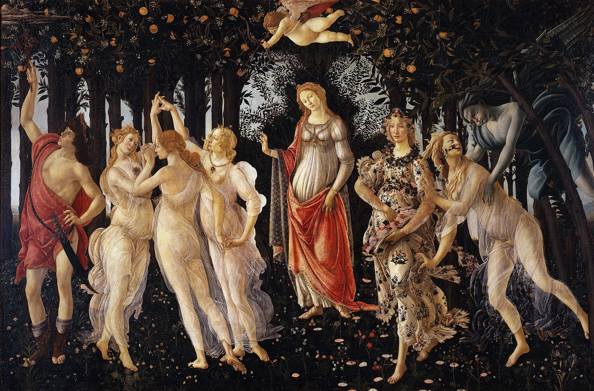

# botticelli-primavera

Botticelli's *Primavera* painted in front of you as you scroll, in the order
of egg tempera. It starts as a bare gesso panel. A brush underdrawing goes
down line by line: each line is pulled from one end at an even pace, figure
by figure, Mercury's outline first and then his folds, then the Graces,
Venus, Cupid, Flora, Chloris and Zephyrus. Then the dark ground is blocked in
round the figures, which stay in reserve as gesso and line, and the grove's
leaves, oranges and sky are laid over it. The figures follow left to right.
Each gets two layers in short hatched strokes, patch by patch along its forms:
first green earth under the flesh and flat local colour elsewhere, then a
second layer hatched across the first that models it, pink over the green.
The meadow's flowers come last. Then shell gold is touched into the hair, the
necklaces and the borders, bright for a moment as it goes on, and the final
glazes deepen everything, left to right, into the Uffizi panel itself, pixel
for pixel. Scroll back and it un-paints.

```html
<link rel="stylesheet" href="botticelli-primavera.css">
<section data-botticelli-primavera data-src="assets/primavera.json">
  <div class="bp-stage">
    <div class="bp-sheet">
      
    </div>
  </div>
</section>
<script type="module" src="botticelli-primavera.js"></script>
```

You can also `import { botticelliPrimavera } from './botticelli-primavera.js'`
and call `botticelliPrimavera(section, { src, mode, runway, webgl })`. It
returns `{ destroy() }`.

## Options

| attribute     | option   | default  | what it does |
|---------------|----------|----------|--------------|
| `data-src`    | `src`    | `assets/primavera.json` | The panel's JSON (size, gesso colour, the regions in the map's order with their boxes). Beside it go `<name>.webp` (the panel), `-under.webp` (the first layer of tempera), `-lines.webp` (lossless: R underdrawing ink, G gold), `-map.webp` (lossless: R region, G+B when the pen reaches each point of a line, 16 bit, A when the gold does) and `-flow.webp` (small: the direction of the forms, for the hatching). |
| `data-mode`   | `mode`   | `scroll` | `scroll`: a pinned stage on a runway. `static`: the finished panel. |
| `data-runway` | `runway` | `520`    | Section height in svh. The stage is pinned for `runway - 100` svh of travel. |
| `data-webgl`  | `webgl`  | `on`     | `off` leaves the finished panel as an image. |

The schedule, as fractions of the pinned travel (in the JS, `STAGES` and
`REGIONS`): underdrawing 0.025-0.19; dark ground 0.19-0.29; the grove over it
0.245-0.345; Mercury 0.335-0.425, the Graces 0.39-0.515, Venus 0.48-0.57,
Cupid 0.53-0.585, Flora 0.565-0.645, Chloris 0.615-0.69, Zephyrus 0.655-0.725
(each: first layer, then the second overlapping it); the meadow's flowers
0.70-0.79; gold 0.795-0.855; glazes 0.845-0.94; then the panel.

Events (bubbling, so a sound can be wired to them later):
`botticelli-primavera:stage` with `detail: { stage }` as each stage begins
while scrolling forward (`drawing`, `ground`, `mercury`, `graces`, `venus`,
`cupid`, `flora`, `chloris`, `zephyrus`, `meadow`, `gold`, `glaze`), and
`botticelli-primavera:done` when the last glaze is on.

## The real thing

The *Primavera* is egg tempera on poplar panel (Uffizi). What a Florentine
workshop of the 1480s did, after Cennino Cennini's *Libro dell'arte* and the general record of
Botticelli's practice:

- **Gesso and drawing.** The panel was sized and laid with gesso, scraped
  smooth and white. The design was drawn on it, with charcoal and then fixed
  with a brush in dilute ink: a spare outline and the main folds, no shading.
- **The ground and the reserves.** The dark ground of the grove and meadow
  was laid round the figures, which were left as gesso and line until their
  turn.
- **Hatching, not blending.** Egg tempera dries almost as it touches the
  gesso and cannot be pushed about, so tone is built in small, parallel,
  hatched strokes, layer over layer, each following the form.
- **Green earth under the flesh.** Flesh was underpainted in *verdaccio* or
  terra verde, modelled in green-grey, and the pinks were hatched over it, so
  the green still cools the shadows.
- **Gold and glazes.** Shell gold was brushed into the hair, the jewels and
  the borders of the draperies, and thin glazes went over the finished
  tempera to deepen and unify it.

Modelled: all of the above, each as a pass that ends in the real panel.
Simplified: two layers per figure (real hatching builds up many); the dark
ground is a blurred, darkened version of the panel's own, not a
reconstruction; the figure order is left to right, not a documented workshop
order; the glazes are one pass over everything; the gold is found by colour
in the scan, so it includes a few yellow highlights that are paint.

## How it works

**Offline (Python: NumPy, SciPy, scikit-image; scripts kept out of the
component).** From the Commons scan, cropped to the panel inside its frame:

1. *Regions.* Seven figure groups are drawn as rough polygons by hand; inside
   each, the figure is whatever is lighter or more coloured than the dark
   ground (CIELAB L and chroma, closed and hole-filled per figure). The rest
   is ground, split into grove and meadow along a ragged horizon.
2. *Underdrawing.* Canny edges of the half-size lightness, kept where they
   touch a figure (with tight squiggles of the dress patterns dropped) and,
   in the ground, only long upright ones (the trunks). Skeletonised, weighted
   by edge contrast (outlines against the dark ground firm, folds lighter),
   drawn at full size with soft edges. For timing, each line is a connected
   chain: a geodesic distance from its upper end (`MCP_Geometric`) gives the
   pen's position along it, and the lines are scheduled four pens at a time
   at a constant speed, figure by figure, outline first then the folds from
   the top down. The time is stored at 16 bits and spread to the line's
   neighbourhood.
3. *The first layer.* Flesh is found by lightness and hue (warm, moderately
   saturated) and painted in a green-earth ramp from its own lightness; other
   figure areas get their local colour with the modelling compressed to 30%;
   the ground is the panel blurred inside the ground (normalised convolution)
   and darkened.
4. *Gold.* Pixels in the figures that are yellow, light and lighter than
   their neighbourhood (a top-hat); they arrive left to right.
5. *Flow.* The structure tensor of the panel at an eighth of its size gives
   the direction along the forms; where it is weak, the hatcher's diagonal.

**In the browser.** One quad, one fragment shader; the strokes are not stored
anywhere, they are drawn by the shader. Per pixel:

- The gesso, and the underdrawing where the pen has passed (map time ≤ scroll).
- Hatching: the panel is cut into patches (Voronoi cells about twelve rows
  wide, their borders warped by noise), each patch's strokes run along the
  flow at its centre, in rows of short tapered strokes with a little wobble.
  A patch's time is its place along the painter's way through the region (down
  a figure; across the Graces), plus its row; each stroke is then drawn from
  one end. Gesso shows between strokes until the gaps fill a little later, and a
  fresh stroke is slightly transparent for a moment. The second layer is hatched
  about 57° across the first.
- The second layer lays the tempera before glazing: the panel itself at 80% of
  its optical density, a touch desaturated, with the gold not yet in.
- Gold arrives with a brief warm glint; the glazes sweep left to right in long
  streaks and turn every pixel into the scan. Past the end of the glazes the
  shader returns the scan texture directly: the last frame is the panel, texel
  for texel (checked by reading the canvas back: no differing pixel).

- All images are decoded off the main thread as ImageBitmaps (unpremultiplied,
  no colour conversion) and go up to the GPU one per frame; the panel and the
  drawing are resampled to the canvas's pixel size so fine line never aliases.
- Once a region's second layer is done its strokes are no longer computed.
- Scroll is followed on a critically damped spring (quicker going back). A frame
  draws only while the spring is moving and the section is on screen
  (IntersectionObserver) in a visible tab; nothing runs when idle.

## Theming

| variable      | default         | used for |
|---------------|-----------------|----------|
| `--paper`     | `#f3efe6`       | the page around the panel |
| `--bp-gutter` | `var(--gutter)` | side padding of the stage (the demo uses 6px on phones) |
| `--bp-runway` | set by the script | section height in scroll mode |

## Accessibility and motion

- Without JS (or WebGL) the finished panel stays as an ``; the canvas is
  `aria-hidden`. The art is ornament (`alt=""`); credits are in
  `assets/credits.json`.
- Reduced motion: no runway, the finished panel, still.
- Nothing is interactive, so a swipe always scrolls.

## Cost

- Assets 2.8 MB: panel 1.9 MB, first layer 0.15 MB, lines 0.38 MB and map
  0.3 MB (lossless), flow 44 KB, JSON 1 KB.
- Measured in Chrome on an Apple M1 Pro at 1440×900, DPR 2 (canvas 2457×1620):
  a steady 16.7 ms a frame scrolling through the whole runway and scrolling back
  fast, no long tasks at load or while scrolling. DPR capped at 2.

## Credits

Sandro Botticelli, *La Primavera*, c. 1482, tempera on panel, Uffizi Gallery,
Florence. Google Art Project scan via Wikimedia Commons, public domain. The
separation is ours. No third-party code.
