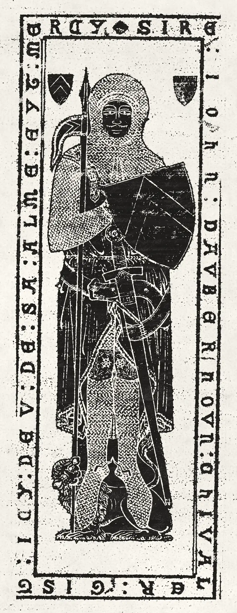
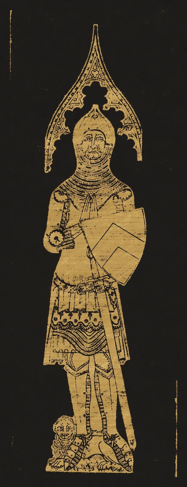

# brass-rubbing

A sheet of thin paper taped over a memorial brass. Rub it and the knight comes
up out of blank paper: black where the metal stands, white wherever the burin
cut a line, the stone round him a pale grey grain, and every stroke leaving
streaks along the way your hand went, the way heelball does. A light pass
greys the tops of the paper's fibres; going over it again fills them in. The
surface underneath is never shown, only what the wax finds. Enter rubs the
whole sheet for you in about six seconds. A second variant lays gold heelball
on black paper, as the brass-rubbing centres sold it.

```html
<link rel="stylesheet" href="brass-rubbing.css">
<figure data-brass-rubbing data-surface="assets/aubernoun-1277-relief.webp" data-hint="0.5 0.2">
  
</figure>

<figure data-brass-rubbing data-wax="gold" data-surface="assets/aubernoun-1327-relief.webp">
  
</figure>
<script type="module" src="brass-rubbing.js"></script>
```

The `` is a finished rubbing made by this component. It sizes the sheet
and is what you see without JavaScript (and in print). Give it the same
proportions as the surface. Or call it yourself:

```js
import { brassRubbing } from './brass-rubbing.js';
const sheet = brassRubbing(figure, { wax: 'gold', hint: 'none' });
sheet.rub();          // the automatic rub (instant under reduced motion)
sheet.clear();        // a fresh sheet
sheet.snapshot();     // data URL of paper + wax (how the no-JS images were made)
sheet.state;          // { ready, rubbing, anyInk, size }
sheet();              // destroy: canvases, listeners, observer
```

## Options

On the element (`data-*`) or in the options object, which wins.

| attribute | option | default | |
|---|---|---|---|
| `data-surface` | `surface` | required | the height map. Grey: white = raised, black = cut, stone in between. Alpha, if present, is the **grip**: how readily the surface takes wax (1 on metal, ~0.3 on worn stone). Same origin |
| `data-wax` | `wax` | `black` | `black` heelball on white paper, or `gold` on black paper (gold lays less on the stone) |
| `data-hint` | `hint` | `0.5 0.2` | centre of a small patch already rubbed when the sheet arrives, as fractions of the sheet; `none` for blank paper |
| `data-reach` | `reach` | `22` | half-width of the rub, css px, for a 460px sheet (it grows with the square root of the sheet's width) |
| `data-duration` | `duration` | `6` | seconds for the automatic rub |
| `data-tooth` | `tooth` | `assets/paper-tooth.webp` beside the script | the paper's fibre texture (a tileable grey map) |
| `data-seed` | `seed` | `3` | creases, tape, streaks and the hint |

## Interaction

- **Mouse and pen:** press and drag. Pen pressure counts (light pen, grey
  rubbing). A quick stroke skims and lays less than a slow one.
- **Touch:** the sheet is `touch-action: pan-y`, so the page always scrolls
  under a vertical swipe. A **sideways** stroke rubs at once. **Hold still for
  a quarter second** and that touch rubs in any direction until you lift it
  (the page will not move under it). Real force is used where the screen
  reports it.
- **Keyboard:** the sheet is focusable; **Enter** (or Space) starts the
  automatic rub: close zigzags working down the sheet, then a lighter
  diagonal pass, as people actually rub.

## Theming

| variable | default | |
|---|---|---|
| `--br-paper` | `#f4f1e9` (gold: `#1e1b19`) | the paper |
| `--br-wax` | `#161413` (gold: `#be964e`) | the heelball |
| `--br-sheen` | a warm grey (gold: pale gold) | the burnish on heavily rubbed fibre tops |
| `--br-tape` | `#ddcda0` | masking tape |
| `--br-shadow` | a hairline and a soft drop | the sheet lying on the stone |
| `--accent` | clay | keyboard focus ring |

Colours are read once, when the sheet is built.

## How it works

1. **The surface** (made in Python from a line engraving of the brass, see
   below): the cut lines are grooves (0), the plate is raised (1) with a
   little wear (the cuts are shallower where the metal is worn), pits and
   fine scratches; the stone round it is a field of sparse high grains on a
   low ground. Alpha carries the grip.
2. **Contact.** Built once, at device resolution. The paper is stiff, so it
   bridges narrow cuts a little: a morphological closing about a pixel wide,
   blended in at 45%, then a 1-2-1 blur. Hairlines come out a little greyer
   than broad cuts, as they do in a real rubbing, but close cuts never merge
   into blobs (a plain blur lowered the metal between them). The heelball is rigid and rides on the local high points: a max
   filter over about 4 thousandths of the sheet's width, blurred wider than
   itself so its square corners round off. Contact is
   `smoothstep(1 - (ride - paper) / 0.4) × grip`, so the wax reaches the paper
   only where it lies at the top level. Near the plate the crayon rides on the
   metal and leaves a thin white margin round the figure, exactly as the edge
   of a brass does.
3. **Creases.** Two to six creases fan in from the taped corners. Along each
   one the paper stands up a little: the ridge catches wax across the image
   and the hollows either side skip it. Their light (a bright edge and a soft
   shade) is drawn above the wax.
4. **Deposit.** Each pointer segment adds wax to a density buffer, per pixel,
   in proportion to the length of the stroke that passed within reach of it
   (an exact chord through a disc, so segments chain without seams), times a
   soft profile across the stroke, times **streaks**: a 1D noise across the
   stroke direction, in sheet coordinates, so going back and forth over the
   same place reuses the same streaks, like the lumps on the heelball's edge
   dragging the same lines. Pressure, speed and a slow wobble scale it. The
   hand slows at every turn, and the deposit follows its speed relative to
   its own running average, so each stroke tapers at its turnarounds; it also
   lands over the first 24 px and its width wanders by ±20%, so the edge of a
   rubbed patch is soft and ragged rather than straight.
5. **Paper tooth.** The wax goes on the fibres from the top down. Each pixel
   has a threshold from the fibre map (high fibres low threshold, valleys
   high), so a light rub is a broken grey grain, more rubbing fills it, and
   the deepest valleys of the paper stay as white specks even in the blacks.
   Heavily rubbed fibre tops take a slight burnish.
6. **Render.** Three canvases: the paper (painted once, with the fibre map
   and a faint cockle), the wax (only the dirty rectangle is recomputed and
   `putImageData`'d each frame), and an overlay that holds the crease light
   and the tape, overhanging the sheet.

## Tuning

- How dark the stone goes: the grip in the surface's alpha (`GRIP` in the
  Python: 0.19 on the slab, 0.16 on the floor, rising to about 0.5 in a soft
  halo round the plate, where the stone was dressed up to the metal and the
  crayon grazes it). In gold the grip is raised to the power 1.6.
- How hard you need to rub: `k` in `deposit()` (0.75) and the threshold curve
  in `build()` (`0.12 + (1 - tooth)² × 2.6`).
- Line softness: the two blur radii on `Hp` (0.7 and 0.5 thousandths of the
  width) and `depth` (0.4).
- Streak character: the octaves in `streak` (periods 1.3 to 42 thousandths)
  and the exponent 0.95.

## Making a surface

Any grey height map works. For these two, the line engravings were cut to the
slab, the white region of stone found as the largest connected area around
the figure, everything else inside taken as plate, the inked lines inside the
plate kept as grooves (slimmed a pixel, since an engraver's cut is finer than
the draughtsman's ink) and the outer outline given to the plate's edge. The
inscription letters, inked solid in the drawing, become raised brass on
stone. A couple of places where the drawing's outline left a gap (the lion's
mane) are closed by hand. The draughtsman's ink in the faces is far heavier
than a burin's cut and rubbed into a caricature mask, so the 1277 face is
redrawn by hand as hairline cuts following Utting's lines (brows into the
nose, lids, drilled pupils, nostrils, moustache, mouth), and the 1327 face and
both lions' heads are skeletonised to hairlines. The script lives outside the
component.

## Cost

- Nothing runs while nobody rubs. The rAF loop exists only while a stroke is
  queued or the automatic rub is going, and the automatic rub pauses off
  screen.
- The sheet is built when it comes within 600px of the screen: about
  0.2-0.4 s of work on a laptop for a 440 × 1140 sheet at DPR 2 (two blurs,
  a max filter, a few full passes over 2 Mpx). Phones take longer, once.
- Memory: about 16 bytes per device pixel kept (contact, density, threshold,
  the wax image), ~32 MB for the desktop demo sheet, ~20 MB on a phone. DPR capped at 2, and the sheet
  at 4.6 Mpx.
- Per frame of rubbing only the stroke's own rectangle is touched.
- Assets: two surfaces ~0.7 MB each (they are noise-heavy), the tooth 0.3 MB,
  and the two no-JS pictures 0.2-0.5 MB, which the browser loads anyway
  because they size the sheet.

## Accessibility and reduced motion

- The figure is `role="img"` with an `aria-label` explaining how to rub it,
  focusable, with a visible focus ring. Enter rubs; a polite live region says
  when the rubbing is started and finished. The `` keeps its alt text.
- `prefers-reduced-motion: reduce`: the sheet arrives fully rubbed. Rubbing
  by hand still works on top of it.
- Without JavaScript, the finished rubbing is an ordinary image.

## Credits

- The two brasses of Sir John d’Aubernoun at Stoke d’Abernon, Surrey, from
  the wood engravings (signed Utting) in the *Surrey Archaeological
  Collections*, public domain, via Wikimedia Commons. Details in
  `assets/credits.json`.
- Paper tooth: procedural, made for this component. No third-party code.
