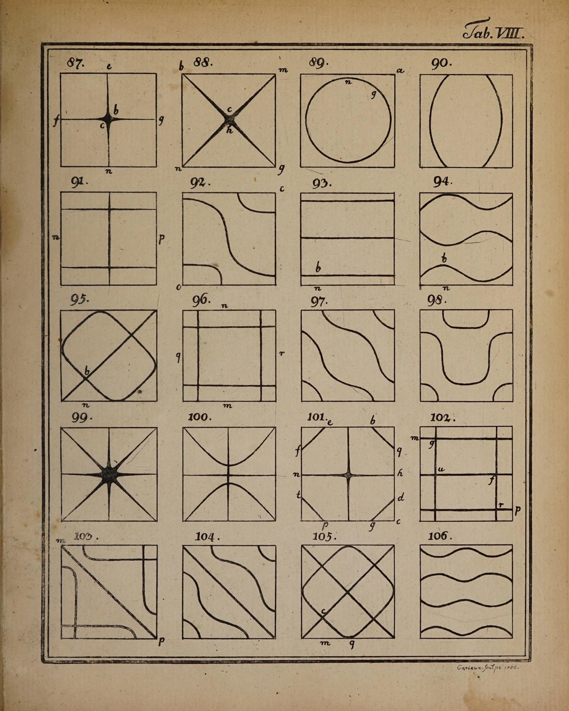

# chladni-slider

Ernst Chladni's own sand figures, made again as you scroll. The sheet is Tab. VIII of
his *Entdeckungen über die Theorie des Klanges* (Leipzig 1787): twenty square plates,
figures 87 to 106, engraved in copper by Capieux in 1786. It begins as bare, toned rag
paper inside its ruled border. Then all twenty plates come alive together, the whole sheet always in view, with only a faint
ripple across it from the top left: each plate's square is ruled, sand is sifted over it from a moving hand, and the bow is drawn: the grains hop out
of the parts of the plate that swing and gather, in a second or two, on the lines that stand
still, which here are the engraving's own lines. Where three or four lines cross they creep
together into the heaps Chladni drew as dark stars. Then the printed line comes up out of
the sand, from the heaviest heap outward, each grain going as the ink reaches it, and the
number and letters are cut last. After the twentieth figure the title and the engraver's
line follow, and the last frame is the scan, pixel for pixel. Scroll back and it un-makes.

The folder keeps its old name; it is no longer a slider. One input: scroll.

```html
<link rel="stylesheet" href="chladni-slider.css">
<section data-chladni data-src="assets/tab8.json">
  <div class="cl-stage">
    
  </div>
</section>
<script type="module" src="chladni-slider.js"></script>
```

```js
import { chladniSlider } from './chladni-slider.js';
const destroy = chladniSlider(section, { runway: 300 });
destroy.seek(0.42);     // show a moment at once (tests, figure sheets)
destroy.progress;       // where the sheet is now, 0..1
destroy.running;        // true only while the spring is catching up with the scroll
destroy();              // removes the canvas, listeners, observers, GL objects
```

Without JS, without WebGL2, or with reduced motion, the section is the ``: the finished
sheet lying on the page with a tight shadow.

## Options

| data- / option | default | what it does |
| --- | --- | --- |
| `src` | (required) | the sheet's JSON; `<name>.webp`, `-paper.webp`, `-times.webp`, `-sand.webp` sit beside it |
| `runway` | `300` | the section's height in svh while live (the time the scroll has to make the sheet) |
| `grains` | `1` | multiplier on the sand density (grains are counted from the plate's size on screen, then scaled by its line length, x0.7 to x1.35) |

Events (bubbling, forward scrolling only), for sound later: `chladni:bow` `{fig}` as the bow
starts on a plate, `chladni:figure` `{fig}` when its line has printed, `chladni:done`.

## The real thing

Chladni held a thin square plate of glass or brass at one point (a fingertip or a clamp),
dusted it evenly with sand, damped one or two places on the edge with his fingers and drew a
rosined bow down the edge somewhere else. The note sounds at once and the sand starts to
jump. A grain is thrown only where the plate's acceleration beats gravity, so it leaves the
antinodes in small hops that shorten as it nears a line that stands still, and within a
second or two the sand lies in lines: thin where the plate's slope across them is steep,
wide where it barely moves on either side, and heaped where lines cross. He had no way to
fix it, so he drew each figure by eye; Capieux engraved them, ruling the square first and
cutting the number and the letters (keyed to his text, for where the plate was held and
bowed) last.

What the piece models: the order (square, sand, bow, the line, the letters), the sand's
physics (below), the heaps at crossings, the sheet's own paper and ink. What it simplifies:
the plate is never shown as glass or brass; the sand lies on the engraving's paper, so that
the figure it settles into can become the print in place. The bow itself is the scroll.

## How it works

**Offline (Python, in the scratch folder: `s1_layers.py`, `s2_maps.py`, about 300 lines).**

1. *Optical density.* The scan in linear light against a local paper estimate (median of a
   1/8 downscale); ink is anything denser than paper by 0.16 that contains a core denser
   than 0.55, and is not a speck.
2. *The paper before printing.* Every ink pixel and an 11 px halo is refilled with real
   paper texture copied from a clean offset nearby (29 to 131 px away, in rounds for the
   wide heaps), colour-matched by a normalised Gaussian estimate of the local paper and
   feathered into the scan. A maximum of fill and scan is taken only in the ink's core:
   taking it everywhere brightened a ring round every line, a ghost of the figure that the
   absence test caught. The rings now sit within half a grey level of the paper around them.
3. *The plates.* Long strokes found by morphological opening locate the twenty squares to a
   pixel. Inside each, ink components are nodal lines, letters (small, free-standing) or
   paper scratches (faint); outside, numbers and letters go to the nearest plate, the double
   border and the title and engraver's line to their own classes. Unclassed ink (specks,
   the dark edge of the leaf) is paper and is there from the start.
4. *Arrival times.* Each square is ruled clockwise from its top-left corner. Each figure's
   lines print by geodesic distance along the ink (`MCP_Geometric`) from their thickest
   point, the heap, with a little fBm in the front. Letters left to right. Packed at half
   resolution, lossless: R = time inside its stage, G = class.
5. *Sand fields.* On a 128 grid over each plate: `d`, the distance to Chladni's lines, and
   `dr`, the distance to the ridges between them (the medial axis of the free plate, and the
   free edge, which swings most). `A = sin(pi/2 * d / (d + dr))`, 0 on his lines and 1 on
   the ridges: a stand-in for the mode's amplitude drawn from his own figure rather than
   fitted. The G channel holds, for every cell, the time the nearest line ink prints, so a
   grain knows when to go. Heaps are where the line ink is much thicker than a ruled line
   (figs 87, 88, 99, 101, plus small ones at some crossings).

**Runtime (WebGL2, one canvas).**

- *The sheet* is one fragment shader: per pixel, `colour = P * (O / P)^a` in linear light,
  where `P` is the paper before printing, `O` the scan and `a` how much of the ink has
  arrived, from the pixel's class, its time and that stage's progress. When every `a` is 1
  the result is the scan. Nothing is cross-faded; a line that has not arrived is absent.
- *The sand* is the random walk from the old version of this component, now driven by each
  plate's field: under a threshold (about one g) a grain stays put; above it, it hops a
  distance that grows with the amplitude, with a small drift down the amplitude slope (a
  grain landing on a plate tilted as it swings is kicked downhill a little more often).
  Grains already on a line still tremble and creep toward a heap, where they roll over
  each other into a mound. Nothing places a grain on a line. The walk runs once per plate
  from a fixed seed (240 steps, kept as 25 snapshots, computed in an idle callback just
  before it is needed), so scroll can play it both ways; between snapshots, a grain still
  ringing is lifted and nudged by a hash of the moment, so it dances while you scroll and is
  still when you stop.
- *Each grain* is a point sprite: washed river sand (warm quartz, iron-stained, the odd dark
  mineral), lit as a small translucent dome from a low window at the upper left, with a
  shadow that lengthens as it leaves the paper. A grain shrinks to nothing as the ink reaches
  the place it lies; a grain left out in the field is brushed off early in the printing.
- *No camera, at any size.* The whole sheet always fits the viewport (contain, with a margin),
  pinned while the runway scrolls. All twenty plates run the same schedule at once, offset by a
  ripple of under 3.5% of the runway. Grains are sized to the sheet as shown (never under 1.7
  device px) and counted so a freshly sifted plate is about a fifth covered.
- *Scroll is time*: a pinned stage on a 300svh runway, a critically damped spring toward
  the scroll position, and the loop stops when it has caught up. Nothing runs at rest, off
  screen, or in a hidden tab.

## Theming

The page colour around the sheet is the section's computed `background-color`
(`--paper`, `#f3f0e8`). `--cl-gutter` sets the stage's side padding (6px on a phone in the
demo). The sheet itself is never recoloured.

## Accessibility

The art is ornament: the `` has `alt=""` and `aria-hidden`, the canvas `aria-hidden`.
The essay around it carries the content. Vertical swipes scroll the page; nothing captures
touch.

## Reduced motion

The printed sheet, still: the ``, with no runway and no canvas.

## Cost

Assets 2.5 MB (scan 1.26 MB, paper 0.86 MB, times 0.21 MB, sand fields 0.22 MB). The scan and
paper are uploaded at the size they are shown (mipmapped), the times map once, exactly. A
plate's walk takes 20-60 ms once; all twenty plates have sand at once (about 80,000 sprites on a
large screen, 25,000 on a phone; under 2 ms a frame on an M1). Idle: zero.

## Credits

The sheet: Chladni, *Entdeckungen über die Theorie des Klanges*, Leipzig 1787, Tab. VIII,
engraved by Capieux; Getty Research Institute copy, scanned by the Internet Archive
(`entdeckungenuber00chla`), public domain. Details in `assets/credits.json`.
