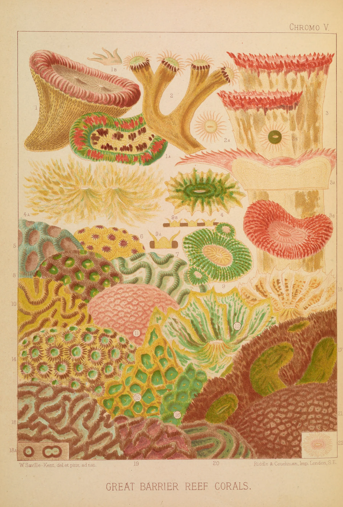

# coral-reef

The Great Barrier Reef as William Saville-Kent showed it to London in 1893: Chromo V,
"Great Barrier Reef Corals", from *The Great Barrier Reef of Australia*, printed in front of
you as you scroll, stone by stone, the way Riddle & Couchman printed it. The sheet starts as
bare plate paper. The key goes through the press first: the drawing in the plate's
brown-crimson, the outlines and meanders of the corals, the frame line and the lettering. Then
one stone per ink, lightest first: chrome yellow, buff, an olive yellow and an ochre, the
blue-green, a grey olive and a sage, the vermilion, and four crimson-browns that build the
brain corals and the dark reef bank, darkest last. Each stone prints along the scraper's line
as the press bed travels, so the new colour arrives as a slightly uneven front moving down the
sheet; just behind it the oily ink is a shade deeper with a faint gloss, and then it sets matte.
Anything a stone has not yet printed is simply not there. The last frame is the scan of the
plate, pixel for pixel. Scroll back and it un-prints.

```html
<link rel="stylesheet" href="coral-reef.css">
<section data-coral-reef data-src="assets/reef.json">
  <div class="cr-stage">
    
  </div>
</section>
<script type="module" src="coral-reef.js"></script>
```

Or `import { coralReef } from './coral-reef.js'` and call `coralReef(section, { src, mode, runway, webgl })`.
It returns `destroy()`, which removes the canvas, listeners, observers and GL resources.

## Options

| attribute     | option   | default  | what it does |
|---------------|----------|----------|--------------|
| `data-src`    | `src`    | required | The plate's JSON: size, paper field, the stones (name, ink, scale, weight), the run, file names. Beside it: `reef.webp` (the plate), `reef-g0.webp` ... `reef-g12.webp` (one stone each, greyscale coverage) and `reef-time.webp` (lossless, half size: the scraper's line and drying). |
| `data-mode`   | `mode`   | `scroll` | `scroll`: a pinned stage on a runway. `static`: the finished plate as an image. |
| `data-runway` | `runway` | `560`    | Section height in svh. The stage is pinned for `runway - 100` svh, about 35 svh per stone. |
| `data-webgl`  | `webgl`  | `on`     | `off` leaves the finished plate as an image. |

The run is `run: [-0.07, 0.95]` of the runway, shared among the stones by `weight` (the key
gets 1.4, the rest 1). Progress starts a little below zero while the section's top is still
coming up the screen, so the key is printed as the sheet arrives and the pinned stage opens
on a confident drawing rather than a blank sheet. Inside each stone's slice the scraper crosses the sheet in the first
74%, then the sheet comes off the press and the ink sets before the next stone goes on. No
two stones are ever on the press at once, as in the shop: the whole edition went through one
stone before the next.

Events (bubbling, for sound later): `coral-reef:stone` with `detail: { index, name }` as each
stone goes on the press while scrolling forward, and `coral-reef:done` after the last
impression.

## The real thing

Read: George Richmond's *Grammar of Lithography* (1880) on chromolithographic practice;
Michael Twyman, *A History of Chromolithography* (British Library, 2013); Peter Marzio,
*The Democratic Art* (1979); and the plate itself at full resolution.

- **The artwork.** Saville-Kent, Commissioner of Fisheries for Queensland from 1889, painted
  living corals in watercolour, on the reef flats at low spring tides and in tanks, because
  their colour goes within hours of leaving the water: "W. Saville-Kent, del. et pinx. ad
  nat." is printed under the plate. The printer, "Riddle & Couchman, Imp. London, S.E.", is
  printed on the other side.
- **One stone per colour.** The printer's artist draws a key (the outline) and offsets
  impressions of it onto every other stone as a non-printing guide. On each grained stone he
  draws, in greasy crayon, only what takes that ink, pressing harder where it should be
  stronger. The grain breaks the crayon into specks: at 100% every colour on this plate is a
  scatter of dots, and greens are often a blue-green over a yellow, each grain still visible.
  That is exactly what the unmixing finds (below).
- **The press.** The stone is damped and rolled up with ink, the damp sheet is laid on it
  against the register pins, and the bed is cranked under a fixed scraper, so the impression
  is made along a line that travels across the sheet. Here the line runs down the sheet,
  slightly bowed and a touch uneven where the damp sheet cockles, with a faint damp band at the
  line itself. Fresh litho ink is oily: a little deeper and glossy, then matte as it sets
  (thin films first, heavy deposits last).
- **Order.** Light to dark, the darkest stone last so that it sits crisp on top. The key is
  printed first here, as a full drawing in the plate's line colour. That is a reconstruction:
  printers did print the key early on some plates, and it gives the opening a confident
  drawing, but the order on this plate is not documented.

Simplified: there are thirteen passes; the real plate may have used more stones (some inks
here are probably two stones that share a colour). The key is split from the dark inks by
where they form line work, not from a real key impression. The stone itself, the roller and
the tympan are not shown: you watch the sheet as if the press were glass, the way a printer
looked at progressive proofs. No misregistration is added (this edition is well registered).

## How it works

**Offline** (Python, numpy/scipy/scikit-learn/scikit-image; scripts in the builder's scratch
folder, not in the component). All of it in linear-light optical density.

1. *The sheet.* The Internet Archive JP2 (5751x7581) cropped to the sheet inside the binding.
2. *The paper.* A robust cubic fit, per channel, to the bare paper between the specimens: the
   sheet's own toning, which the shader evaluates from ten coefficients. `D = -ln(O / paper)`.
3. *The inks.* Sparse dictionary learning on 250,000 pixels: each pixel is explained by at
   most two inks with non-negative coverage (closed-form two-ink least squares over every
   pair), inks re-fitted from the coverages, 14 rounds, from a k-means start. Twelve inks come
   out, sorted light to dark. Every pixel of the 2400px master is then coded against them.
4. *The key.* A ridge filter (Sato, sigma 1-2.6 px) on the dark inks' density finds the line
   work; long components are kept, plus everything in the margins (the lettering). That share
   of the dark inks is refitted as one ink, the key, and taken out of the dark stones.
5. *Export.* Coverage resampled by area to 1800px wide, scaled per stone, one greyscale WebP
   each. The time map: the scraper's line (down the sheet, bowed, cockle fBm) and a drying
   map. A Python copy of the shader proves the end frame equals the shipped plate (max error
   0.5/255, float precision).

**In the browser.** One quad, one fragment shader (WebGL2; WebGL1 without mipmaps). The
thirteen greyscale stones are packed three to a texture once, at load. Per pixel:
`D_O` from the plate and the paper field; each stone's density `a_k d_k`; the residual
`R = D_O - sum(a_k d_k)` (what the inks do not explain: paper texture, scan noise). The shown
density is `R·eps/(S+eps) + sum c_k (a_k d_k (1 + wet) + R·lum(a_k d_k)/(S+eps))`, where `c_k`
is whether the scraper's line has passed this pixel for stone `k` and `S` is the total ink.
The residual is shared between the bare paper and the stones in proportion to the ink each
lays, so when every stone has printed `D = D_O` and the pixel is the plate, exactly, and before
that nothing of an unprinted stone shows. The colour is `paper · exp(-D)`.

- Scroll is followed by a critically damped spring (quicker going back). Nothing runs while
  the scroll is still, off screen (IntersectionObserver) or in a hidden tab. DPR capped at 2.
- The canvas draws the sheet's edge and a tight shadow on the page itself. No vignette.
- No camera: the whole plate stays in view and prints as a whole.

## Theming

| variable      | default         | used for |
|---------------|-----------------|----------|
| `--paper`     | `#f3f0e8`       | the page around the sheet (read from the section's background) |
| `--cr-gutter` | `var(--gutter)` | side padding of the stage (the demo uses 8px on phones so the plate fills the width) |
| `--cr-runway` | set by the script | section height in scroll mode |

The sheet keeps the plate's own paper.

## Accessibility and motion

- Without JS, without WebGL, or with `data-webgl="off"`, the finished plate is an ``.
  The canvas is `aria-hidden`; the art is ornament (`alt=""`), credits in `assets/credits.json`.
- Reduced motion: no runway, no canvas, the finished plate. If the setting changes mid-visit
  it settles on the finished plate.
- Nothing is interactive, so a swipe always scrolls. No UI and no caption on the page.

## Cost

- Assets about 5.9 MB: the plate 1.1 MB, thirteen stones 4.4 MB, time map 0.25 MB, JSON 3 KB.
- At load, the stones are read back once (thirteen 1800x2658 canvases) and packed into five
  RGBA textures: about 200 ms on a laptop and 94 MB of texture with mips.
- One full-screen quad, ten texture reads and two short loops over thirteen stones per pixel,
  only while the scroll spring is moving.

## Credits

William Saville-Kent, *Great Barrier Reef Corals* (Chromo V), chromolithograph printed by
Riddle & Couchman, London, in *The Great Barrier Reef of Australia*, 1893. Smithsonian
Libraries copy via the Internet Archive and the Biodiversity Heritage Library. Public domain.
The separation into stones, the key and the time map are ours. No third-party code.
