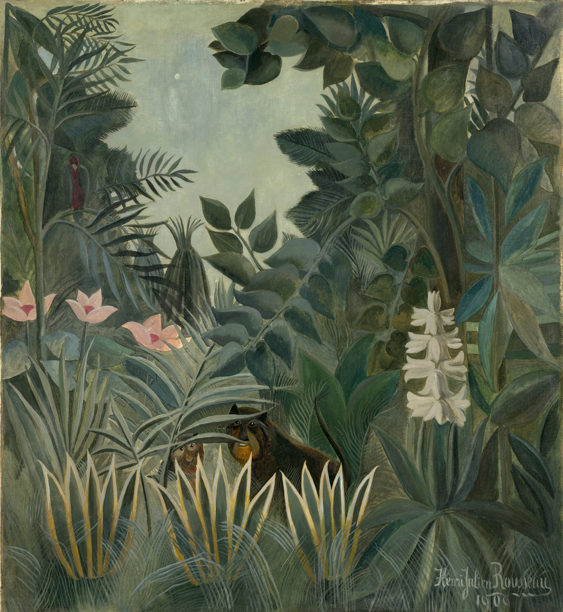

# drip-tip

Rain in Henri Rousseau's *The Equatorial Jungle* (1909). The painting is a
full-bleed band on the paper, cropped to its upper half: a cluster of dark
leaves hanging into a pale sky, palm fronds at the left, a spray of pointed
leaves below. Fourteen of its own leaves have been cut out where Rousseau put
them, and at rest each one is the painting itself, pixel for pixel. The
picture starts dulled and cooled by the downpour (its own colour at about 55%), with streaks of rain falling through it.
On the cut leaves the water gathers and runs down the midrib as a wet streak to
the tip. There it swells into a pendant drop that holds the jungle upside down,
lets go and falls as a bright drop with a short tail. A leaf it lands on dips a
few degrees on its petiole and rings back. Scroll through the section and the
shower eases: fewer streaks, then only big drops from the crowns above and
drips from leaf to leaf, slower and slower, then a last drop and stillness. The
painting's own blue-greens, olives and teals come back. Scroll up and the rain
returns. Tap or click a leaf to knock it; it swings and sheds its water.

```html
<link rel="stylesheet" href="drip-tip.css">
<section data-drip-tip data-src="assets/rousseau-the-equatorial-jungle.webp">
  <div class="dt-stage">
    
  </div>
</section>
<script type="module" src="drip-tip.js"></script>
```

Or call it yourself:

```js
import { dripTip, weather, LEAVES } from './drip-tip.js';
const rain = dripTip(section, { seed: 11, rain: 1 });
rain.state();   // { progress, running, weather, drops, dropsAt, frame, leaves: [{ id, drip, tip, middle, bead, film, angle }] }
rain.shake(4);  // knock leaf 4
rain();         // destroy: canvas, listeners, observers, loop
weather(0.4);   // { rain, canopy, colour, veil } at 40% of the runway
```

The auto-started instance is on `section.dripTip`. Without JS the painting is a
plain image. If an image fails to load, the page shows that same plain image.

## Options

| attribute | option | default | |
|---|---|---|---|
| `data-src` | `src` | the ``'s | the painting (same origin). The cut-outs are tied to *The Equatorial Jungle* at 3681 x 4000 |
| `data-masks` | `masks` | `assets/leaf-masks.png` | greyscale atlas: each leaf's outline, with a 5 px collar of the paint around it and a fine wedge past the tip |
| `data-under` | `under` | `assets/leaf-under.webp` | the paint behind each leaf, filled in, shown only while a leaf moves |
| `data-seed` | `seed` | `11` | the band's edge, the beads on the blades, each leaf's spring and drop size |
| `data-rain` | `rain` | `1` | 0-1, scales the downpour and the canopy drip |
| `data-focus` | `focus` | `1 .013` wide, `.476 .018` tall | object-position of the crop |

## Events

Bubbling `CustomEvent`s on the section, for sound later:

| event | when | `detail` |
|---|---|---|
| `drip-tip:drip` | a drop leaves a tip (also each drop shed by a shake) | `{ leaf, volume (mm³), x, y, kind: 'drip' \| 'shake' }` |
| `drip-tip:hit` | a falling drip or canopy drop lands on a leaf | `{ leaf, strength 0-1, x, y }` |
| `drip-tip:shake` | a leaf was knocked | `{ leaf, volume }` |

Raindrops striking leaves in the downpour do not fire `hit` (hundreds a second);
they are the rain's own sound.

## The real thing

What was modelled, from the drip-tip literature (Jungner's "Träufelspitze";
Dean & Smith 1978; Lightbody 1985 on *Piper*; a La Selva study with artificial
leaves) and the physics of pendant drops:

- **Throughfall.** In the downpour, streaks fall at 5.5-8.5 m/s. Each is drawn
  as 1/60 s of its motion, the length the eye smears it to. A near streak that
  meets a cut leaf ends there in a small splash. Under the streaks, every leaf
  takes on water in proportion to its painted area and trembles with the hits.
- **The film runs to the tip.** Each leaf holds a store of water that drains
  to the apex with a time constant of 2.4 s. The flow follows the midrib, traced from the mask as the middle of the
  blade so it curves with the leaf. It is drawn as wet paint: a broad,
  soft-edged band only about 13% darker than the leaf (three multiply passes),
  widening where the water gathers toward the tip, with a few bright glints of
  sky sliding along it.
- **The bead and its release (Tate's law).** The pendant drop at the tip is
  the hero, drawn 1.45x larger than the blade beads' scale (`TIP_GAIN`). It
  grows by that flow over a second or two in the dripping phase. It is a
  teardrop drawn to a point at the tip, a lens showing the painting inverted,
  with a bright catchlight. It hangs lower and longer as it swells, and lets go at its critical
  volume. That is 16-26 mm³ per leaf, matching the "small, frequent drops"
  (8-30 mm³) measured from drip-tip leaves. A third to a half of the bead stays
  behind, and most of the time a small satellite drop follows. So the rhythm of
  drips from each tip is set by how much water is coming in, and it slows as
  the leaf drains.
- **The fall.** A released drop falls under g, at the painting's scale (taken
  as 2.0 painted px per mm). It is drawn as a bright bead with a short tail.
  If it meets a cut leaf it stops there: a crown of fine droplets, the leaf
  dips, and the water joins that leaf's store. Otherwise it lands 9-38 cm
  lower on painted foliage, in a small splash.
- **The leaf on its petiole** is a damped spring: 2.0-3.6 Hz (big leaves
  slower), damping ratio 0.11-0.16. A hit is a dip of two or three degrees and
  a few shrinking swings. The momentum in is drop volume × speed × lever arm.
  The weight of the water bends the leaf down a little, and when its bead lets
  go it springs up.
- **After the rain.** Big drops keep coming down from the crowns (the
  `canopy` curve) after the streaks have stopped, so the dripping goes on from
  leaf to leaf, slower and slower. Then the stores run dry, the last drops fall,
  and each tip keeps a sub-critical bead, as real leaves do.
- **Simplified:** one plane; drops fall straight down; the film is one number
  per leaf. Beads are drawn about twice life size so they read at arm's length.
  The painting's other leaves stay dry: only the cut ones carry water.

## How it works

- **The cut-outs** were made offline. Each leaf's outline started as a
  lanceolate shape from hand-placed base, tip and width. It was then aligned to
  the paint by searching offset, angle and width for the greatest contrast
  between inside and a ring outside. Next it was snapped to the strongest
  colour edge within 8 px, or for the thin frond leaflets refined with
  GrabCut, with the tip kept sharp. Finally it was supersampled to a soft alpha.
  The mask carries a 5 px collar of the surrounding paint and a fine wedge past
  the tip, so the whole painted leaf moves. The paint under the leaf plus 4 px
  is filled from its surroundings (Telea inpainting) into `leaf-under.webp`.
- **At rest nothing is drawn over the painting.** The stage shows the painting
  (cover-cropped into a full-width band, never blurred, its top and bottom
  meeting the paper on a 3 px edge with a 3 px irregularity). A leaf is drawn
  only while it moves: first the filled paint behind it, then the leaf (cut
  from the same painting at its own resolution, through its mask) rotated about
  its petiole, then any neighbour whose box overlaps, so its edge survives the
  fill.
- **Dulled to full colour.** A rain-dulled copy is made once per size, of the band and
  of every leaf and fill: saturation down to about 55%, contrast lowered
  slightly, cooled toward a blue-grey. It is never monochrome. Each frame crossfades the copies by the `colour`
  curve, then lays a light grey veil of falling water (up to 17%) over painting
  and leaves alike.
- **Each frame** (canvas 2D): the band, far rain (`source-atop`, so only on the
  painting), moving leaves, the veil, then the water: rivulets, beads on the
  blades, tip beads, splashes, falling drops and near rain.
- **A bead is a lens**: clipped to its ellipse, the painting behind it is
  drawn inverted and minified (a field of 11 bead radii), under a dark rim,
  with light gathered into its lower inside edge and a hard highlight.
- **Scroll** gives the weather (`weather(p)`). `rain` falls from 1 to 0 over
  14-50% of the runway. `canopy` rises and falls between 4% and 80%. `colour`
  arrives over 36-92%, and `veil` lifts over 8-62%. If the page sits still in
  the rain for 50 s, the shower passes anyway (over 25 s).

## Tuning

- `LEAVES` (box, atlas position, petiole and tip of each cut-out, in
  painting px) must match the two atlases. `FRAMES` sets the band (5% of
  paper above and below on wide screens) and the zoom: `crop` is how many
  painting px the width shows: 3121 wide (x 560-3681, y 30-1785), and 1200
  on a phone (x 1180-2380, y 30-2370), the hanging cluster with the spray
  below it. Both crops stop short of the small red bird at the left edge and
  the creature hidden in the grass near the bottom. The zoom never passes 1.2 device px per
  painted px.
- `BEAD_GAIN` (2.1, up to 1.5x more on small crops) sets bead size. `TAU`
  (2.4 s) sets how quickly a leaf drains, and `V_CRIT` the drop volume range.
  The canopy rate (4.5/s at 1100 px wide) sets how busy the dripping phase is.

## Theming

The paper shows above and below the band: the section's background is
`--paper` (`#f3f0e8`). `--dt-runway` (default `260svh`) sets the length of the
scroll. `--accent` colours the keyboard focus ring.

## Accessibility and reduced motion

- The canvas is `aria-hidden`. The stage is a button ("Leaves after rain.
  Press to knock a branch and shed its water."): Enter or Space knocks the
  wettest leaf near the middle, with a visible focus ring.
- Phone: the stage and canvas are `touch-action: pan-y`, so a vertical swipe
  always scrolls; a tap knocks a leaf.
- `prefers-reduced-motion: reduce`: no runway. One still frame of the moment
  after the rain: colour returned, a bead hanging at every drip tip, and beads
  on the blades. A tap still sheds a leaf's water (redrawn, no swing).
- Print shows the painting.

## Cost

- 60 fps on a laptop in the downpour (a few hundred streaks). At rest no
  leaf is drawn; a moving one costs two small drawImages. The band's
  grey/colour composite is redrawn only when the scroll changes the colour. The loop stops when nothing moves (no streaks, drops or splashes,
  every leaf still and drained), off screen (IntersectionObserver), and in a
  hidden tab; scrolling, a tap or a resize wakes it.
- DPR capped at 2. The rain-greyed copies are made once per size (one pass
  over the stage's pixels). Assets: the painting (1.7 MB) plus 25 KB of masks
  and fills.

## Credits

- Henri Rousseau, *The Equatorial Jungle* (1909), National Gallery of Art,
  Washington, Open Access (CC0), via Wikimedia Commons. The leaf masks and
  fills are derived from it. Details are in `assets/credits.json`.
- Sounds (added by the studio): see `sounds.json`.
- No third-party code.
