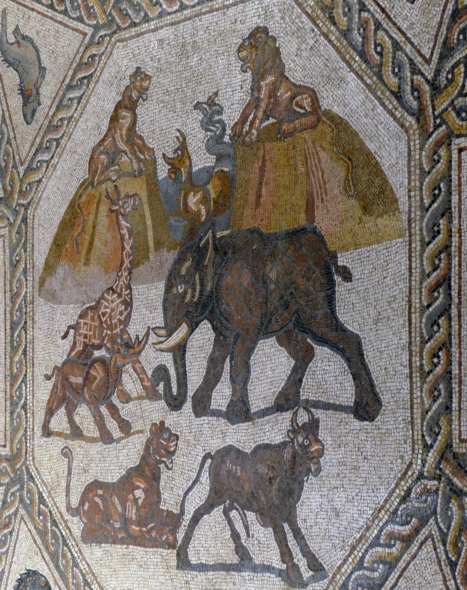
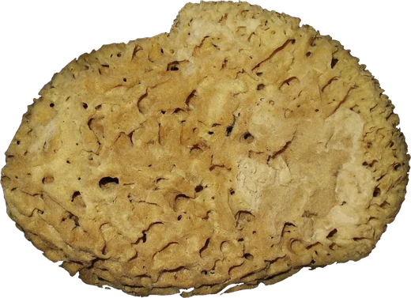

# excavation

A Roman floor at the bottom of a trench, under a skin of sand and dust, and you
uncover it with a brush. The sand does not vanish where you brush: it is pushed,
building low ridges along both sides of every stroke and a little pile where a
stroke ends, and a ridge heaped too steep slumps back down. Brushed clean, the
stones come up dull and chalky under a veil of dust that keeps the marks of the
bristles. Then you wet it, as excavators do before they photograph a floor: a
press of the sponge lying by the trench (or two taps, or Enter) splashes water
over the patch you have been working, and there the tesserae go dark, deep and
glossy and the picture blazes into colour. Wet sand goes dark and sticks. Over
about twenty seconds the patch dries from its edges in, back to dust.

```html
<link rel="stylesheet" href="excavation.css">
<figure data-excavation style="aspect-ratio: 16 / 9">
  
  <button class="ex-sponge" type="button" aria-label="Wet the floor with the sponge">
    
  </button>
</figure>
<script type="module" src="excavation.js"></script>
```

Give the figure a size (an `aspect-ratio` is easiest); the `` fills it with
`object-fit: cover`, and any `object-position` you give it is the crop the floor
uses. The sponge is optional: any `.ex-sponge` button inside the figure wets the
floor when pressed. Or call `excavation(figure, options)` yourself; it returns
`destroy()`.

## Options

| attribute | option | default | |
|---|---|---|---|
| `data-depth` | `depth` | `7` | css px of sand over the floor, on average (thicker in drifts and against the walls) |
| `data-brush` | `brush` | `1` | scales the brush: its width, so how much one stroke clears |
| `data-hint` | `hint` | `.14 .8` | where the corner already brushed clean lies, as fractions of the figure; `none` for none |
| `data-dry` | `dry` | `24` | seconds the heart of a splash takes to dry (its edges go first; it reads as wet for about 20 s) |
| `data-sand` | `sand` | `assets/sand.webp` | the grain: a seamless greyscale tile, power-of-two, mean grey |

## Using it

- **Mouse or pen:** drag to brush. Back-and-forth scrubbing, as a person really
  brushes, works best. Double-click to wet the floor there.
- **Touch:** a sideways stroke brushes at once; a finger held still for a
  quarter of a second brushes in any direction for that touch. Anything else
  scrolls the page (`touch-action: pan-y`), so the trench never traps a
  vertical swipe. Two quick taps wet the floor there.
- **The sponge:** pressing it wets the middle of what you have brushed clean
  (or the middle of the floor if you have not started).
- **Keyboard:** the figure is focusable. Enter or Space wets the middle of the
  floor; the arrow keys brush a short scrubbing stroke, moving across the floor.

## Theming

| variable | default | |
|---|---|---|
| `--ex-sand` | `#c9b494` | loose sand, dry (the grain photo modulates it) |
| `--ex-soil` | `#85705c` | the soil around the cut |
| `--ex-dust` | `#dcd1bd` | the film of dust left on the stones |
| `--accent` | clay | keyboard focus ring |

Wet sand and wet stone are derived from these, not themed separately. The
canvas is transparent outside the ragged edge of the soil, so the page shows
through.

## How it works

- **Sand.** A height field on the CPU, about 300 cells on the long side (never
  finer than 2.5 css px), in css px, so slopes are real slopes. It starts as an
  even layer with some depth variation, wind ripples (a long gentle stoss and a
  short lee) that wander and fade, and sand slumped against the foot of the
  walls; the hint corner is made by running the real brush along a few wiggly
  strokes before the first frame.
- **The brush** is a round, soft-edged footprint (1.7 R along the stroke, 2 R
  across, R 20-40 css px, weight `(1 - r²)^1.4`) that wobbles a little either
  side of the path, as a hand does, dragged along the pointer's path in steps
  shorter than a cell. Each step lifts a share of the sand under it, more under
  the middle of the bristles than at their tips, and throws it: a little just
  ahead of the brush, where the next step picks it up again, so a small mound
  travels in front and is left as a pile where the stroke ends, and the rest out
  to the side just past the bristles, a little further for a quick flick, which
  builds the ridges along the track. Excavators clear outward, so the throw is
  also bent toward the unexcavated side: each step reads the sand on a ring
  1.8 R out, and the more one-sided it is (the brush is at the edge of a cleared
  patch), the more the sand goes toward the deep side. Thrown sand is fanned
  over an arc, not dropped in one spot, and sand thrown across bare floor keeps
  sliding until it meets standing sand: strokes inside a clearing all feed the
  one bank around it rather than leaving a ridge between every two strokes.
  Just outside the bristles, the splayed tips flick any spur left between two
  strokes outward onto that bank, so even rows of parallel back-and-forth
  strokes end in a soft, irregular oval with one continuous bank. Repeated strokes widen a
  clean field and bank the sand round its edge instead of back into it. Sand
  that would land on the trench wall stays put. Half of what is lifted is lost
  (the fine fraction, gone into the air and the dustpan). An elephant-sized area
  comes clean in six to ten back-and-forth strokes.
- **Relaxation.** Every pair of neighbours (across, down and both diagonals)
  steeper than the angle of repose, 32 degrees, passes part of the excess
  downhill, symmetrically, four passes a frame over only the region still
  moving; slopes a little short of it creep, which rounds the crests of banks. A ridge heaped too steep visibly slumps over a fraction of a second.
  Wet sand holds a slope three times steeper and resists the brush.
- **Dust.** A separate film under the sand. Bristles touch it only where the
  sand is already thin, thin it a little per pass and never quite clear it (it
  bottoms out at 16%), and leave it combed: the direction of the last strokes is
  kept per cell (as cos 2a, sin 2a, so back and forth agree) and the shader draws
  bristle streaks along it.
- **Water.** A splash reaches out over a third of a second: five overlapping
  lobes with rims that wander with the ground, three runnels that run off down
  the floor's slight fall toward the lower right, and forty drops flung past the
  edge. The wet line is soft (about a tenth of a lobe), and wet sand is darker in
  its own hue with a slightly darker line where it meets dry sand; a wet film of
  sand over the stones goes see-through. It lays down most water at its heart and evaporates at an even
  rate, with a fixed patchy variation, so the patch dries from the edges in, as
  a real one does, and the loop stops when it is dry.
- **Shader.** One pass draws everything. The floor, pre-cropped at one texel per
  device pixel: dry, the colour drained by 55% and the darks lifted halfway to
  white (dust in every pore: a pale, chalky floor that still reads); wet,
  saturation x1.65 in each stone's own hue and a gamma of 1.16 (whites stay a
  pale cream), the joints darkened (found as pixels darker than their
  neighbours), and a glint on every stone: a cell noise at the scale of the
  tesserae picks out the one stone in seven tilted toward the light, and only
  those carry a small, sharp glint; the joints stay matt. Over the whole wet
  area a broad, soft, low-gloss sheen, stronger toward the light. Over it the dust
  veil, which only ever lightens (it turns translucent when wet, which is why
  excavators wet a floor before they photograph it), and the sand: cover `1 - e^(-h / k)` with k varied
  by the grain, so a thin layer is grainy and see-through and a thick one opaque;
  albedo and micro relief from a real photograph of fine sand, sampled at two
  scales and angles so it never visibly repeats; lit from the height field's
  normals by a low warm light (36 degrees, from the upper left). Shadows are
  marched toward that light through the sand and the walls (14 steps, 36 px), with a
  penumbra that widens with distance, so ridges and the trench walls cast them.
- **The trench.** Two signed distance fields, built once per size at half css
  resolution: the cut (a rectangle set off-centre, pushed about by long, slow
  noise and a few bites) and the ragged outer edge of the soil, so the bank is
  wide on one side and almost gone on another, but always a little outside the
  cut. The soil has pebbles (lit domes, each its own colour), a damper, darker
  strip just behind the cut, and in places it has crumbled and spilled into the
  trench as darker, thicker sand at the foot of the wall; the sand all along the
  foot of the walls is damp and darker too. The cut face is a 4-7 px slope from the floor to the soil
  top, 18-40 px up depending on the size of the panel, lit like everything else.

## Tuning

The constants at the top of `excavation.js` are the physics: `REPOSE` (tan of
the angle of repose), `K_LIFT` (how much a pass lifts), `KEEP` (how much of it
lands again), `K_DUST` and `DUST_MIN` (the dust film), `RESIDUE` (sand the
bristles always leave), `ELEV` and `LIGHT`. The brush width is `brushR()`. The
dry and wet looks are `chalk()` and `wetten()` in the shader.

A floor photographed straight down, with a lot of white ground and a strong
dark figure, shows the effect best: the chalky dry state reads as dust, and the
wet patch has somewhere to go.

## Behaviour and cost

- **The loop runs only while something moves:** while brushing, while sand is
  still slumping, while a splash spreads, and while anything is wet (drying is
  updated about 20 times a second). Then it stops. Nothing runs off screen or in
  a hidden tab; a patch that is still wet when you scroll away waits for you.
- Each frame re-uploads only the rows of the field that changed. Brushing costs
  a millisecond or two on a laptop; the shader is about 45 texture reads a
  pixel (mostly the shadow march), and it is drawn only when something changed.
- Canvas DPR capped at 2. The floor image needs about 2x the panel's css width
  in pixels (the demo's is 2880 px wide).
- Without WebGL, or if the image is cross-origin (WebGL refuses it), the ``
  stays, dusted by a CSS filter and clipped to a ragged edge. Print shows it too.

## Accessibility and reduced motion

- The image and canvas are decorative (`alt=""`, `aria-hidden`). The figure is
  focusable with `role="application"` and a label explaining the controls
  (unless you set your own). A polite live region says when the floor is wet.
- The sponge is a real `<button>`.
- `prefers-reduced-motion: reduce`: the floor starts part-excavated, with one
  patch already wet, and that water stays (no drying animation). Brushing still
  works, as direct manipulation; sand settles at once at the end of a stroke
  rather than slumping visibly. Wetting is instant and stays.

## Credits

- The Lod Mosaic (a Roman villa floor at Lydda, about 300 CE), central panel,
  photograph by Bukvoed, CC BY 4.0. Fine sand by Paul The Writer, CC0. Bath
  sponge (*Spongia officinalis*) by H. Zell, CC BY-SA 3.0. All via Wikimedia
  Commons; details in `assets/credits.json`.
- No third-party code.
