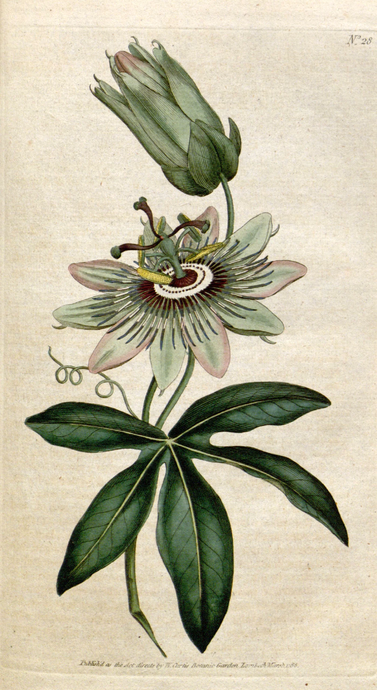

# florilegium

A colourist's bench. Seven plates from *The Botanical Magazine* (Curtis,
1787-1791: passion flower, camellia, fuchsia, iris, moss rose, Jacobean lily,
oriental poppy) come up one after another as bare impressions, black line on
the magazine's cream paper, and are coloured by hand as you scroll. Each plate
gets its greens first, then the flower, then the flower's small bright parts.
A wash spreads as a wet front from where the brush went down, held back by the
engraved lines. It is darker and faintly glossy while wet, and it dries from the
edges in, with pigment drawn to the rim and settled into the paper's tooth,
into exactly the real coloured plate. On a wide screen the pattern plate, the
coloured model being copied, lies small beside the bench. A finished plate is
laid aside on the pile and the next bare sheet is underneath. At the end the
whole set lies on the bench together. The first plate is coloured slowly and
in full, and the later ones a little faster, like work going on. Scroll back and
it all un-colours.

```html
<link rel="stylesheet" href="florilegium.css">
<section data-florilegium data-src="assets/florilegium.json">
  <div class="fl-stage">
    <div class="fl-row">
      
      <!-- one  per plate, in the JSON's order -->
    </div>
  </div>
</section>
<script type="module" src="florilegium.js"></script>
```

Or `import { florilegium } from './florilegium.js'` and call
`florilegium(section, { src, mode, first, later, pattern })`; it returns
`destroy()`.

## Options

| attribute      | option    | default  | what it does |
|----------------|-----------|----------|--------------|
| `data-src`     | `src`     | required | The collection JSON: per plate its id, size and washes in painting order. Beside it, per plate: `<id>.webp` (the coloured scan), `-bare.webp` (the uncoloured impression), `-flat.webp` (each wash blurred inside its area: the pigment in suspension), `-map.webp` (lossless: wash index, arrival time, distance to the wash's edge, distance to a damp neighbour). |
| `data-mode`    | `mode`    | `scroll` | `scroll`: a pinned bench on a runway. `static`: the finished set in a row. |
| `data-first`   | `first`   | `110`    | svh of scroll for the first plate. |
| `data-later`   | `later`   | `52`     | svh for each later plate. The runway is computed from these (about 560svh for seven plates). |
| `data-pattern` | `pattern` | `on`     | `off` hides the pattern plate. It only shows on wide screens. |

Events (bubbling, for sound later): `florilegium:wash` with
`detail: { plate, index, kind }` as each wash goes down while scrolling
forward (kinds `leaf`, `stem`, `flower`, `detail`), `florilegium:plate` with
`{ plate }` as a finished plate is laid aside, and `florilegium:done` when the
set is complete.

## The real thing

What the magazine's colourists did, and what a wash does on a printed sheet
(Wilkinson, *A Treasure Regained*, Library of Congress Information Bulletin,
2003; Glasgow University Library on the magazine's history; Curtis, Anderson,
Seims, Fleischer and Salesin, *Computer-Generated Watercolor*, SIGGRAPH 1997):

- Each plate was printed in black from a small copper plate and coloured by
  hand by a team (at one time about thirty colourists, sitting side by side),
  copying a pattern plate coloured as the artist meant it. They were paid by
  the piece. Up to three thousand copies of each plate a month, coloured until
  1948.
- A colourist laid flat washes up to the engraved line, colour by colour:
  greens, the flower, then the small bright parts. The engraver's hatching
  does the shading, so a wash only has to give the colour.
- The wet front advances unevenly and creeps along the lines. Wet paint is
  darker and glossy. As it dries, from the edges in, pigment gathers at the rim
  and settles into the tooth, and the wash ends lighter and matte. Where a
  wash meets one still damp there is a small bloom.

Modelled: all of that, as transients that settle into each plate's own
washes. Simplified: one wash per area (no glazing in layers, no gum arabic
highlights laid separately). The order of washes inside a group climbs the
plant from the bottom, which is not documented for these sheets.

## How it works

**Offline (Python, scripts in the builder's scratch folder).** The pipeline is
the one from `hand-colouring`, run per plate:

1. The scan (Missouri Botanical Garden's copy, via the Internet Archive) is
   cropped inside the page and white-balanced from its pink-yellow cast to an
   aged cream.
2. *Line from colour.* In linear light, the least-absorbed channel of each
   pixel against its local mean (and against its local ground for solid
   strokes) isolates the engraved line whatever wash lies over it. A clean
   smoothstep threshold makes an anti-aliased line mask, which is inked in
   fresh copperplate black-brown `#2a221c` on the plate's own paper (filled in
   under the washes from the paper around them). Away from the paint the bare
   image is the scan itself, so start and end agree there. Gutter shadow and
   foxing are kept out of the paint mask (components touching the scan's
   border, or far from the plant).
3. *Areas.* SLIC superpixels of the line-free colour layer, merged by colour on
   a region graph, folded, split into connected pieces, merged again across
   borders that are not engraved lines and into passages of neighbouring
   leaves or petals. Kinds come from hue (and a box round the flower where its
   colour is close to the leaves').
4. *Arrival.* A brush path along each area's principal axis from its upper
   end; the front's arrival time is the geodesic travel time from the path,
   slowed on the engraved lines.
5. The map holds per pixel the wash index, arrival time, distance to the
   wash's edge and to a damp neighbour, lossless and exact.

**In the browser.** One canvas covers the pinned bench and draws only the plate
under the brush, with the `hand-colouring` shader, over a transparent ground,
with its own sharp edge and shadow. The finished plates are the plain
``s of the markup, moved by `transform` onto the pile and into the set.
The sheets waiting underneath are plain paper. A plate's textures are packed
at the size shown, and the next plate's are packed while this one is being
worked, so the change of plate never stalls. Each plate's schedule lives in
its window of the scroll: one area after another, at most two or three wet at
once, big areas 12-20svh on the first plate and about half that later. On a
phone the sheet fills the width and a camera, a function of scroll only, zooms
toward the wet washes and pulls back before the plate is laid aside.

## Theming

| variable  | default   | used for |
|-----------|-----------|----------|
| `--paper` | `#f3f0e8` | the bench (the page) |
| `--fl-runway` | set by the script | section height in scroll mode |

## Accessibility and motion

- Without JS, or with reduced motion, the seven finished plates lie in a row
  (three to a row on a phone). They are ornament (`alt=""`); credits are in
  `assets/credits.json`.
- Nothing is interactive, so a swipe always scrolls.

## Cost

- Assets: 15 MB for seven plates, about 2.1 MB each (coloured, bare, flat, map), fetched as
  the bench reaches it: the next plate loads while the current one is
  coloured.
- One full-screen quad, a dozen texture reads per pixel inside the sheet. A
  frame draws only while the scroll spring moves and the section is on screen.
  DPR capped at 2. WebGL2 for mipmaps (the phone's zoom); WebGL1 works
  without the zoom.

## Credits

*The Botanical Magazine; or, Flower-Garden Displayed*, William Curtis, London,
vols 1-4 (1787-1791), plates 28, 42, 47, 57, 69, 91, 97; hand-coloured
engravings, drawn by Sydenham Edwards and others. Missouri Botanical Garden,
Peter H. Raven Library, digitised for the Biodiversity Heritage Library
(Internet Archive `mobot31753002719489`, `mobot31753002719497`). Public
domain. The separations are ours. No third-party code.
