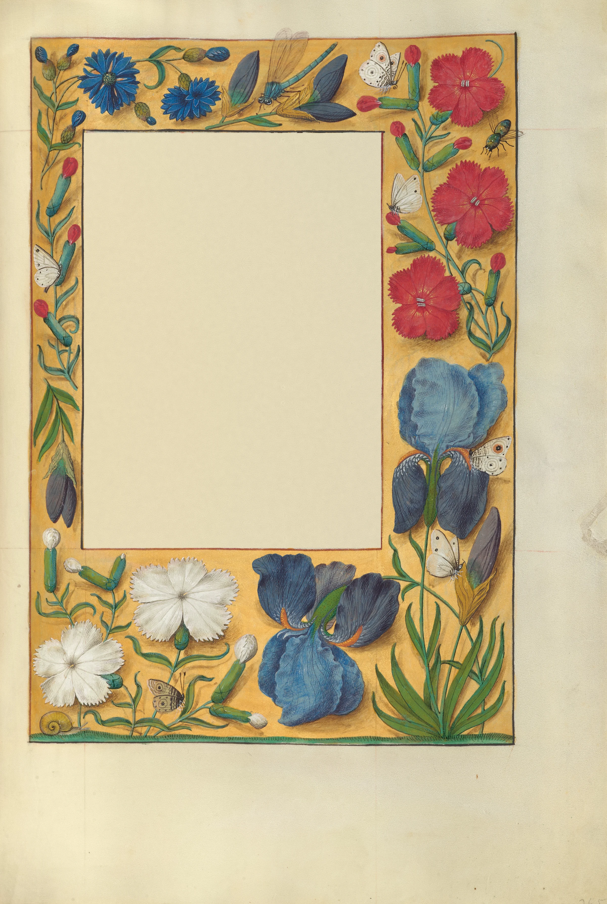

# flower-border

A leaf from a Flemish book of hours, the Spinola Hours (Ghent or Bruges, about
1510-1520), painted in front of you as you scroll, in the order the illuminator
worked. It opens as the ruled page: bare parchment, the frame and the line
rulings faint in red-brown, and the scribe's text already written in the
middle. Then a fine grey underdrawing of every flower, insect and snail is run
in, object by object. The yellow ground goes on as one wet front that travels
round the border clockwise, darker and glossy where it is wet, with a hard bead
at its edge, around the reserved flowers, which stay bare parchment with their
drawing on them. Then, flower by flower, a pale transparent wash spreads from
where the brush went down, the opaque body colour covers it in crisp strokes,
and the fine strokes (veins, stamens, hatching, the white lights) bring it to
the finished flower. The insects and the snail come after the flowers. Last,
the cast shadows: a soft grey-brown wash spreads out from under each flower, a
shade darker while it is wet, and the flowers lift off the page. The last frame
is the leaf, pixel for pixel. Scroll back and it un-paints.

The scribe's text is your own passage, set by Cheng Lou's pretext in the text
block the scribe left: justified, hyphenated with TeX's patterns, on the
ruling, with a red initial three lines deep. It is real text and stays readable
from the first frame to the last. Nothing is painted over it.

```html
<link rel="stylesheet" href="flower-border.css">
<section data-flower-border data-src="assets/leaf.json">
  <div class="fb-stage">
    <div class="fb-leaf">
      
      <p class="fb-text">Ghent or Bruges, about 1515. The scribe has written his lines…</p>
    </div>
  </div>
</section>
<script type="module" src="flower-border.js"></script>
```

You can also `import { flowerBorder } from './flower-border.js'` and call
`flowerBorder(section, { src, mode, runway, webgl })`. It returns `destroy()`.

## Options

| attribute     | option   | default  | what it does |
|---------------|----------|----------|--------------|
| `data-src`    | `src`    | required | The leaf's JSON (size, parchment colour, the text block, the objects in painting order with their centres and areas, the ground front's track). Beside it: `<name>.webp` (the finished leaf, text block bare), `-vellum` (bare parchment, half size), `-ground` (the ground laid, no shadows), `-wash` and `-body` (the first washes and the body colour, half size), `-masks` (object mask, reserve mask, ink), and lossless `-id` (object, shadow owner, distance to edge) and `-time` (half size: when each pass reaches each point). |
| `data-mode`   | `mode`   | `scroll` | `scroll`: a pinned stage on a runway. `static`: the finished page. |
| `data-runway` | `runway` | `420`    | Section height in svh. The stage is pinned for `runway - 100` svh of travel. |
| `data-webgl`  | `webgl`  | `on`     | `off` leaves the finished leaf as an image (the text is still set by pretext). |

The passage is the `<p class="fb-text">`. Its length sets the type size: the
script picks the largest size at which the passage fits the text block, so
about 80-100 words gives a book-like 15-17 lines. The first letter becomes the
red initial.

The schedule, as fractions of the runway: the ruled page to 0.03, underdrawing
0.03-0.15, ground 0.15-0.36, flowers and insects 0.35-0.75 (each object's time
scaled by the square root of its area, the next begun when the last is about
two-thirds done, so two or three are in hand at once), shadows 0.755-0.975 in
two passes each (a pale wash, then the darker core), then the finished page.

Events (bubbling, so a sound can be wired to them later):
`flower-border:stage` with `detail: { stage }` as each pass begins while
scrolling forward (`drawing`, `ground`, `flowers`, `shadows`),
`flower-border:object` with `detail: { name, kind }` as each flower or insect
is begun, and `flower-border:done` at the end.

## The real thing

What we read and modelled (the Getty's catalogue and Open Content notes on
Ms. Ludwig IX 18; T. Kren and S. McKendrick, *Illuminating the Renaissance:
The Triumph of Flemish Manuscript Painting in Europe*, Getty 2003; A. M.
As-Vijvers, *Re-Making the Margin* (Brepols), on the workshops' use of patterns;
D. V. Thompson, *The Materials and Techniques of Medieval Painting*):

- **The scribe first.** The sheet was pricked and ruled, the text written and
  the rubrics added before the illuminator had it. Here the page opens ruled
  and written: the frame lines and the line rulings faint, the text black, the
  initial red. (The real leaf has a gold acanthus initial painted by the
  illuminator; ours is a rubricator's red one.)
- **Underdrawing.** The motifs were drawn on the parchment, often from model
  drawings, in a fine line. Modelled as a confident grey-brown line along each
  object's outlines and main inner edges, laid object by object, which the body
  colour then covers.
- **The ground.** Ghent-Bruges strewn borders are painted on a coloured ground,
  here a yellow with a gold sheen, laid round the motifs, which are left in
  reserve. Modelled as one wet front around the border, darker and glossy
  while wet, drying behind itself; the reserves stay bare parchment. A few
  motifs are painted over the ground instead (the faint stems, the dragonfly's
  and the fly's transparent wings, some hatching): these are left out of the
  reserve and painted over the laid ground with their object. The frame lines
  are inked from the first frame, so a wet front never uncovers a straight
  edge.
- **Each flower, in passes.** Thin transparent washes first, then opaque body
  colour for the solid petals, then the fine strokes: the veins and stamens,
  the hatching that models the petals, the white lights. Each object is
  finished before the next is far along. Flowers first, round the border from
  the top left; the insects and the snail last.
- **The shadows last.** A soft grey-brown wash beside each object, as if the
  light came from the upper left, laid in two passes: a pale wash spreading
  out from under the object, then the darker core against it. This is what
  makes them lie on the page; it is the last stage, about 90svh of scroll.

Simplified: one first wash and one body-colour pass per object (the real
painting has several glazes); the order of objects is ours, not documented;
the ground is laid as a single continuous front; the time of drying is
compressed into scroll.

## How it works

**Offline (Python, scripts kept in the builder's scratch folder).** The
Getty's 6228 px IIIF image is resampled to 2400 px. All the layers work in
linear light and optical density, `D = -ln(colour / parchment)`.

1. *Bare parchment.* The border and the text block are filled with parchment
   that continues the margins': their local mean (grain removed) filled
   smoothly inward with a push-pull pyramid, so the scan's own light gradient
   runs straight across, given the lower margin's fine grain (its straight
   rulings removed) and a soft mottle, and feathered over 10 px into the scan.
   Outside the border the shader shows the scan itself.
2. *Ground and objects.* Each pixel's colour is compared with the local ground
   colour (a smooth field fitted to confident ground pixels): ground and its
   shadows only darken that colour, everything else changes its hue. That
   gives the reserves (the opaque objects); polygons add the snail, the
   iris bud's golden spathe and the dragonfly's wings. The reserves are split
   into 21 named objects by a seeded watershed on the colour gradient. Pixels
   near an object that are off the ground's colour but not shadow (pale stems,
   wings, drawn lines) are *glaze*: painted with their object over the ground.
3. *Shadows.* Shadow density is the darkening relative to the ground field,
   kept only near objects; each shadow pixel belongs to its nearest object.
   The ground layer `G` is the leaf with the shadows removed (and plain ground
   with copied or synthetic grain under the objects and the shadows' hatching).
4. *Washes and body colour.* Per object: the smoothed colour posterised by
   k-means into 2-4 flat areas at about 40% density (the first wash). The body
   colour is the scan's own modelling at lower contrast (72%), blended half and
   half with a ten-level posterisation and smoothed inside the object, so it
   reads as opaque paint laid smoothly.
5. *Underdrawing.* Canny edges inside the objects plus the reserves' outlines,
   skeletonised, short pieces dropped, drawn as a 1.5 px line with wandering
   pressure.
6. *Time maps.* Within each object, geodesic distance from where its brush goes
   down (the flower's head), pieces it cannot reach timed after it. The
   ground: geodesic distance round the border from the top left over noisy
   costs, with a wavering barrier so it goes clockwise. Shadows: distance out from the object.

**In the browser.** One quad, one WebGL2 fragment shader. Per pixel, with
coverages `c` from the time maps (offset by paper noise, so fronts are ragged)
and each object's progress in two uniform arrays:

- ground `gp = mix(P, mix(G, P, reserve), cg)`
- object `fp = gp → W (cw) → B (cb) → O (cf)`, `Dn = mix(gp, fp, mask)`
- shadow `D = Dn + (0.45·cs + 0.55·cc)·(O - Dn)`: the pale pass, then the core

Wet states are darker (density × 1.2-2), soft (a four-tap blur), with a bead
at the wet front and a faint sheen; drying adds a rim and granulation. When
every pass is down and dry, `D` is exactly the leaf's density: the leaf, pixel
for pixel.

- The leaf, the ground and the masks are resampled on the CPU to the size they
  are shown at, then mipmapped. The id map is uploaded exact and sampled
  nearest; the time maps exact and linear (each extended past its own area so
  half-size sampling never mixes in junk).
- Scroll is followed on a critically damped spring (quicker going back).
- The canvas draws the leaf itself, its trimmed edge sharp with a tight shadow.
- The passage is laid out once by pretext in the leaf's own units
  (`prepareWithSegments`, `layoutNextLineRange` with the first three lines
  narrowed for the initial, `materializeLineRange`), justified line by line,
  as positioned spans in one box with an SVG of the rulings. That box is moved
  and scaled with the leaf (one CSS transform), so the type is real, crisp and
  selectable at every zoom, blended `multiply` onto the parchment.
- On a narrow screen the leaf fills the width, and the camera (a pure function
  of scroll, smoothed along it) goes in to about 2x and follows the work: the
  drawing, then the ground's wet front, then the objects in hand, then the
  shadows, and pulls back to the whole page at the end.

## Tuning

- **Pacing:** `buildSchedule()` (the stage windows and each object's duration
  `0.9 + 3.2 √(area / 350000)`), `updateState()` (how body colour and fine
  strokes follow the wash within an object).
- **Wet looks:** in the shader, the ground's `1.22` and bead, the wash's
  `1.35` and rim, the shadow's `1.7` and `2.0` (pale pass, core: darker while wet, drying to the leaf's own).
- **Camera:** `zMax` in `layout()` (2.1 on phones), the zoom weights in
  `buildCamera()`.
- **Type:** the `--fb-ink`, `--fb-red` and `--fb-rule` colours; the line height
  (`1.3`) and the inner padding of the text block in `setText()`.
- **Another leaf:** the offline scripts need, per leaf, the frame boxes, seeds
  for each object, and polygons for anything the colour rule misses (yellow
  objects on a yellow ground). Look at the reserves, the glaze and the shadow
  classes at full size before exporting.

## Theming

| variable      | default         | used for |
|---------------|-----------------|----------|
| `--paper`     | `#f3f0e8`       | the page around the leaf (read from the section's background) |
| `--fb-ink`    | `#2a1f18`       | the passage |
| `--fb-red`    | `#b0301c`       | the initial |
| `--fb-rule`   | soft red-brown  | the line rulings |
| `--fb-serif`  | `var(--serif)`  | the book face (the demo uses EB Garamond) |
| `--fb-gutter` | `var(--gutter)` | side padding of the stage (the demo uses 5px on phones so the leaf fills the width) |
| `--fb-runway` | set by the script | section height in scroll mode |

## Accessibility and motion

- The `<p>` is the real text. Without JS it is laid over the text block in CSS
  (justified, sized in container units, with a red first letter); once pretext
  has set it, it stays for screen readers and the spans are `aria-hidden`. The
  leaf is ornament (`alt=""`, `aria-hidden`); credits are in
  `assets/credits.json`.
- Reduced motion: no runway and no canvas; the finished leaf with the passage
  set on it. If the setting changes mid-visit it settles on the finished page.
- Phone: nothing is interactive, the stage has `touch-action: pan-y`, and a
  swipe always scrolls.

## Cost

- Assets 4.2 MB: leaf 1.7 MB, ground 0.7 MB, masks 0.74 MB, id map 0.5 MB and
  time maps 0.49 MB (lossless), washes, body colour and parchment 0.15 MB, JSON
  4 KB. Heavier than wet-on-wet because a book page's border is full of fine
  separate objects.
- One full-screen quad, about fifteen texture reads per pixel. A frame draws
  only while the scroll spring is moving and the section is on screen
  (IntersectionObserver); nothing runs when the scroll is still, off screen or
  in a hidden tab. DPR capped at 2. WebGL2 is required for the animation;
  without it the finished page is shown.

## Credits

- Decorated text page, Spinola Hours, Ms. Ludwig IX 18, fol. 265 (the prayer
  for the feast of Mary Magdalene), Ghent or Bruges, about 1510-1520. The J.
  Paul Getty Museum, Los Angeles, Open Content program (no copyright). The
  separation into passes, the underdrawing and the time maps are ours.
- [pretext](https://github.com/chenglou/pretext) by Cheng Lou, MIT
  (`vendor/pretext`, unmodified, see `LICENSE` and `VERSION`).
- Hyphenation: Knuth's `hyphen.tex` US English patterns (`vendor/hyphen`, see
  `LICENSE` and `VERSION`).
