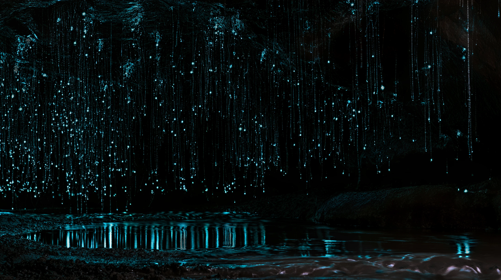

# glowworm-grotto

A glowworm cave as a dark plate on the page: the long-exposure picture of a
Waitomo-style grotto, blue-green points on the ceiling, their beaded threads,
and the same points again in the still stream. Bring a torch to it and the
warm beam finds wet limestone, the droplets glint, and every larva in the beam
goes dark. Move on and they come back slowly and unevenly. Now and then a midge
flies up out of the dark, sticks on a snare, struggles, and is hauled in.

```html
<link rel="stylesheet" href="glowworm-grotto.css">
<figure data-glowworm-grotto role="img" aria-label="…">
  
</figure>
<script type="module" src="glowworm-grotto.js"></script>
<script type="module" src="sound.js"></script>   <!-- optional, off until turned on -->
```

The `` sets the plate's size at its own ratio, so the whole cave is in view;
a 1 px warm-ink edge and a tight shadow set it on the paper. Nothing is written
on it. Without JS or WebGL the `` (the picture at rest) is all there is.
The baked layers sit beside it: `grotto-base.webp`, `grotto-glow.webp`,
`grotto-rock.webp`, `grotto-maps.png`.

## Options

| Attribute | Default | |
|---|---|---|
| `data-beam` | `.17` | The torch's radius, as a share of the plate's longer side. |
| `data-lamp` | `1` | The torch's strength, 0 to 2. |
| `data-recover` | `45` | Seconds for the last larva in a lit patch to relight. |
| `data-prey` | `true` | A catch 15 to 30 s after load while visible, then every 40 to 110 s. |

`glowwormGrotto(figure, opts)` returns `destroy()`, which also carries
`destroy.torch(x, y, k)` (css px; `k = 0` puts it out), `destroy.prey()`,
`destroy.step(dt)` (tests) and `destroy.state`. Events: `glowworm-grotto:catch`.

## How it works

The picture was split offline into a near-black rock layer and a light layer
(points, silk and their reflection); the colony's diffuse teal haze was
removed, and every pixel of light was tied to one larva (silk to the larva
above it, a reflection to its larva's mirror image), each with its own
threshold. The rock under the light was recovered from the red channel, which
the blue-green glow barely reaches. At rest the shader shows the picture
unchanged. The torch is a warm spot (about 2700 K) that lights the rock with
relief from its own shading and a wet sheen, catches the droplets, and is
mirrored in the water. Where it falls a coarse disturbance field rises within a
second or two; once it moves on the field ebbs over `data-recover` seconds and
each larva relights as the field drops below its own threshold, so a patch
fills in unevenly. The midge is drawn in the same shader: a speck and the blur
of its wings, lit by the torch and faintly by the colony. It flies up from the
stream toward a glowing larva (one of the bright points found in the light
layer), sticks a little way down its snare, struggles, and is drawn up to the
larva in small tugs (minutes in life; about ten seconds here).

## Cost, accessibility, reduced motion

Draws only while the torch moves, the colony recovers or a midge flies, and
only on screen. A vertical swipe still scrolls the page (`touch-action: pan-y`);
a resting finger is the torch. The plate is focusable: the arrow keys carry the
torch, Escape puts it out; a catch is announced in a polite live region.
Reduced motion: the torch still lights the rock and darkens the larvae under
it, but nothing fades on its own and no midges fly.

## Credits

The cave picture was generated with Midjourney for Taste and processed as
above (see `assets/credits.json`). Sounds are synthesised (see `sounds.json`).
