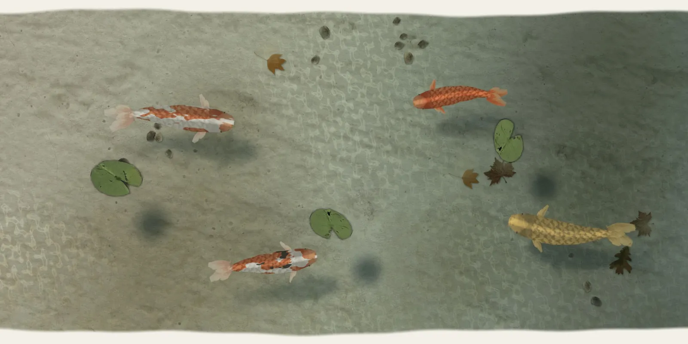

# koi-pond

Koi from a woodblock print swimming under water you can touch. A band of
clear pond runs across the page: a silted stone floor that shelves deeper and
cooler to one side, a few river pebbles, sunken leaves, lily pads riding the
surface, and the sun's net of light moving over all of it. The koi are big,
about a third of the band's height long, and cruise slowly with minds of
their own, along the edges and back through the middle, at different depths:
deep ones dim and green and wobbling under the ripples, shallow ones bright,
their soft shadows thrown further off the higher they swim. They pass under
the pads. Draw a finger through the water and the fish near it bolt, bending
into a C and sprinting off, then glide, calm down and drift back. Tap and a
crumb lands with a small ring. A fish notices, turns, rises, and takes it with
a rise ring at the surface. They never follow the pointer. Left alone for a
minute they go and hang together in the shaded corner, and the pond goes still.

```html
<link rel="stylesheet" href="koi-pond.css">
<figure data-koi-pond style="height: 80svh">
  
</figure>
<script type="module" src="koi-pond.js"></script>
```

The figure is the pond. Give it a size; it is meant to run full-bleed, a band
of water across the page. Its sides run off the figure's edges; its top and
bottom meet the paper along a gently irregular line and fade into it over
9 px (no blurred vignette: the floor and fish stay sharp right to the edge).
The `` is what shows without WebGL (a still of the pond, `object-fit:
contain`). Or call `koiPond(figure, options)` yourself; it returns `destroy()`.
`destroy.state` is a read-only peek (`running`, `sleeping`, `resting`,
`crumbs`, `pads`, each fish's position, depth and mode, and `ms`, the
script's cost a frame).

## Options

| attribute | option | default | |
|---|---|---|---|
| `data-koi` | `koi` | `auto` | how many fish: auto fits 3 on a phone, 4-5 on a desktop band |
| `data-floor` | `floor` | `assets/pond-floor.webp` | the floor image (same origin). Pale stone or ground works best: it is lightened by the water anyway |
| `data-seed` | `seed` | random | the pond's outline and which fish come; random each visit unless set |
| `data-size` | `size` | `1` | scales the fish (base length: 34% of the band's height or 40% of its width, whichever is less) |
| `data-caustics` | `caustics` | `0.7` | 0-1, how strongly the ripples focus light on the floor |
| `data-ambient` | `ambient` | `0.6` | 0-1, the slow sunlit swell and its net of light on the floor |
| `data-rest` | `rest` | `60` | seconds without input before the fish go to rest |

The options object wins over the attributes.

## Events

Bubbling `CustomEvent`s on the figure, for sound:

| event | when | `detail` |
|---|---|---|
| `koi-pond:crumb` | a crumb lands on the water | `{ x, y }` css px in the pond |
| `koi-pond:rise` | a fish takes a crumb at the surface | `{ x, y }` |
| `koi-pond:startle` | one or more fish bolt (at most every 0.6 s) | `{ x, y, count }` |

## The real thing

What I modelled, from how koi behave in a garden pond:

- **Seen from above** a koi is a slim torpedo, widest just behind the head
  (about a fifth of its length), with the pectoral fins standing out at the
  sides, a dark dorsal line and a thin forked tail.
- **Cruising** at 0.3-0.8 body lengths a second (here 0.6, varied per fish),
  in beats of 1-4 s and glides of 1-4 s in which the body straightens and the
  fish coasts and slows. Carangiform: the front barely moves, a wave runs back
  with its amplitude growing toward the tail (tip swing about 0.075 L), about
  one wavelength per body, tail beat about 1 Hz.
- **Turns** bend the whole body: the tail follows the path of the head, so a
  turn is an arc, not a rotated sprite. A slow koi turns on a radius of about
  one body length. When slow or hovering the pectorals scull (alternate strokes
  about 1.3 Hz); when fast they fold back; on the inside of a turn the fin
  stands out.
- **Company:** loose aggregation. Room is kept between bodies (nearest of four
  points along each spine, about 0.6 L), steering away and easing sideways when
  closer, so calm fish never lie stacked; a weak pull toward company further
  off. Only a fleeing or feeding fish may pass over another at a different
  depth.
- **Startle (C-start):** latency 15-65 ms plus a little for distance, so far
  fish react later; stage 1, the body bends into a C in 70-110 ms as the head
  whips 40-120 degrees away; stage 2, a powerful tail beat and a sprint at
  3-4.4 L/s for 0.3-0.5 s; then a glide, a dive of about a third of the depth,
  and 5-9 s on alert (faster, keeping away, not feeding) before cruising
  again. Fish further off only veer away.
- **Feeding:** the crumb floats; after 0.5-1.3 s the nearest calm fish turns
  to it (braking and pivoting if the crumb is behind it), rises steeply as it
  closes in, slows almost to a stop under it, and
  when its mouth reaches the surface the crumb is gone and a rise ring spreads,
  then the slurp closes over: 2-5.5 s from landing (median about 3.5 s; the
  turn toward it starts within 0.5-1.3 s). A
  frightened fish drops the crumb for later, and a fish on alert will not feed.
- **Rest:** after a minute of quiet they swim to the shaded corner, sink deep,
  line up facing one way and hang there, barely finning, and the water stills.
- **Light and shadow under water.** A clear shallow pond is read by its
  caustic net: thin bright folds of focused sunlight drifting over the floor
  (and over the fishes' backs, less so near the surface). A fish's shadow on
  the floor is soft and never black (the floor keeps the sky's light), offset
  from the fish and blurred in proportion to its height above the floor, its
  edges broken by the same caustics. Fins and tail are thin and translucent:
  the floor shows through them, tinted by the body's colour.
- **The pond.** Deeper water is darker and cooler (red light is absorbed
  first). Lily pads float on the surface, ride the ripples (bobbing, drifting
  downhill on a wave, turning a little) and throw soft round shadows on the
  floor; fish pass under them.

Simplified: depth is a number, not a pitch of the body (a rising fish gets
brighter, sharper and less refracted, and its shadow moves off, but it does
not tilt); the mouth is not drawn opening; there is one painted fish, coloured
five ways.

## How it works

- **The fish.** Utagawa Toyokuni I's *The Red Carp* shows one carp rising
  through a swirl. Offline it became one straight top-view koi, 1024 x 256
  with mip-maps: a blunt, rounded head outline (a smooth Pchip profile), the
  head's smooth skin from the print's pale snout running into its red brow,
  scales from its flank, the tail from two copies of its pectoral fin (keyed
  off the print's green ground). Eyes stand a little proud of the outline at
  the sides (a bronze iris, dark pupil, a speck of light; the shader keeps
  them out of the recolouring), with nostrils, a lip line and short fleshy
  barbels. Plus the fin alone, and the silhouette in a wider frame blurred
  three ways for shadows. Kohaku
  (red patches from a noise field in body coordinates, white fins and tail),
  sanke (plus sumi), hi, yamabuki (gold) and chagoi (tea brown) are all
  recoloured in the fragment shader from the print's own reds, so the scales
  and the grain of the block survive. A rounded-back shade and a faint sheen
  down the spine give it volume. Tail and pectorals are drawn at 40-90%
  opacity, the painted rays the most opaque, tinted toward the body colour
  near their base.
- **Bending.** Each fish is a strip mesh of 22 segments. The head is where the
  fish is; behind it each segment's angle runs from the heading toward a lagged
  tail angle (the lag closes as the fish moves forward, so the body traces the
  head's path), and a lateral travelling wave is added on top. A C-start is
  just the head whipped round while the tail lag is held. The pectorals are
  separate quads at 21% of the length.
- **Two passes, one context.** The scene pass draws, into a texture, the floor,
  each fish's shadow (its own strip mesh along the same spine, 1.3 L long and
  0.65 L wide so a wide blur has room; offset down-right from a sun at the
  upper left by 0.08-0.5 L with height; blurred by mixing the three silhouette
  blurs, 0.006, 0.03 and 0.07 L; multiplied in as a cool grey-green, at most
  about 40% dark), the pads' soft round shadows,
  and the fish, deepest first, fading toward the water's green and softened by
  a mip bias with depth. Its alpha channel is written through
  `blendFuncSeparate(..., CONSTANT_ALPHA, ONE_MINUS_SRC_ALPHA)` with the
  fish's depth as the blend colour, so it holds how much water lies over each
  pixel. The water pass is ripple-pool's: a CPU height field (wave equation,
  surface tension, viscosity) packed into an RGBA8 slope texture; refraction
  scaled by that alpha (deep things bend more), caustics from
  `1 / det(I + kH)` weighted the same way, the analytic sunlit swell, a soft
  glint. Output is premultiplied with the pond mask, so the edge fades into
  whatever the page is.
- **The edge** is two irregular lines (three slow sines each) with a 9 px
  ramp; cells beyond them are damped (a sponge layer). The fish use a separate
  distance field (1 at the edge, about two body lengths deep) to keep off the
  banks and the sides; a feeding fish is allowed right up to the bank.
- **Steering** is a weighted heading: the goal, room from the others, and the
  bank (looked for one body length ahead on the analytic outline, turned away
  from by its gradient), with a turn rate that grows with speed. A target
  almost dead behind commits to one way round instead of dithering.
- **The floor** is composed once per layout on a 2D canvas: the stone, drifts
  of silt, sunken leaves (some half veiled in silt), small groups of pebbles
  in the shallows and by the banks, each with a soft contact shadow; then the
  water's colour over it, deepening and cooling toward the far end of the band
  (along its long side), and the shade over the corner where the fish rest.
  Seeded, so the same `seed` gives the same pond.
- **Caustic net.** Six short analytic waves (15-35 px) at uneven angles, none
  near parallel, so there are no bands or lattice; only the bright side of
  `1 / det(I + fH)` is kept and sharpened, so the net is a web of thin
  filaments. Its strength is uneven: a slow large-scale noise (patches about
  a third of the band across) leaves roughly half the floor with only a faint
  net, it fades toward the deep end, and it is gone in the pads' shadows. It
  stays, frozen, when the pond comes to rest. A touch's caustics are weighted
  up (1.35x) so a wake reads through it.
- **Lily pads** (graded to a deep, waxy olive a little darker than the floor,
  sharpened, about 0.4 L across) are drawn after the water, on top: lit by
  how the ripple under them tilts them, with a cool sky sheen and a dark meniscus (the pad's own
  alpha blurred by mip bias), pushed downhill by the slope of the height field
  under their centre.
- **Crumbs** float on top of the water (drawn after it), with their own faint
  shadow on the floor.

## Tuning

At the top of `koi-pond.js`: the water constants (`WAVE`, `TENSION`,
`VISCOSITY`, `REFRACT`, `FOCUS_K`) and `SEG`. In `update()`: cruise speed
(`L * 0.62 * f.sp`), beat and glide lengths, `wMax` (turning), the startle
burst (`f.burst`, `f.burstT`) and alert time. The kinds of fish and their mix
are the `pool` in `spawn()`; their colours are `red`, `white`, `gold`, `dark`
and `sumi` in the fish shader. Floor tint, depth and the shade over the rest
corner are the gradients in `prepareFloor()`.

## Theming

The pond takes its colours from the floor image: the water's green and the
trough tint are its mean colour, darkened. There are no colour variables;
`--accent` colours the keyboard focus ring.

## Accessibility and reduced motion

- The canvas is `aria-hidden`; the fallback image is decorative (`alt=""`).
- With motion allowed the figure is focusable (`role="button"` and a default
  `aria-label`): Enter or Space drops a crumb, the arrow keys draw a wake
  across the pond.
- `prefers-reduced-motion: reduce`: the fish at rest in a composed
  arrangement, the water still but for two faint rings caught part way out.
  One frame; nothing moves and touch does nothing.
- Phone: `touch-action: pan-y`. A sideways stroke stirs the water, a
  vertical swipe scrolls the page (a stroke that starts mostly vertical never
  touches the water), a tap drops a crumb.
- Print shows the still.

## Cost

- While the fish are awake: one rAF loop, about 0.1 ms of script a frame
  (fish and meshes) when the water is calm, about 1.4 ms while the height field
  is running after a touch (measured on an M-series laptop). GPU: the floor,
  the fish and the water, three full-screen fills a frame plus a few small
  meshes. The floor dressing is composed once, at layout.
- After `rest` seconds without input the fish settle, the loop drops to 24 fps
  while they gather, the swell slows to a stop (its net stays), and 14 s after the last one is still
  the loop **stops** with the last frame on screen. Any touch, key, hover or
  scrolling it back into view wakes them.
- Off screen or in a hidden tab nothing runs. Canvas DPR is capped at 2, or 3
  on a phone when the pond is under ~3.4 megapixels (as ripple-pool), so the
  print's scales stay sharp.
- Without WebGL the still image stays. If a dressing image (pads, pebbles,
  leaves) fails to load, the pond simply goes without it.

## Credits

- Koi: Utagawa Toyokuni I, *The Red Carp*, c. 1804-18, colour woodblock
  print, Art Institute of Chicago (CC0).
- Floor: *Sawn limestone texture*, Titus Tscharntke, Wikimedia Commons
  (public domain).
- Lily pads: *20260817 LilyPad*, NotPavlychenko, Wikimedia Commons (CC0).
- Pebbles: *Neolithic smoothing stone (FindID 410734)*, Salisbury and South
  Wiltshire Museum, Katie Hinds, Wikimedia Commons (CC BY-SA 4.0).
- Leaves: *Autumn American Sycamore / Tulip Tree / White Oak Leaf*,
  Ninjatacoshell, Wikimedia Commons (CC BY-SA 3.0).
- Water: ripple-pool, after Evan Wallace's WebGL Water.
- Details per file in `assets/credits.json`.
