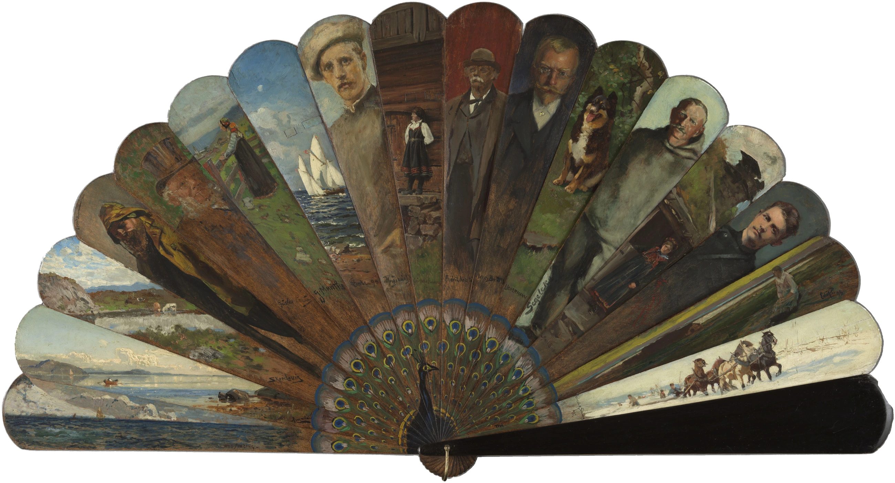
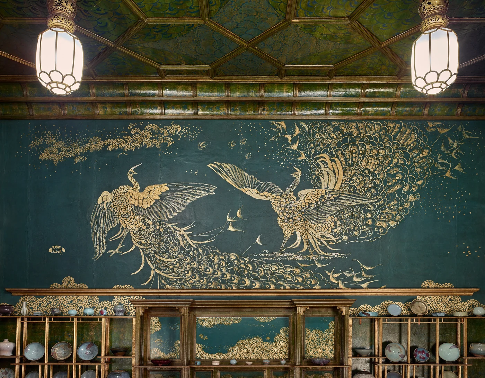

# kongque

A range input that is a brisé fan with a peacock at its heart: *Kunstnerviften*, the Artists' Fan (Kristiania, 1898,
Nasjonalmuseet NG.M.04483). Eighteen broad wooden sticks open to a half circle. Each stick is painted by a different
Norwegian artist (Gude, Krohg, Munthe, Peterssen, Nørregaard and more), and across the gorge a peacock spreads its
painted tail over all of them. *Kǒngquè* (孔雀) is Chinese for the peacock.

The fan is the slider's picture. Closed is the minimum, fully open the maximum, and every value between opens it that
far. Take the top guard, or anywhere on the fan, and turn it round the pin. You can also use the keys, or set the
value, and the fan follows. Each stick, heel and all, is its own photographed piece. They turn about the rivet in their
real stacking order, so closing folds the peacock's tail away into the stack, as it does in the hand. The brass bail
hangs from the pin and stays put. A quick opening deals the sticks out from the top. Fully open and at rest, what you
see is the ``: the photograph itself.

The runtime is badbezan's (the Persian brisé fan in `components/badbezan`), carried over with its own geometry; the
cut in `tools/` is new.

```html
<link rel="stylesheet" href="kongque.css">
<div class="kq" data-kongque data-format="{value}%">
  <div class="kq-fan"></div>
  <div class="kq-face"><label class="kq-label" for="zoom">Look closer</label><output class="kq-out" for="zoom">200%</output></div>
  <input class="kq-input" id="zoom" type="range" min="100" max="200" step="5" value="200">
</div>
<!-- compact, in a row (about 44 px tall): add .kq-compact -->
<div class="kq kq-compact" data-kongque>…same parts, id="vol" min="0" max="100"…</div>
<script type="module" src="kongque.js"></script>
```

Read it as you would any range: `input.value`, and the `input` and `change` events (dragging the fan fires them too).

```js
import { kongque } from './kongque.js';
const f = kongque(root);
f.value = 120;          // sets the input (and fires `input`); the fan opens to it
f.open;                 // how open the fan is now, 0..1
root.addEventListener('kongque:change', (e) => e.detail);   // { value, open }
f.hold(true); f.advance(.1); f.settle();                     // for stills
f();                    // destroy
```

Without JS it is the photograph of the open fan over a native slider with its label and output.

## The demo

*Harmony in Blue and Gold*: a gallery page for Whistler's Peacock Room (Freer Gallery of Art, public domain). The
large fan is the page's magnifier ("Look closer", 100–200%; it starts fully open, at 200%). It brings Whistler's mural of the two quarrelling
peacocks closer, using the 3840 px photograph swapped in once you zoom past the small one. A compact fan is the volume
of a real peacock calling (Denver Zoo, 2009, public domain). The page is in the room's colours. Desktop sets the
fan beside the wall, about 480 px wide; the phone sets it below, full width.

**The gold, relit** (`kongque-light.js`, after `components/gold-ground` and `components/lustre-stars`). Each of the
room's photographs is a `<figure data-kongque-light>`. Offline, `tools/gold_bake.py` gives each one a gold mask
(found from colour: a yellow-to-olive hue, some chroma, some lightness; the Prussian blue, the green lacquer, the
porcelain and the floor fall outside it) and a normal: the rim where the gold paint stands proud of the ground,
its brushwork and the leaf's surface from the photograph's own fine detail, and a slow wander of a degree or two,
because leaf never lies flat. These are packed in one lossless RGB PNG beside the image (`<name>-gold.png`:
R and G are the normal, B is gold), at half the photograph's width or less. One WebGL fragment shader (WebGL2 with
mipmaps where it can) puts a lamp at the pointer, held near the wall. On a phone the tilt turns the wall under it.
The eye is at the middle of the screen, so scrolling moves it too. Gold throws the lamp back as a warm lobe in its
own colour, near white at the peak; gold not catching sits a little deeper than the photograph's flash. The blue
ground stays matte, with a faint broad sheen. Nothing is recoloured, outlined or glowing. The mural's layer zooms
with the fan: the shader samples through the same scale about the same origin as the img's CSS transform (the
module owns the zoom's easing and writes `--z`). When the img swaps to the 3840 px photograph, the 1920 px bake
loads with it. It draws only while the pointer, the scroll, the tilt, the lamp's easing or the zoom moves, and
nothing at all when idle (counted: 0 frames). Reduced motion gives one still frame with the lamp fixed. Without
WebGL, or if the bake fails, the photographs stay as they are.

```html
<figure class="kl" data-kongque-light data-origin=".47 .52">
  
</figure>
<script type="module" src="kongque-light.js"></script>   <!-- figure.goldLight.zoom(2), .aim(x, y), .advance(s) -->
```

**The mural is stronger.** On the first wall the gold blazes harder than on the others, as gold leaf can
(`data-sharp="2.6"`: a tighter, hotter flash; `data-deep=".42"`: leaf that isn't catching sits well below the
photograph's flash; `data-light="1.35"`). The first time the wall is half in view, a lamp is carried once, slowly
(3.2 s), from left to right across it (`data-sweep`), so the gold is seen to be gold. After that the lamp follows
the pointer or the tilt; with no pointer it rests at `data-rest=".6 .4"`, on the spread peacock. Under reduced motion
there is no sweep, and the lamp stands still at that resting place.

The fan's painted peacock is left as photographed: it is oil paint, not metal, so it takes no lamp.

## In life, and here

| In life | Here |
|---|---|
| A brisé fan has no leaf: rigid sticks pinned at the base and held by a ribbon. This one is eighteen broad wooden sticks with round tips and a black lacquered guard, made in Kristiania in 1898 and painted by the circle of artists there, one stick each, signed. Across the gorge a peacock spreads its tail over every stick. | The fan is the museum's photograph of it fully open. Each stick is cut from it as one rigid piece along its leading edge. Each edge is a straight line, fitted along the shaft to the colour edge in polar coordinates about the pin, and followed round the rounded cap. The heel below the pin is the same strip carried through. Nothing is drawn: the peacock breaks where the sticks part, as it does in life. |
| The sticks stack in one order: each lies on the one before it, clockwise, the black top guard over all. | They are drawn in that order. Closing turns each stick back over the one below, so it only ever hides what the photograph shows. Closed, you see the black guard and the round tips of the stack beyond it. |
| All eighteen turn on one brass rivet, with a brass bail hanging from it. | The rivet's head is a circle fitted to its edge (r 14.8 px at 5330 px). Every stick turns about it. The rivet's head and the bail are one piece that does not turn. |
| You hold the bottom guard and push the top one round; a ribbon pulls each stick open after the one above it. | The bottom guard stays put. The top guard is the slider's thumb, 171° from closed to open. Each inner stick springs to its share of the opening, the top ones a little quicker. It never lies further from the one below than it does fully open, and never passes it. |
| The room was made to be seen by gaslight and daylight from the shutters: Whistler laid gold leaf on the shutters, shelves and ceiling ribs, and painted the peacocks in gold over Prussian blue, so the gold flares and goes dark as you walk round it. | The photographs are the colour. A lamp at your pointer (or the phone's tilt) moves over them, and only the gold takes it: each pixel of gold catches when its baked normal sits at the mirror angle between the lamp and your eye, so the light breaks over the peacocks' feathers and the shutters' leaf in patches. The blue keeps a faint matte sheen. Magnified by the fan, the relit layer magnifies with the photograph. |

Simplified, and why:

- The ribbon that ties the sticks is not visible in this photograph (it runs on the back), so it is only the limit
  on the motion, not a picture.
- The heels below the pin are cut by angle through the pin. Their small overlaps there are approximate (a few
  pixels at the fan's size).
- The sticks are flat. Their thickness shows only as the stack of real painted edges as the fan closes.

## How it was cut (offline, `tools/`)

Python, `./tools/run.sh <stage>.py`, or `./tools/run-all.sh` (the fan); `./tools/gold_bake.sh` (the room's light).
The source goes in `tools/engine/jobs/fan-peacock2-src/` (the 10661 px original, worked at 5330 px as
`kv-5330.png`); work files go to `tools/engine/jobs/fan-peacock2-work/`.

1. `rivet.py`: the rivet's head, a circle fitted to its radial edge, and a polar unwrap about it (`look_grid.py`
   draws an angle grid on it).
2. `mask.py`: the matte. BiRefNet (the asset engine's `matte_worker.py`) at half size gives the outline. Within a band
   either side of it, alpha is solved at full size from how far the (lightly smoothed) photograph stands from a smooth
   model of the linen mount's colour.
3. `edges.py`: the seventeen leading edges, found at mid-shaft from colour-edge strength. Each is fitted as a straight
   line at its own angle and distance from the pin, along the shaft (r 420–2340). Over the rounded cap a dynamic-
   programming path follows the cap's own curve.
4. `cut.py`: a label for every fan pixel (which stick it shows; below the pin, the stick whose blade is opposite),
   the bail (brass by colour under the pin) as the fixed piece, islands joined to the stick they border most, and the
   distance past each leading edge for antialiasing.
5. `export.py`: at half the working size, `fan.webp` (2599 × 1406, the photograph cut off its linen, the fringe
   un-mixed from the linen's colour: the page's ``), `sticks.webp` (the eighteen faces as they lie, each running
   4 px on under the stick above, plus the fixed piece), and `fan.json` (the pin, each stick's place and angle).
6. `box.py`: the box the fan sweeps (8 px past the photograph on the left, 16 px below).
7. `preview.py`: renders the fan from the assets at any opening. Fully open it matches `fan.webp` (mean 2.5/255).

## Runtime

Canvas 2D, about 330 lines, no libraries (badbezan's). Each stick is resampled once to device pixels at its exact
sub-pixel place; a frame is eighteen rotated blits and the fixed piece. The loop runs only while something moves and
the fan is on screen, with fixed 240 Hz substeps.

## Options

| Option | Attribute | Default | |
|---|---|---|---|
| `format` | `data-format` | `{value}` | What the `<output>` says. |
| `open` | `data-open` | `13` | How briskly the guard follows a new value (rad/s). |
| `src` | `data-src` | `fan.json` beside the image | Geometry; `sticks.webp` sits beside it. |

`min`, `max`, `step` and `value` are the input's own. `.kq-compact` puts a small fan (`--kq-height`) and its words in a row.

## Theming

`--ink`, `--ink-3`, `--accent` (focus ring), `--serif`, `--sans`, and `--kq-width` (default `min(100%, 640px)`;
the box is 2603 × 1422), `--kq-height` (compact, 44 px), `--kq-size` (the output), `--kq-gap`, `--kq-shadow`.

## Accessibility

The `<input type="range">` stays in the accessibility tree with its label and keys (arrows, Page Up/Down, Home, End).
Once the script is ready it is visually hidden and the fan is its picture, with the focus ring drawn round the fan. A
pointer on the fan focuses the input, so the keys work after a drag. On touch the fan lets vertical swipes scroll
(`pan-y`). A sideways drag or a tap sets the value, and a touch that becomes a scroll puts the value back. The canvas
is `aria-hidden`; in forced colours the photograph stays. **Reduced motion:** nothing moves by itself; a new value
puts every stick where it comes to rest (the demo's zoom has no transition either).

## Cost (the light)

`kongque-light.js` is about 320 lines with one shader pass. Bakes: mural 0.58 MB (960 px) and 2.4 MB (1920 px, loaded
only with the full photograph), fireplace 0.43 MB, shutters 0.47 MB. Rebuild them with `tools/gold_bake.sh`.

## Cost

The fan: `fan.webp` 816 KB, `sticks.webp` 916 KB, `fan.json` 1 KB, shared by every fan on the page. The demo's room
photographs are 4.8 MB, mostly the 3840 px mural, which loads only once you zoom.

## Credits

The fan: *Kunstnerviften*, Kristiania 1898, Nasjonalmuseet for kunst, arkitektur og design, NG.M.04483, the museum's
photograph via Wikimedia Commons, public domain. The Peacock Room: James McNeill Whistler, *Harmony in Blue and Gold:
The Peacock Room*, 1876–77, Freer Gallery of Art, Smithsonian, F1904.61, public domain. The peacock's call: Ke4roh,
Denver Zoo 2009, public domain. The shortlist and the reasons are in `assets/PICK.md`. The runtime is
`components/badbezan`'s. See `assets/credits.json`.
