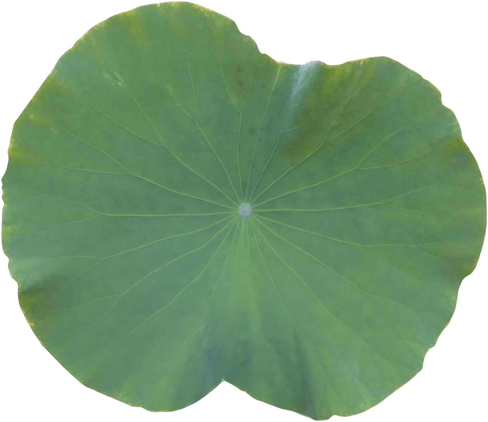
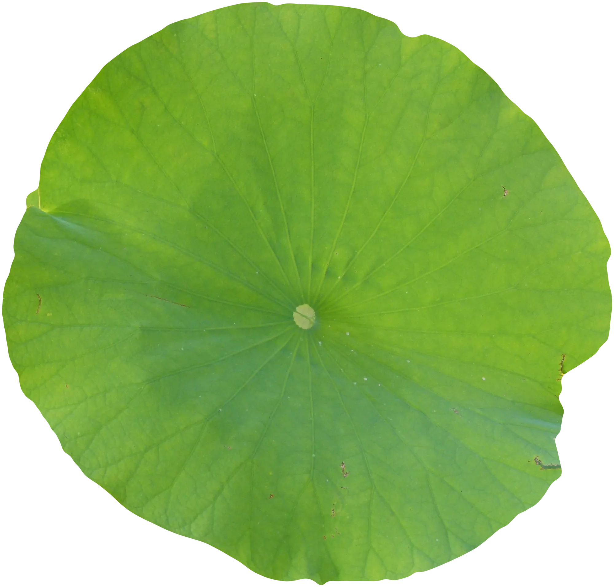
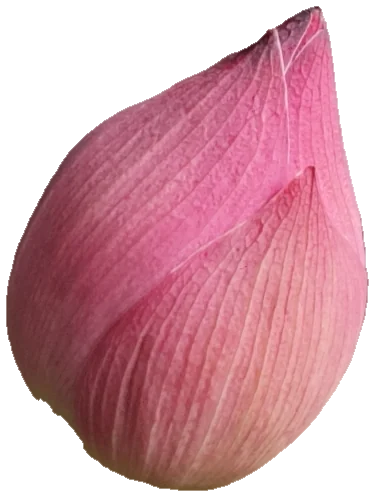

# lotus-leaf

Rain on a cluster of lotus leaves. Five to seven real leaves, cut out along
their own rims, lie on the paper as if on still water: some float flat, others
stand above them on stalks, one large leaf dominant, one high leaf tipped and
seen half on edge, the higher ones larger and casting soft warm shadows on the
leaves below and on the paper. A single closed pink bud stands among them, the
one touch of colour, its stalk hidden under the big leaf. When the
pond comes into view a shower passes over it. On every leaf the drops come to
rest as beads so round they hardly seem to touch it, and they shine like
quicksilver: the tiniest are points of silver, the bigger ones little lenses
with a silver margin, and in each leaf's cup they gather into one flat, sky-bright
pool. Drops that miss the leaves make faint grey rings on the paper, as on
water.

Tip the phone, press and hold a leaf, or push a bead with a finger or the mouse,
and the beads roll on every leaf at once, merge with a quick shiver, pick up the
dust in their path, and run off the edge: onto the leaf below, or down to the
water with a ring. A stalked leaf nods when a heavy drop lands on it, and settles. Tip
everything clear and after a moment another light shower comes. The leaves
start grey-green and their colour deepens as the rain lands.

```html
<link rel="stylesheet" href="lotus-leaf.css">
<figure data-lotus-leaf>
  
  
  
</figure>
<script type="module" src="lotus-leaf.js"></script>
```

Each `` is a cut-out leaf (alpha = the leaf; same origin, since WebGL and
the physics read it). `data-navel` is where the stalk joins under it and
`data-radius` its mean radius, as fractions of the image. The figure sets its
own aspect ratio (1.18 wide, 0.86 on a narrow column, below 560 px) and the
script lays the leaves out from the two images, varied by rotation, mirroring,
size and a slight shift of hue. Or call `lotusLeaf(figure, options)` yourself;
it returns `destroy()`, which also has `.state()`, `.rain(n, radiusMM)` and
`.tip(x, y)` (-1..1, as if the phone were tipped) for tests and tinkering.

A third `` (optional) is the bud: drawn among the leaves, no physics, its
colour arriving a little ahead of the leaves'. Without JS or WebGL the two
leaves lie on the paper as a still group.

## Options

On the figure (`data-*`) or in the options object, which wins.

| attribute | option | default | |
|---|---|---|---|
| `data-water` | `water` | `none` | `none`: the leaves lie on the paper, their shadows and the rings on it in faint warm greys. `wash`: a broad, very pale wash of water under the cluster, fading over 40-80 px with no outline |
| `data-span` | `span` | `420` | the pond's width in mm on a wide layout (300 on a narrow one). Sets the scale: leaves are 55-150 mm across, beads 0.3-2.8 mm in radius |
| `data-shower` | `shower` | auto | drops in the shower when the pond first comes into view (about ten seconds). Auto is one per 95 mm² of leaf, 120-1000: 40% fine (0.3-0.7 mm, they stay where they fall), the rest small, medium and big; big ones throw off a few tiny satellite droplets |
| `data-rain` | `rain` | `9000` | ms between the sparse drops after the shower (jittered ±40%); `0` = none |
| `data-drops` | `drops` | `14` | how many sparse drops before the sky clears |
| `data-seed` | `seed` | `7` | the leaves' relief, the dust, the pond's outline and where the rain falls |

The layouts (`LAYOUT_WIDE`, `LAYOUT_TALL` at the top of the script) give each
leaf its place, size, height above the water (0 = floating), image, rotation,
mirroring, hue and, for a stalked leaf, how far it is tipped and which way.

## Events

All bubble from the figure, with `detail: { r }` (the drop's radius in mm):

| event | when |
|---|---|
| `lotus-leaf:land` | a drop strikes a leaf (from the sky or from a leaf above) |
| `lotus-leaf:merge` | two beads touch and become one (beads under 0.45 mm stay quiet) |
| `lotus-leaf:runoff` | a bead goes over a leaf's edge |
| `lotus-leaf:splash` | a drop reaches the water (and makes a ring) |

## Theming

| variable | default | |
|---|---|---|
| `--accent` | clay | keyboard focus ring |

The pond's colour (`water` in the script) is a pale grey-green, the sky it
mirrors. The leaves' grade is in the shader (`grade()`, `SAT0`/`SAT1`): the
photographs' blue-green with a faint waxy bloom, from 24% saturation when dry
to 74% once wet.

## The real thing

- **The lotus effect** (Barthlott and Neinhuis, 1997): papillae 10-20 µm high
  covered in wax tubules trap air; water meets the leaf at about 160° with tiny
  contact-angle hysteresis, so drops *roll* at a tilt of a few degrees. Modelled
  as a rolling bead (a share of g·sinα, with viscous loss) held by hysteresis
  below a critical tilt of 4.2° for a 1.2 mm bead, growing as 1/R². Fine beads
  stay where they fall; big ones run.
- **Shape from the Bond number.** Below the capillary length (2.7 mm) a sphere;
  above it a puddle whose height saturates at 2·lc·sin(θ/2) ≈ 5.3 mm.
  Modelled as a superellipsoid of revolution, sphere to flat top.
- **Each leaf** has a height field in its own frame: a cup deepest over the
  stalk, gentle hollows, the veins (found in the photograph) as faint ridges,
  scaled with the leaf. A stalked leaf is tipped, so its water gathers a little
  off-centre. The phone's tilt is turned into every leaf's frame, so one tilt
  rolls the beads on all of them the same way in the world.
- **Quicksilver.** The film of air under the water (the plastron) mirrors the
  sky where the underside curves up: every bead has a silver band round its
  margin and lower half, the tiniest are nearly all mirror, and a pool is a flat
  sheet of sky with a silver rim, the window crisp near one side and the veins
  faint through it. A pool's outline follows the cup and keeps a lobe where a
  bead ran in.
- **Coalescence** rings in the capillary mode (`f = √(8γ/ρR³)/2π`), shown as a
  few quick damped cycles slowed about four times. **Impact** (Richard, Clanet
  and Quéré, 2002): contact time ~2.6√(ρR³/γ), then one small rebound,
  stretched about three times; big drops throw off satellite droplets.
- **Falling.** A bead over the edge is a free body: it keeps its speed across
  the pond, falls (shown at a third of g, since a real fall of 10 cm is over in
  a seventh of a second), shrinks with distance, and lands on the first leaf
  under it or in the pond, where it makes a capillary ring that spreads, slows
  and fades within a second.
- **The pond** is still, pale, mirroring an overcast sky; higher leaves stand
  nearer the eye (perspective from about 62 cm) and their shadows fall on the
  leaves and water below, offset 0.62 mm per mm of height and softer the
  higher the leaf.
- **Simplified:** stalks are not drawn (from above they are under the leaves);
  the tipped leaves are foreshortened, not modelled in 3D; a leaf's sway moves
  it but does not shake its beads; the pond is still except for the rings.

## How it works

- **Assets.** Two Commons photographs, each cut out along its rim by tracing the
  edge in polar coordinates from the navel (dynamic programming over a score of
  the thin rim line and of leaf colour inside versus outside; the second held to
  an ellipse band because its neighbours are the same green). The edges are the
  leaves' own, sharp, 2 px anti-aliased.
- **Textures.** Each image is uploaded square and mipmapped (1024²) so a small
  leaf never shimmers; its alpha, blurred and mipmapped (256²), is its shadow,
  the mip level picked from the leaf's height.
- **Physics (CPU, mm and seconds),** 240 Hz substeps. Per leaf: the mask and
  veins of its image, its own height field (128 wide), its beads and dust.
  Pairs of beads that are both at rest are not tested for merging.
- **Rendering (WebGL1, one context, no float textures).**
  1. The pond: its outline (a soft union round the leaves and the open water
     between them, with a short quiet fade at the edge), the shadows of all the
     leaves (up to 8 casters in one pass), the rings.
  2. Then each leaf from the lowest to the highest: the leaf, graded, with the
     shadows of the leaves above it; its beads' contact shadows and caustics
     (blended `dst · (src + srcα)`, so one pass darkens and brightens); its
     dust; its beads, ray-traced as lenses through this leaf's image, with the
     plastron's silver, the sky and window, and a size floor of 1.3 css px so
     the finest stay points of silver; the dust they carry; then any drop
     falling past that height.
- **Loop.** Runs only while something moves (a bead rolling or in the air, a
  shiver, a ring, a leaf still swaying, the dimple, the colour deepening) and the
  pond is on screen in a visible tab. Rain waits on `setTimeout`. A slow
  interval watches the phone's tilt only while the pond is visible.

## Tuning

Constants at the top of `lotus-leaf.js`: `PIN_ANGLE` (hysteresis), `ROLL`,
`DRAG`, `TILT_DEG`, `FALL` (how slowly falls are shown), `PERSP`, `SHADOW`,
`SAT0`/`SAT1`; the layouts; `rainSize()` for the mix of drop sizes. The leaf
relief is in `makeLeaf()`, the pond's outline in `buildPond()`, the window and
sky seen in the beads in `env()` and `sky()` in the bead shader.

## Cost

- Idle it draws nothing. During the shower (about 500-600 beads on a wide
  layout) it holds 60 fps in desktop Chrome: one pond pass, one pass per leaf,
  and small quads for the beads.
- DPR capped at 2. Off screen or in a hidden tab, nothing runs. If WebGL is
  missing or a shader fails, the ``s stay. A lost context hands back to
  them.

## Accessibility and reduced motion

- The figure has `role="img"` and an `aria-label`; the canvas is `aria-hidden`.
- Keyboard: the figure is focusable; the arrow keys tip the leaves while held,
  Enter or Space lets a few drops fall.
- Touch: `touch-action: pan-y`, so a vertical swipe scrolls the page; a
  sideways push rolls a bead, press-and-hold dimples a leaf, a tap on the water
  makes a ring. On iOS the first tap asks for motion permission (`tilt.js`).
- `prefers-reduced-motion: reduce`: the finished state, computed at load (the
  shower settled for six seconds of simulated time): beads where they stopped,
  a pool in every cup, the leaves at full colour. Nothing moves.
- Print shows the plain images.

## Credits

- Leaves: *Nelumbo nucifera Himeji 03*, photograph by Syrio, Wikimedia
  Commons, CC BY-SA 4.0; *Nelumbo nucifera feuille*, photograph by Dinkum,
  Wikimedia Commons, CC0. Details in `assets/credits.json`.
- Physics after W. Barthlott and C. Neinhuis, "Purity of the sacred lotus, or
  escape from contamination in biological surfaces", *Planta* 202 (1997), and
  D. Richard, C. Clanet and D. Quéré, "Contact time of a bouncing drop",
  *Nature* 417 (2002). No third-party code.
- Bud: photograph by Md. Tayhid Hasan, iNaturalist, CC BY 4.0.
