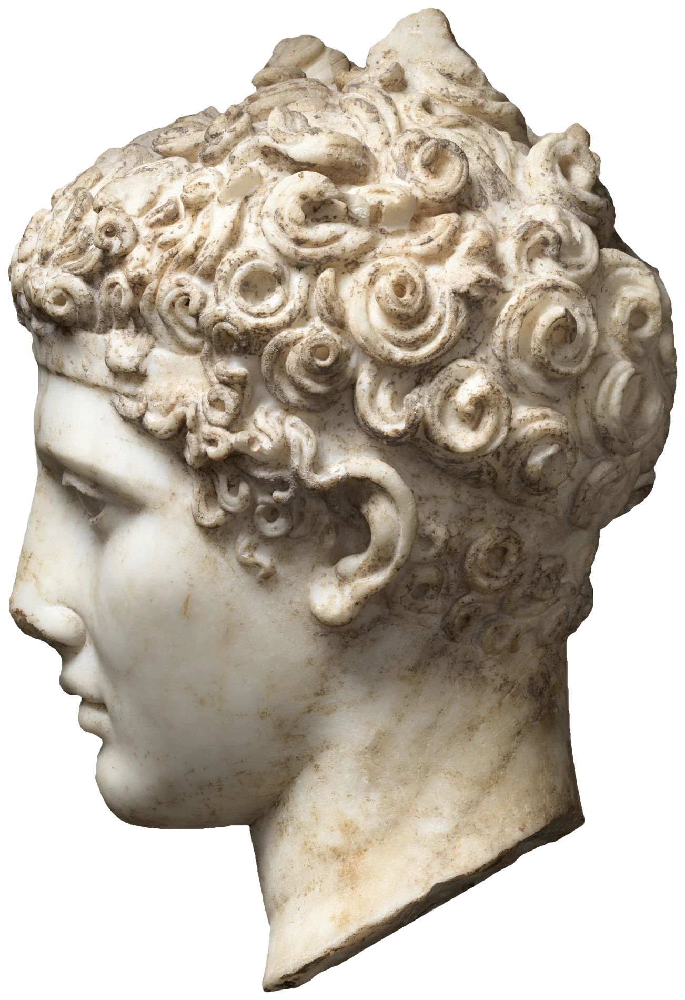

# marble-relight

A marble head standing in the page, lit by a candle you carry. In a museum at
night a guard's torch passes over a statue and it comes alive: the eye sockets
fill with shadow, the cheekbone catches, and at the thin places (the rim of the
ear, a curl standing free, the edge of the profile) the stone glows, because
marble lets light in a few millimetres before it lets it out again. That glow
is what makes marble read as marble and not plaster. Here one museum
photograph of a Roman head becomes that statue: the pointer is the candle (on a
phone, the tilt of the phone and a sideways drag), the head never moves, and
its shadow falls across the paper and the words beside it.

```html
<link rel="stylesheet" href="marble-relight.css">

<figure data-marble-relight data-height="471" data-thick="915.1"
        data-albedo="assets/athlete-albedo.webp"
        data-normal="assets/athlete-normal.png"
        data-aux="assets/athlete-aux.png">
  
</figure>

<script type="module" src="marble-relight.js"></script>
```

Or `import { marbleRelight } from './marble-relight.js'` and call
`marbleRelight(figure, options)`; it returns `destroy()`.

The `` is the plain cut-out photograph and sets the size. It is what shows
without JS or WebGL, in print, and until the maps arrive. The maps are fetched
only when the figure comes within 800 px of the viewport.

## Options

| attribute | option | default | |
|---|---|---|---|
| `data-albedo` | `albedo` | required | the photo with its studio light divided out; alpha = the cut-out. Its colour is carried out past the outline (saved with WebP `exact`), so it filters cleanly |
| `data-normal` | `normal` | required | PNG, lossless: r g = surface normal, b = height |
| `data-aux` | `aux` | required | PNG at half size: r g = a wide (blurred) normal, b = thickness, a = 0.5 + 0.5 x polish |
| `data-height` | `height` | `400` | the range of the height channel, in texels of the normal map. Printed by the processing step |
| `data-thick` | `thick` | `800` | the range of the thickness channel, in texels |
| `data-light` | `light` | `-45 32` | where the candle rests: azimuth and elevation in degrees. Azimuth is on the screen: `0` = from the top, `-90` = from the left, so `-45` is the flattering three-quarter light from the upper left |
| `data-cast` | `cast` | `0.7` | 0-1, how dark the shadow on the paper is |
| `data-muted` | `muted` | `0.45` | 0-1, how far the stone's colour is muted toward grey (the candle adds its own warmth) |
| `data-reach` | `reach` | `5` | in head radii: past this distance the pointer stops carrying the candle and it drifts back to rest |
| `data-glow` | `glow` | `1` | scales how far light travels in the stone (the translucency). `0` gives plaster |

The options object wins over the attributes.

## How the candle moves

- **Desktop:** the pointer is the candle. Its direction from the head's centre
  is the side the light comes from; its distance sets how high it is held:
  over the face it is up in front (66°), a head's height away it is down at
  the side (10°), so below the head is the museum-at-night look and beside it
  is raking light. Past `reach` it drifts back to rest; leave the window and
  it goes back to rest.
- **Phone:** turning the phone left and right carries the candle up to ±110°
  round the head; tipping it toward or away from you lowers or raises it
  (`tilt.js`, shared and smoothed, its level drifting back over about 12 s).
  A sideways drag on the head carries it too (260° across the screen); a
  vertical swipe scrolls the page as usual (`touch-action: pan-y`). Six and a
  half seconds after the last touch the drag is let go and the candle returns.
- **Keyboard:** the figure is focusable. Left and right arrows carry the
  candle round by 20°, up and down raise and lower it by 6°; Escape sends it
  back.
- **A hand-held candle.** It follows through a critically damped spring
  (`STIFF = 4.6`/s): a little lag, no overshoot. The first time the head is
  seen, the candle arrives from below and settles at the three-quarter light
  (about two seconds, once).
- **Flicker.** While the candle is carried its flame gutters a little
  (±4-5% brightness, a fraction of a degree of wobble). Held still in still
  air a flame stands up and steadies, so about 1.4 s after the candle stops,
  the flicker has faded and the loop stops. This is deliberate: a flame that
  flickered forever would keep the GPU busy on an idle page.

## How it works

**Offline (Python), from one evenly lit photograph** (the Met's left profile,
4000 px tall, the head about 2900 px):

1. **Cut-out:** the backdrop is a grey gradient, so it is modelled per row
   from the outer columns; a Lab distance (mostly chroma) seeds GrabCut; the
   steel post is walked out column by column from below until solid bright
   marble, and the neck's broken lower edge is drawn straight across where the
   post went in. Signed-distance alpha, about a pixel of anti-aliasing.
2. **Large form:** the silhouette is *inflated*: solve ∇²u = −1 inside the
   outline (conjugate gradients at half size) and take √u, which gives round,
   smooth cross-sections with no crease along the middle (a distance transform
   has one, and it shows as a ridge under a low light). That is modulated by
   the low frequencies of **Depth Anything V2 Small**
   (`depth-anything/Depth-Anything-V2-Small-hf`, run locally at 1904 px), and
   the model's middle frequencies are added on top: the snail-shell volume of
   each curl, the ear, the brow. A real head is about 0.36 of its width deep
   on the visible side, which sets the scale.
3. **Fine carving** from luminance (dark = deep under soft light), band-passed
   at four scales, **with stains taken out first**: on the smooth face and neck
   the only darkening is stain, so the luminance band-pass is regressed on the
   chroma band-pass there, and that much of each yellow-brown stain is
   removed before the carving is read. Shrinkage drops faint mottle, and a
   closing by line segments at eight angles fills any pit or speck shorter
   than 17 px whichever way it lies (weathering, dirt, sensor grain), while a
   drilled groove survives along its length. Kept shallow (5 px).
4. **Thickness** along the view: the solid is taken as mirrored about the
   outline, so 2 × the large form's height, except where something stands
   proud and narrow (a white top-hat at 12 px: the ear's rim, free curls),
   which is a thin flap whatever its height.
5. **Polish:** smooth, clean, bright = polished (the face, the neck); the
   drill-work of the curls and the weathered crown were not.
6. **Albedo:** the studio light is found by fitting ambient + one soft key
   against the wide normals over a grid of directions (it came out upper left,
   40° up), divided out (to the 0.85 power), with a cavity term; the veining
   and the iron stains stay.

**In the shader (only while the candle moves):**

- **The candle is a point**, a little more than a head's height from the
  centre, so its light falls off across the head (1/d^1.8): the near side
  glows, the far side sinks.
- **Diffuse, per channel:** red is lit through a normal 55% of the way to the
  wide normal, green 25%, blue the sharp one, with a wrap of 0.22 / 0.13 /
  0.07. This is a cheap stand-in for blurring the irradiance under the
  surface (wider in red, as in pre-integrated skin shading): terminators are
  soft and warm, small carving stays crisp in blue.
- **Light through the stone:** a warm fill wherever the candle reaches nearby
  (a shadow on marble glows a little, warm, under the stone that casts it),
  and light out through thin parts, `exp(−thickness / ℓ)` per channel
  (ℓ red ≈ 1.3 cm, green 0.8×, blue 0.58×) times how much the wide normal
  faces the candle. With `glow: 0` the same head reads as plaster.
- **Self-shadows:** 40 geometric steps of a narrow cone toward the candle
  through the height field (the mip level grows a little with distance so
  thin features cannot alias into streaks; the first step is jittered by one
  whole step in log space so there are no bands). Penumbra widens with
  distance (a candle and its glow). Near the terminator the shadow hands over
  to the wrapped diffuse, so the march never cuts a hard line through a
  rounded cheek.
- **Polish:** a faint Blinn-Phong highlight (60 and a broad 9) where the
  polish map says so.
- **Room:** a dim, slightly cool ambient, darker in cavities (the height
  against a coarser mip), plus the candle's own light bouncing back off the
  room.
- **Shadow on the paper:** its own canvas, larger than the head, drawn at
  0.75 px per css px. The head's height (the normal map's blue, drawn small)
  is the body; each paper point marches 16 steps toward the candle in five
  side-by-side cones and measures how much of the candle's disc the head hides.
  Dark and sharp where it leaves the stone, softer and paler with distance, a
  narrow contact shadow all round the outline. It lies over the text.

## Tuning

- In the processing: `HMAX` (depth of the head), `DEPTHW` and `MID` (how much
  the depth model shapes the form and the curls), `DETAIL`, the shrinkage and
  the `LINE` length, the flap top-hat size. Look at four light positions side
  by side before choosing.
- In the shader: `wrapW` and the normal mixes (the softness of the
  terminator), `ell` and `uEll` (how far light goes into the stone), the fill
  weight (0.13), `uPen` (shadow softness), `uAmb`, the candle colour in
  `draw()`.
- In the JS: `STIFF`, `DIST`, `EL_MIN`/`EL_MAX`.

## Theming

| variable | default | |
|---|---|---|
| `--accent` | clay | keyboard focus ring |

The candle and the room are not themed: the candle is warm, the room dim. The
shadow on the paper is near-black ink at up to 50%; it is meant for paper.

## Behaviour and cost

- **Nothing runs when the candle is still.** The loop runs while it moves and
  for about 1.4 s after (the flame steadying), then stops. Off screen, in a
  hidden tab or idle, nothing runs. Verified: 0 frames in 2 s idle.
- DPR capped at 2 for the head; the shadow canvas is at 0.75. A head 540 css
  px wide is about 1.7 Mpx a frame with about 45 texture reads a pixel, plus
  the shadow pass: smooth on a laptop GPU while moving.
- **Weight:** about 3.2 MB, all loaded only near the viewport: normal 1.8 MB
  (lossless; lossy compression shows as blocks under a low light), aux
  0.64 MB, albedo 0.48 MB, the photo 0.34 MB.
- Without WebGL, `createImageBitmap`, or if a map fails, the `` stays.
  If the GPU drops the context, the img shows until it comes back.

## Placement in the demo

The head floats right in the essay, overhanging the column, and the text
follows the profile: `shape-outside: polygon(...) content-box`, the outline
traced offline from the cut-out's alpha at 41 heights. (An image
`shape-outside` would be stretched over the margin box by the negative
margins; the polygon on the content box is not, and it needs no JS, so the
wrap is there in the no-JS page too.) Below 900 px the head stands alone
between the title and the text.

## Accessibility and reduced motion

- The image is decorative (`alt=""`, `aria-hidden`); the canvases are
  `aria-hidden` and never take input. The figure is focusable with a default
  `aria-label` ("A marble head lit by a candle. Arrow keys carry the candle
  around it.") unless you set your own.
- `prefers-reduced-motion: reduce`: the candle rests at the three-quarter
  light from the upper left (the finished, beautiful state), with no arrival,
  no flicker and no easing. Hovering does nothing and the phone's tilt is
  ignored; a deliberate act still moves it, **instantly**: pressing on the
  head and dragging (mouse or finger), or the arrow keys. Chosen over "the
  pointer moves it instantly" because a light that jumps with every passing
  mouse movement is itself motion the visitor did not ask for.
- Text under the cast shadow keeps its contrast (the shadow is at most 50%
  ink, usually far less where it reaches the words).
- Print shows the plain photograph.

## Credits

- Photograph: *Marble head of an athlete*, Roman, Antonine, ca. 138–192 CE,
  The Metropolitan Museum of Art (248579), Open Access, CC0. Details in
  `assets/credits.json`.
- Depth: Depth Anything V2 Small (Yang et al., 2024; Apache-2.0), run
  offline; nothing of it ships.
- Shading after pre-integrated skin shading (Penner, 2011) and the
  wrap-lighting and thickness-map translucency of real-time SSS (Green, GPU
  Gems 1; Barré-Brisebois and Bouchard, 2011). No third-party code in the
  component.
