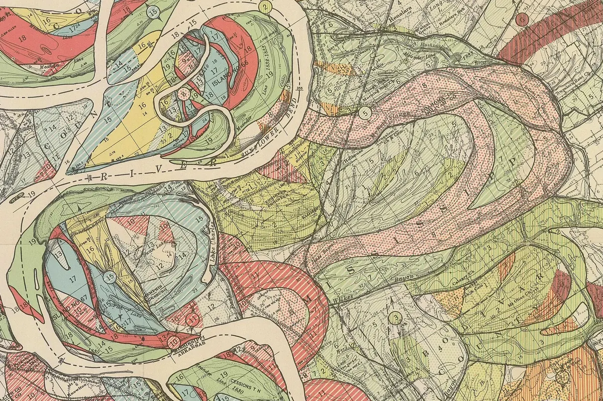

# meander

A river seen from above wanders across its floodplain as you scroll, and the
centuries pile up behind it in the manner of Harold Fisk's 1944 maps of the
ancient courses of the lower Mississippi. The page starts as a printed survey
sheet: a warm-grey base of township and section lines, section numbers, spot
heights, bayous, swamp, a railroad and a few towns, and across it one river
drawn as Fisk draws the modern one, quieter than the colours: the sheet's own
buff inside, fine wavering banklines in warm ink, a dashed thalweg, levees with hachures either side, and M I S S I S S I P P I
R I V E R in spaced capitals along the channel. As you scroll, its bends grow,
lean and travel downstream; a few fine scroll lines mark the old inner banks;
necks narrow until the river breaks through and a loop is left as an oxbow
lake, which takes a name in italic, silts into a swamp of marsh tufts and ends
as a scar. Each stage of the river is printed in its own Fisk tint when the
next one begins: mostly flat, a few with a sparse screen, its line plate a hair
out of register, the grey base printed over it all. Where a younger stage
sweeps through an older one it destroys those deposits, so the older survives
only as clipped fragments with crisp edges: Fisk's packed mosaic. Numerals (some circled) name the patches, and a
legend fills in stage by stage. Scroll back and it all un-happens. With a
mouse, pointing at an old course (or its swatch) makes the rest recede.

```html
<link rel="stylesheet" href="meander.css">

<section data-meander aria-label="A river meandering across its floodplain over centuries">
  <div class="mr-stage">
      <!-- no-JS fallback -->
  </div>
</section>

<script type="module" src="meander.js"></script>
```

Or call it yourself:

```js
import { meander } from './meander.js';
const destroy = meander(el, { seed: 3, courses: 10, runway: 420 });
destroy.state();   // { step, frames, done, oxbows, orient, k, renderMs, rebuildMs, computeMs }
destroy();         // canvas, legend, listeners, observers, timers
```

The section becomes a tall runway with the stage pinned inside it. The valley
runs along the stage's longer side: left to right on a desktop, top to bottom
on a phone, zoomed so the belt fills the width, with the legend in the margin
under the map.

## Options

On the element (`data-*`) or in the options object, which wins.

| attribute | option | default | |
|---|---|---|---|
| `data-seed` | `seed` | `7` | the whole history is deterministic from it |
| `data-courses` | `courses` | `13` | stages the history is divided into (2-14); the present river is one more |
| `data-steps` | `steps` | `2600` | simulation steps scrubbed by the scroll (about 0.05 W of migration each at a sharp bend) |
| `data-runway` | `runway` | `350` | section height in svh; the stage (100svh) is pinned for the rest |
| `data-span` | `span` | `72` | channel widths of valley shown along the long side (smaller = closer) |
| `data-hetero` | `hetero` | `.75` | how unevenly the plain erodes (0 = textbook sine-generated bends, 1 = ragged Fisk loops) |
| `data-clay` | `clay` | `.4` | erodibility of an old oxbow's clay plug, relative to the sand around it |
| `data-decay` | `decay` | `.9` | length (in W) of the upstream curvature kernel; longer = longer wavelength |
| | `ymax`, `soft` | `14`, `8` | half-width of the meander belt in W, and how softly the bluffs push back |
| | `cut` | `1.15` | centreline distance (W) at which a neck breaks |
| | `lake`, `swamp` | `160`, `520` | steps until a lake starts to fill, and until it is only a scar |
| | `L`, `ds`, `dt`, `omega`, `gamma`, `spin`, `smoothing`, `noise`, `force`, `gap` | | the simulation's own constants, see the top of the script |

## The real thing

What a real observer of a lowland river would see (notes in the brief's
spirit, from Leopold & Wolman, Ikeda-Parker-Sawai 1981, Howard & Knutson 1984,
and Fisk's report): channel width W about a kilometre; meander wavelength 10-14
W; sinuosity rising toward 2-3 before neck cut-offs cap it; banks migrating a
few per cent of W a year at the apex and not at all at the crossings; bends
that grow, skew and translate downstream; the outer bank eroding while the
inner one builds a point bar whose old shorelines survive as concentric ridge
and swale; necks that close over decades and break in a single flood; oxbows
whose ends plug with sand first, so the lake is a crescent with tapered horns,
then fill with clay over centuries; a belt held between bluffs.

What is modelled:

- **Migration** (Howard & Knutson's form of the Ikeda-Parker-Sawai model). At
  each point the bank moves along the normal at `R1 = Ω·C + Γ·∫C(s-ξ)e^(-ξ/λ)dξ / ∫e^(-ξ/λ)dξ`,
  with Ω = -1, Γ = 2.5 and λ = 0.9 W, curvature C in 1/W. The local term
  straightens, the upstream-weighted term pushes outward, and because it lags
  the bend the greatest erosion falls just downstream of the apex: bends grow,
  lean and travel down-valley. The convolution is computed as a running
  exponential sum, so a step costs O(n).
- **Resampling** to half a channel width each step, with a light Laplacian
  smoothing (8%).
- **Neck cut-offs**: a spatial hash finds two points more than 9 W apart along
  the river and less than 1.15 W apart on the ground; the loop between them is
  removed and kept as an oxbow with its step.
- **Erodibility** varies over the plain (smooth value noise, ±75%), and each
  oxbow leaves a clay plug that erodes at 0.4 of the rate, Fisk's own
  observation; this is what turns regular sine bends into the buckled, compound
  loops of his plates. The belt is soft-confined at ±14 W (bluffs).
- **Bends from upstream**: the kernel at the inflow is fed by a slowly
  wandering curvature, standing for the meanders above the map; about 20 W at
  each end of the valley is simulated off screen so the ends never
  show.
- **Scroll lines**: three or four per stage, at uneven moments, drawn along
  the bank that is building (the one the channel is moving away from, the
  sign of `R1`), only where it migrates noticeably, so they fan out round the
  apex and pinch out at the crossings.

Simplified: no chute cut-offs, no avulsion, constant width and discharge, no
sediment budget, no floods as events (each step is an average year or so), and
the "courses" are equal slices of time rather than the river's own epochs.

## How it draws

- **History first**: about 2600 steps are computed at load in 12 ms slices
  between frames (about 0.5 s in all on a laptop); every step's centreline is
  kept (around 6 MB). Scroll maps to a step, eased toward the target with a
  0.14 s time constant so it settles. Nothing runs while the scroll is still.
- **Ownership**: a grid at half a channel width records, for each place, the
  last stage whose channel swept it. At the close of each stage a chamfer
  distance transform finds roomy places for numerals; numerals stay put while
  their place stays theirs. The same grid answers the pointer.
- **Three plates, as in print.**
  - *Paper* (base canvas): a faint buff and a still grain.
  - *Colours* (into the same base canvas, one stage at a time): the stage's
    swept ground (its centrelines every third step, stroked a channel wide) is
    first erased back to bare sheet with a hard edge (the river destroyed the
    older deposits there), then its tint plate (flat or sparsely screened, with
    grain) is multiplied over it, then its line plate (a faint outline, its
    scroll lines, the banks of its oxbow scars) is multiplied half a pixel or so
    out of register. Older stages survive as clipped fragments, each with its
    own numeral where there is room.
    Moving forward adds one stage; moving back rebuilds (about 5-20 ms).
  - *Grey base* (its own canvas, drawn once per size, multiplied over the
    colours every frame): the irregular survey grid (township rows with
    correction-line jogs, slightly skewed sections), small section numbers (mostly in the cells near the belt), spot
    heights, dotted contours, bayous (two named), swamp tufts, a railroad with
    its branch, towns.
- **Each frame**: paper and colours; the stage just closed fading in from bare
  sheet; the current stage's fresh ground as bare sheet with pencil scroll
  lines; the grey base plate over all of it; numerals (hidden where fresh
  ground has covered them); lakes; levees (a hachured line each side of the
  present belt, from a dilated and smoothed envelope of the channel); the
  river; its name. About 2-5 ms of script per frame.
- **The river's name**: each capital is set where the channel crosses an
  evenly spaced point down the valley, at the crossing that runs most
  down-valley, turned to the channel and kept upright. Each letter remembers
  the crossing it used last frame and strongly prefers it, so letters do not
  jump between crossings as you scrub (forgotten after a big jump).
- **Lakes** are crescents whose horns plug and whose width narrows with age,
  the sheet's buff inside with a fine warm shoreline and one faint waterline while open,
  turning sage with marsh tufts, then dissolving into the scar already in the
  colours. The larger ones get a name from a list of real lower-Mississippi
  oxbow lakes (Lake Bruin, Lake St. John, Moon Lake, ...), set letter by letter
  along the straightest part of the open water, haloed in paper.

## Theming

| variable | default | |
|---|---|---|
| `--paper` | `#f3f0e8` | page colour (the highlight wash and the lake-name halo use it) |
| `--ink`, `--ink-2` | `#141312`, `#4a4744` | legend rules and lettering |
| `--mr-serif` | Cormorant Garamond | lake names, "Scale of Miles" |
| `--mr-sans` | Inter | numerals and the legend |

The course colours and screens are in `COURSES` at the top of the script,
sampled from the legend of Plate 22, Sheet 7 (vermilion-salmon reds,
yellowish greens, grey blues). `BASE_INK` the grey of the base plate, `TOWNS` and `BAYOUS` the
names on it.

## Events (for sound later)

| event | detail | when |
|---|---|---|
| `meander:cutoff` | `{ step, length }` (length in W) | the scroll carries the river through a neck cut-off (forward only) |
| `meander:course` | `{ course }` | a stage closes and its colour is laid down (forward only) |

Both bubble from the section.

## Accessibility and reduced motion

- The canvas and legend are `aria-hidden`; give the section an `aria-label`
  (the demo does). The essay around it carries the content.
- `prefers-reduced-motion: reduce`: no runway and no pin; the finished map
  after the whole history, still. Pointing still highlights a course.
- `touch-action: pan-y` on the stage; a vertical swipe always scrolls.
- Without JS the stage shows a detail of Fisk's plate.

## Cost

- One-time: ~0.5 s of simulation in slices (longer on a phone, during which
  the map shows the last computed step), ~6 MB of history.
- Four canvases the size of the stage at DPR up to 2 (visible, colours, grey
  base, scratch), plus one more after the first hover. Base rebuilds only when scrolling back
  past a stage boundary.
- No loop while still, off screen (IntersectionObserver) or in a hidden tab.

## Credits

- Harold N. Fisk, *Ancient Courses, Mississippi River Meander Belt*, Plate 22,
  Sheet 7, from *Geological Investigation of the Alluvial Valley of the Lower
  Mississippi River* (Mississippi River Commission, 1944); public domain, via
  Wikimedia Commons. Details in `assets/credits.json`.
- Mark Twain, *Life on the Mississippi* (1883), chapter 17, quoted in the demo.
- Migration law after Ikeda, Parker & Sawai (1981) and Howard & Knutson (1984);
  the running-sum kernel and cut-off test follow the approach of Zoltán
  Sylvester's meanderpy, reimplemented. No third-party code.
