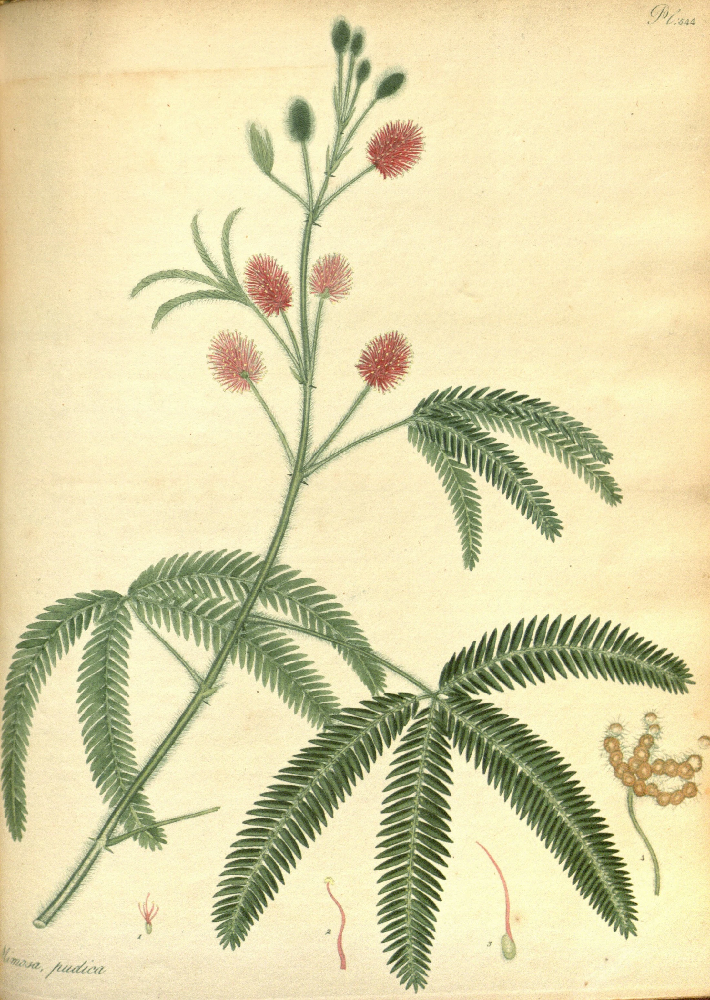

# mimosa-toggle

A switch that is a leaf of a real botanical plate. The plate is Henry Andrews' *Mimosa pudica*,
plate 544 of *The Botanist's Repository* (1807), a hand-coloured engraving, lying on the page as a
sheet. Its great lower leaf is the control. Switch it off, or touch the leaf, and the painted leaf
itself folds the way the sensitive plant does: from the leaflet under your finger the closing runs
down the pinna pair by pair, each painted leaflet rising against its partner and sweeping forward
until the pinna is a narrow braid; at the hub the four pinnae draw together and the others close
from their bases; then the whole leaf falls at its joint on the stem. Switch it on and it reopens,
slowly and unevenly. Switch it too often and it tires.

Open and at rest it is the plate, pixel for pixel: what you are looking at is the ``.

```html
<link rel="stylesheet" href="mimosa-toggle.css">
<figure class="mt">
  
  <input type="checkbox" role="switch" class="mt-switch" data-mimosa-toggle
         data-src="assets/mimosa.json" aria-label="The leaf" checked>
</figure>
<script type="module" src="mimosa-toggle.js"></script>
```

```js
import { mimosaToggle } from './mimosa-toggle.js';
const leaf = mimosaToggle(input, { speed: 900 });
input.addEventListener('change', () => { /* input.checked, as ever */ });
input.addEventListener('mimosa-toggle:fold', (e) => { /* e.detail.strength: 'full' | 'tired' */ });
leaf.set(false);                       // as if a person switched it (fires input and change)
input.checked = true; leaf.sync();     // changed in code: the drawing jumps to match
leaf();                                // destroy: remove canvas, listeners, GL; leave the plain checkbox
```

Without JS or WebGL2 the plate is a plain picture and the checkbox is a small pill switch in its
lower right corner, so the form still works and still looks like a switch.

## The real thing

*Mimosa pudica* has bipinnate leaves: a petiole, at its tip a hub carrying two pairs of pinnae held
like fingers, and on each pinna 15 to 25 pairs of narrow leaflets. Every one of those parts sits on a
pulvinus, a swollen joint packed with motor cells that hold it in place by the pressure of the water
in them.

What a person watching sees, and what is modelled:

| In life | Here |
|---|---|
| Touching a leaflet starts an electrical signal (an action potential) that runs at a few cm/s through the pinna, faster in the petiole. | The signal starts at the painted leaflet nearest your finger and runs along that pinna toward its base (and, more slowly, out toward its tip), then from the hub into the other pinnae from their bases, then down the petiole. 900 plate px/s, about twice life. |
| Leaflets close in pairs as it passes: each rises about the rachis until its upper face meets its partner's, and sweeps forward toward the tip, so the closed pinna is a narrow braid showing the paler lower faces. About a second per pair. | Each of the 255 painted leaflets turns in 3D about its own pulvinule: up about the rachis (68 degrees), then forward in its own plane to 17 degrees from the rachis, projected straight down. Its own painted pixels go with it, foreshortened by that rotation, and turn paler as the lower face comes round. 0.19 to 0.26 s per leaflet. |
| The pinnae converge at their secondary pulvini. | Each pinna turns about the hub halfway toward the leaf's mean direction. |
| The primary pulvinus collapses and the whole leaf drops. | The leaf falls away from you at its joint on the stem: seen from the front it foreshortens along the petiole by 20 percent (and turns down under a degree), with a small give at the bottom. The petiole stays on its own painted line, so what it lay across on the plate is never uncovered. |
| Reopening takes 10 to 20 minutes: the petiole lifts first, then the pinnae part, then the leaflets open one by one, not in order. | The same order, over about 6.5 s (`recover` scales it). Each leaflet waits its own time. |
| Habituation (Gagliano et al. 2014): plants dropped again and again stopped closing within a few drops, and remembered for a month. | Each fold raises a fatigue that decays over about 25 s. A tired leaf still closes (the switch never lies) but slowly, all over, without the fall, as it does at dusk. |

Simplified: real leaflets bend a little as they fold, and the closing sometimes stops part way along
a pinna when the touch is light. Here every touch is a full one.

## How it works

**Offline** (Python, kept in the studio scratch folder, about 800 lines):

1. The scan is trimmed to the sheet and scaled to 2200 px (`plate.webp`).
2. Optical density against the plate's local paper (the paper's own bright envelope, 41 px) finds
   everything painted.
3. The leaf is separated from the rest of the plant by a watershed from seed lines (the petiole, and
   the four rachises traced along the medial axis of each pinna from a handful of hand-placed
   points), against seed lines through the stem and the neighbouring pinnae it lies over.
4. Leaflets: on each side of each rachis the leaflets are a row of slanted stripes. In coordinates
   along and away from the rachis, the slant is found window by window as the shear that makes the
   stripes sharpest; the paper gaps between leaflet tips give a brightness profile, and dynamic
   programming with a local period prior picks one boundary per leaflet. The middle of each stripe
   seeds a watershed on the paper-gap ridges (a Sato filter), so every leaflet keeps its real painted
   edge. A last pass splits any piece that owns two separate tips and merges crumbs. 255 leaflets.
5. Each leaflet gets its pulvinule (the nearest rachis point to its base), its axis, its side and
   its place along the pinna.
6. The clean plate: what is under the leaf. The paper's slow tone from the surroundings, its fibre,
   tooth and faint foxing copied from the plate's own bare paper in tent-blended 96 px patches. Where
   the leaf lay over other leaves (the petiole's base, two neighbouring leaflet tips by the hub),
   OpenCV's frequency-selective reconstruction carries their leaflets across, and the result is
   re-cut to a crisp edge filled with the nearest real pixels of that leaf.
7. Matting: for each leaf pixel the colour F and coverage a such that
   `clean * (1 - a) + F * a = plate`. Coverage comes from density; F is solved, so the identity holds
   to 8 bits.

**Runtime** (WebGL2, about 600 lines): the leaf is 260 instanced quads (petiole with hub, four
rachises, 255 leaflets), each a 2D affine of its own pixels composed down the plant's hierarchy:
leaf (droop about the primary pulvinus) times pinna (convergence about the hub) times leaflet (fold
about its pulvinule). A piece samples the leaf texture and owns its pixels through the id map
(bilinear over four `texelFetch` taps, so neighbours' edges sum exactly). Pieces add into a
half-float buffer; a second pass draws what has lifted off the paper into a half-resolution shadow
buffer, offset away from a key light at the upper left by each leaflet's height, then blurred. The
final pass is `clean * (1 - A) * shadow + leaf`. Every actuator is a timed curve; the rAF loop runs
only while one is moving.

## Options

| Option | Attribute | Default | |
|---|---|---|---|
| `src` | `data-src` | | The leaf JSON; the textures sit beside it. |
| `speed` | `data-speed` | `900` | Signal speed in plate px per second. |
| `recover` | `data-recover` | `1` | Scales the reopening time (1 = about 6.5 s). |
| `habituate` | `data-habituate` | `true` | `false`: every fold is a full reflex. |

Events bubble from the input: `mimosa-toggle:fold` `{response, strength}`, `mimosa-toggle:fall` when
the leaf drops, `mimosa-toggle:open` when it has reopened (for sounds later).

## Theming

| Variable | Default | |
|---|---|---|
| `--mt-width` | `100%` | The sheet's width. |
| `--mt-ring` | `--ink-3` | The keyboard focus ring round the leaf. |
| `--mt-on`, `--mt-off` | green, rule grey | The fallback pill switch. |

The plate keeps its own paper. Put it on `--paper` (`#f3f0e8`) and it reads as a sheet laid on the page.

## Accessibility

It is the real `<input type="checkbox" role="switch">`, laid over the leaf and cut to its outline
with `clip-path`, so the leaf is what you click, and only the leaf. Focus, Space, Enter, the label,
form submission and the screen reader's "switch, on/off" all belong to it. Keyboard focus draws a
thin ring round the leaf. The canvas is `aria-hidden`. Give the input a real label for what it
controls.

**Reduced motion:** the leaf is simply open or closed; switching changes it at once.

**Touch:** the input does not capture touch, so a vertical swipe over the plate scrolls the page.

## Cost

Assets 2.4 MB (the plate 1.3 MB). At rest, open: nothing runs and the GPU holds nothing visible (the
`` is shown). Closed at rest: one frame was drawn and nothing runs. Moving: 260 instanced quads,
two blur passes and one full-canvas pass per frame, canvas DPR capped at 2. Offscreen or in a hidden
tab the loop stops; the actuators are timed, so it resumes where it should be. Context loss falls
back to the plate and rebuilds on restore.

## Credits

Plate: Henry C. Andrews, *The Botanist's Repository*, vol. 8, pl. 544 (London, 1807), public domain;
scan via plantillustrations.org from the Biodiversity Heritage Library copy. See `assets/credits.json`.

References: W. Pfeffer, *Physiologische Untersuchungen* (1873) and *Osmotische Untersuchungen*
(1877). C. Darwin, assisted by F. Darwin, *The Power of Movement in Plants* (1880). M. Gagliano,
M. Renton, M. Depczynski, S. Mancuso, "Experience teaches plants to learn faster and forget slower
in environments where it matters", *Oecologia* 175 (2014) 63-72. T. Sibaoka, "Rapid plant movements
triggered by action potentials", *Botanical Magazine Tokyo* 104 (1991) 73-95.
