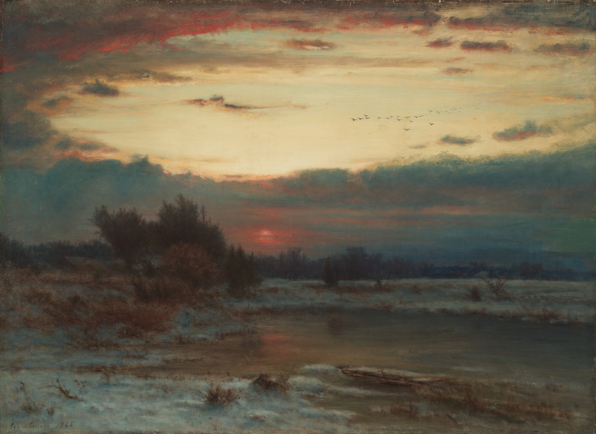

# murmuration

George Inness's *A Winter Sky* (1866), a frozen marsh at the end of a December
afternoon, with forty thousand starlings flying in its light. The flock stretches
into ribbons, folds over itself and thickens to a dark core where you look along
it. Click or tap the sky and a peregrine stoops through: dark bands sweep across
the flock as bird after bird rolls its wing toward you, the cloud opens round
the falcon and closes behind it. Leave it alone and the flock pours down into
the copse on the left, and the painting is as Inness left it.

```html
<link rel="stylesheet" href="murmuration.css">
<section data-murmuration>
  
</section>
<script type="module" src="murmuration.js"></script>
```

```js
import { murmuration } from './murmuration.js';
const destroy = murmuration(el, { birds: 5000 });
destroy.scatter();          // a falcon stoops through the flock
destroy.scatter(0.6, 0.3);  // ...through that point (fractions of the element)
destroy.roost();            // send them down into the copse
destroy.wake();             // up out of it again
destroy();                  // remove everything it added
```

Without JS it is the painting. Nothing is ever drawn over the painting at rest:
an empty sky is the scan, pixel for pixel.

## The real thing

- A murmuration is a winter roost gathering: tens of thousands of starlings
  (sometimes far more) flying together for up to half an hour before dark, then
  pouring down into reeds or trees.
- Starlings fly at about 10 m/s, wingspan 37-42 cm, nearest neighbour about
  0.7-1 m. The flock is a thin sheet a few birds thick, much wider than deep.
- Each bird follows six or seven neighbours by rank, not by distance
  (Ballerini et al. 2008, the STARFLAG study over Rome).
- When a peregrine attacks, birds near it make a "zig": a fast roll almost onto
  the side and back. Neighbours copy it after about 76 ms, and the roll sweeps
  through the flock as a dark band faster than any bird flies (Procaccini et
  al. 2011; Hemelrijk, van Zuidam and Hildenbrandt 2015).
- The band is dark because a starling seen from below and to the side is a thin
  line in level flight and a whole wing when it banks.

## How it works

**The flock.** 7,000 birds (3,000 on a phone) are flown in three dimensions, in
metres and seconds, about 250 m from a camera at eye height: a long lens from
the far side of the marsh, so the flock is only 7-12 degrees above the horizon
and level birds are nearly edge-on. Each finds its **seven nearest neighbours
by rank** every other frame with a uniform-grid spatial hash and takes from
them separation (inside 2 m, stronger fore and aft than to the sides, as
Ballerini measured), alignment, and cohesion weighted by how much it is on the
edge (StarDisplay, Hildenbrandt, Carere and Hemelrijk 2010). Birds on the edge
pull in hard, so the boundary is crisp and dense, as in real flocks. Now and
then a few birds start a turn or a climb of their own and the rest pick it up
through their neighbours (Attanasi et al. 2014); that is where the ribbons and
folds come from. Nothing draws a shape.

**Flight.** Birds turn by banking: the sideways wish becomes a roll angle,
atan(a/g), and the tipped lift does the turning, so the flock swings rather
than slides. Wings flap in bouts at about 12 beats a second with glides between.

**Companions.** Each flown bird carries five companions that keep station on it
inside its own personal space (a fixed place beside, ahead or above, with a
slow drift and their own wingbeat phase). They are drawn, not flown: they share
their bird's heading and roll, so they take part in every turn and every
escape. This is how the sky holds 42,000 starlings (18,000 on a phone) while
the CPU steers 7,000. Spacing is set so the nearest neighbour among all of them
is about 0.7 m. It is a simplification and I say so: within a group of six,
birds do not steer independently.

**Drawing.** Each bird is one WebGL point sprite whose fragment shader draws its
projected silhouette, two tapered wings and a body, with analytic coverage. A
wing's thickness on screen is how much of its surface faces the camera; for a
flapping bird that is taken at the stroke's mean dihedral (at 12 Hz the eye
sees the average), while the wing tips still beat. Contrast falls slowly with
distance (aerial perspective), so far birds take on the painting's sky. Over
the bright opening the flock is near-black; over the cloud bank it all but
disappears, as a real one does.

**The falcon and the waves.** A click or tap sends a peregrine, about a metre
across, stooping through that point on its own line at up to 34 m/s and out
the other side. It never follows the pointer, and nor do the birds. Within 9 m
starlings get out of its line of flight (a vacuole, a split). Within 14 m a
starling zigs: it rolls 83 degrees in 0.25 s, holds 0.12 s, rolls back over
0.3 s, then will not repeat one for 2.5 s, so one attack sends one wave. Its
neighbours repeat the zig after a reaction time drawn around 76 ms (SD 10 ms).
The roll travels at nearest-neighbour distance over reaction time, about
15 m/s. Nothing paints the wave: it is many birds, in a row, showing you their
wings.

**The painting.** The plate is the 3,400 px scan, shown as a plain `` with
`object-fit: cover`. Offline, `assets/bake-land.py` makes a one-channel mask of
everything in front of the sky (the line traced by hand over the full scan, then
refined within 40 px by the paint itself, since the crowns are darker than the
cloud bank behind them). The shader multiplies each bird by one minus the mask,
so birds go behind the copse; the mask is never drawn. The camera is fitted to
the plate: the horizon is the far treeline (57.5% down), the flock flies in the
clear opening (19-30% down) and is about 45% of the painting's width, whatever
the crop, so the birds keep one size against Inness's brushwork.

**The roost.** After `data-roost` idle seconds (or `roost()`) the roost point
moves to the copse and the preferred height becomes a cone over it: the birds
spiral in and go down behind the crowns. When they are all in, the loop stops
and the painting is untouched.

## The statechart

```
flying ──HUNT──▶ hunted ──CLEAR──▶ flying
   │                │
   └──ROOST─────────┴──▶ roosting ──SETTLED──▶ roosted
                            │                     │
                            └──WAKE / HUNT────────┴──▶ flying
```

Mirrored to `data-state`; a `murmuration:state` event bubbles on every
transition (`detail: { state, from, event }`), so a wing sound can be hung on
`hunted` later.

## Options

| JS option | data attribute | default | |
|---|---|---|---|
| `birds` | `data-birds` | `7000` | Birds flown (each carries `group - 1` companions). |
| `birdsPhone` | `data-birds-phone` | `3000` | The cap on phones. |
| `group` | `data-group` | `6` | Birds drawn per bird flown (1-8). `1`: every bird is flown. |
| `roost` | `data-roost` | `75` | Idle seconds before they go down; `0` never. |
| `falcon` | `data-falcon` | `tap` | `none`: clicks do nothing (`scatter()` still works). |
| `seed` | `data-seed` | random | The same flock every load. |
| `ink` | `data-ink` | `0.86` | Opacity of a single bird. |
| `mask` | `data-mask` | `assets/winter-land.png` | The land mask, if you swap the painting. |
| `renderer` | `data-renderer` | `auto` | `2d` forces the Canvas 2D fallback. |
| `adapt` | `data-adapt` | `on` | `off`: never retire birds on a slow device. |
| `label` | `data-label` | (a sentence) | Accessible name of the picture. |

Another painting: replace the ``, bake a mask with `bake-land.py`, and set
the `PLATE` measurements at the top of `murmuration.js` (horizon, roost span,
treetops, the clear band the flock should fly in).

## Theming

| Property | Default | |
|---|---|---|
| `--mm-bird` | `#221c19` | The starlings and the falcon: a dark from the painting's copse. |
| `--mm-aspect` | `3400 / 2476` | Shape when the element has no height of its own. |

Frame the plate with `object-position` on the ``; the camera follows it.

## Accessibility and reduced motion

The stage is `role="img"` with a label, and focusable: Enter or Space sends the
falcon through the flock. The painting is decorative (`alt=""`). A vertical
swipe scrolls the page (`touch-action: pan-y pinch-zoom`); only a tap that does
not move sends the falcon.

With `prefers-reduced-motion: reduce` nothing moves: the flock is shown still,
formed, in the sky, and clicks do nothing.

## Performance

The loop runs only while the plate is on screen and the tab is visible, and
stops for good once the flock has roosted (zero rAF at rest, checked). DPR is
capped at 2. On a slow device, if a frame's work stays over 12 ms the flock
retires a fifth of its birds at a time (they fade out) down to 40%.
Neighbour search is the cost: about 4-8 ms for 7,000 birds on a laptop.

## Credits

George Inness, *A Winter Sky*, 1866, Cleveland Museum of Art, Bequest of John
Huntington 1927.388, CC0. The land mask is derived from it. References:
Ballerini et al. 2008 (PNAS); Hildenbrandt, Carere and Hemelrijk 2010
(Behavioral Ecology); Procaccini et al. 2011 (Animal Behaviour); Attanasi et al.
2014 (Nature Physics); Hemelrijk, van Zuidam and Hildenbrandt 2015 (Frontiers in
Ecology and Evolution). See `assets/credits.json`.
