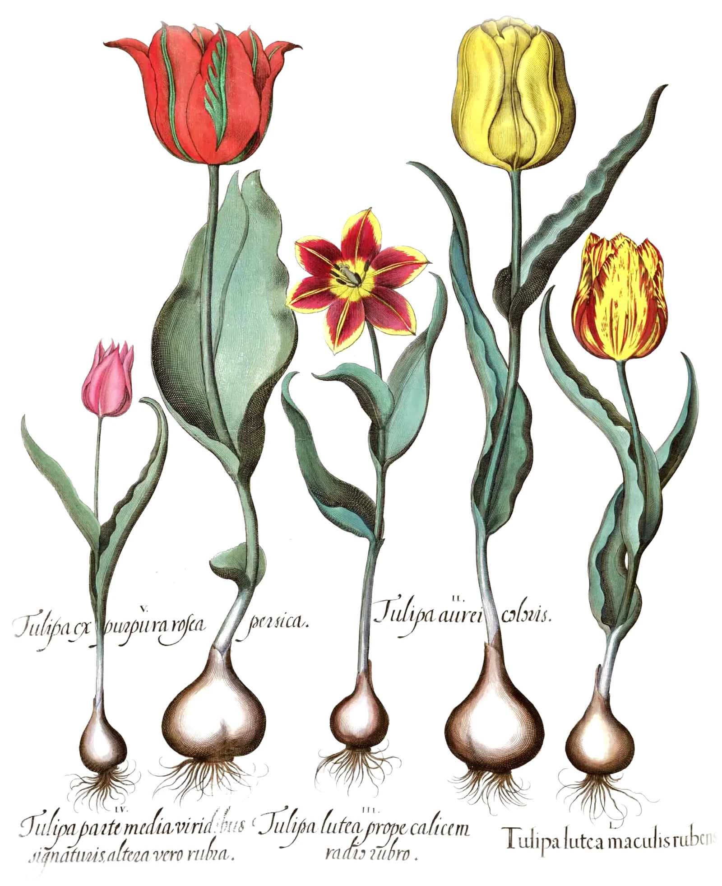

# page-turn

An old printed herbal lying open, and you turn its leaves. Each leaf is a
sheet of rag paper: take it by its edge or a corner and it bends from where
you hold it, a curl that walks toward the spine as you lift, catching the
light along its curve and falling into its own shade on the far side. Its
shadow lies soft on the page beneath and spreads as the leaf rises. Held up
against the light, the paper lets the print on its back show through,
mirrored, with the chain lines of the papermaker's mould. Let go past the
spine and it falls over, the trailing edge bowed back by the air, and settles
on a cushion of air; let go before and it falls back; a flick turns it.

The text pages are set with [pretext](https://github.com/chenglou/pretext)
(Cheng Lou): a running head, a chapter heading, a red drop cap the first
three lines flow around, and justified paragraphs in the Fell types, about 26
lines to the page as an old herbal has, hyphenated by TeX's patterns so the word
spaces stay even. The plates
are hand-coloured engravings from Basilius Besler's *Hortus Eystettensis*
(1613).

```html
<link rel="stylesheet" href="page-turn.css">
<div data-page-turn aria-label="A printed herbal, open. Drag a page by its edge, or use the arrow keys, to turn the leaves.">
  <article class="pt-title">
    <h1><span>A Garden</span> <span>of Flowers</span></h1>
    <p><span>with an account of each:</span> <span>its country, its uses,</span> <span>and its form.</span></p>
  </article>
  <article data-head="Tulips">                         <!-- a text page -->
    <h2><span>Chap. II.</span> Of the Tulip.</h2>
    <p class="pt-latin">Tulipa Turcarum.</p>
    <p>The Turks grew tulips long before Europe did, …</p>
    <p>Its whole worth is the colour. …</p>
  </article>
  <article class="pt-plate"></article>
  …
  <article class="pt-colophon" data-head="The Garden">
    <p>The garden these flowers were drawn from …</p>
    <p class="pt-finis">Finis.</p>
  </article>
</div>
<script type="module" src="page-turn.js"></script>
```

The `<article>`s are the pages in reading order, and the first is a recto.
On a wide screen they lie open in spreads: article 0 on the first right-hand
page, then 1 and 2 facing, 3 and 4, and so on, so text pages (odd) fall on the
left and plates (even) on the right. Below `data-single` px the book shows one
page at a time, inset in its column with boards on both sides and only a sliver
of the facing page at the spine; a turned leaf sweeps off the screen. You can also call `pageTurn(el, options)`; it returns `destroy()`.

- A text page: `data-head` is the running head; `h2 > span` is the chapter
  line, the rest of the `h2` the heading; `.pt-latin` the Latin name in red;
  every other `<p>` is body text. The first paragraph opens with a three-line
  drop cap. Body text is hyphenated automatically (every word of six letters or
  more, Liang's algorithm with Knuth's US English patterns in
  `vendor/hyphen`, two letters before a break and three after); `&shy;` you
  write yourself is kept.
- `.pt-title`: each `span` in the `h1` is a line of big capitals; each `p` a
  block of italic lines (one per `span`); the last `p` sits at the foot in
  spaced small capitals.
- `.pt-plate`: the image is printed onto the page inside its margins, with
  `multiply`, as an engraving is printed onto a sheet: prepare it as an ink
  layer on white (the scan's own paper divided out, its edges feathered to
  white), so every page in the book shares one paper and no rectangle shows.
  Any proportions; give it real `width`/`height`.
- `.pt-colophon`: body text without a drop cap; `.pt-finis` is set in spaced
  capitals after it.
- The page is sized to fit 84% of the viewport's height (74% for a single
  page), and the type is sized to the page (a 34th of its width on a 1.3
  leading, made a little smaller only if a page's text would run over), so the
  pages have the same line breaks at every size. About 220 to 240 words fill a
  text page.

## Options

| attribute | option | default | |
|---|---|---|---|
| `data-start` | `start` | `1` | the spread to open at (0 is the title page alone on the right) |
| `data-single` | `single` | `640` | below this container width (px), one page at a time |
| `data-focal` | `focal` | `4.2` | camera height above the book, in page widths. Lower is stronger perspective: a lifted leaf grows more as it comes up toward you |

The options object wins over the attributes.

The book fires a `pageturn` event (`detail: { turned, leaves }`) on its element
each time a leaf comes to rest on the other side or back where it was.

## How it works

- **The leaf.** In its own frame (x out from the spine, y down the page) each
  point is measured along a direction *n* (s) and across it (t). Paper with
  s short of the fold line lies on the page; beyond it the sheet bends round a
  cylinder of radius R through an angle α and then runs straight. The bend's
  generators stay parallel to the fold, so the surface is developable and the
  paper never stretches (the cylinder construction of the classic page-curl
  papers). Two refinements make it paper rather than plastic: the bend
  radius grows away from the held point, so the far corner lags and the curl
  is conical, as when you pull a real corner; and the fold walks from the held
  point toward the spine as the leaf lifts (a corner peels first, then the whole
  leaf rises from the gutter), with the bend tightening to nothing as it lands.
  It is evaluated per vertex on an 85 × 101 grid in the vertex shader.
- **Holding it.** A drag fixes *n* along the pull and solves, by bisection on
  a monotone function, for the lift that carries the held point exactly that
  far toward the spine. The held point is then up in the air, so the solve is
  repeated three times along the pointer's perspective ray until the paper is
  under the finger. On a single page the drag is geared 2.1 : 1, so a swipe
  across the page turns it.
- **Letting go.** The turn becomes one number, u (0 lying right, 1 lying
  left), and the leaf a little dynamical system: gravity's torque on the share
  of the sheet that is lifted (∝ cos α), linear and quadratic air drag, and an
  air cushion that brakes the last 14% so it lands softly instead of slapping.
  The fold swings parallel to the spine, the cone relaxes, and a curvature on
  the free part follows the motion: it bows back against the air while it falls
  and droops under its own weight when it is slow. Past the spine it falls over,
  short of it it falls back, and a flick (more than 1.4 turns a second) is given
  enough speed to go over. Steps at 240 Hz. Up to three leaves can be in the air
  at once; a key pressed during a turn starts the next leaf.
- **Keys.** ← and → (and Page Up / Page Down) turn a leaf by the same physics:
  a virtual hand takes the lower outer corner, lifts it along a short arc for
  0.6 s and lets go just past the vertical; the whole turn takes about 0.9 s. Home and End go to the
  covers. The two small buttons under the book do the same.
- **Light.** A soft window light from the upper left. Diffuse is wrapped and
  normalised (with a hemisphere term for the room), so a page lying flat shows
  its print exactly and only a bent one changes. A broad, faint sheen runs
  along the bend where it turns toward the light. The underside of a curl gets
  light thrown back from the paper below, warm, so the shade is never grey.
- **Through the paper.** Lying flat, each page shows a 2.4% ghost of the
  print on its other side, softened by a blurred mip. Lifted, light reaching
  the far side passes through (7.5% translucency): the other side's print,
  mirrored, multiplied by this side's, and modulated by chain lines (every
  1/11.5 of the page, vertical as in a folio) and laid lines (which fade out
  before they can alias).
- **Shadow.** Every moving leaf is projected onto the table along the light by
  its height into a half-size buffer, as two channels: a contact term that dies
  off within about 5% of a page width of height, and a lift term that grows with
  height. They are blurred separately (narrow and wide, two separable passes)
  and laid on the pages, the page-block edges and the table, and on the part of
  the leaf still lying down, so the curl shades its own page.
- **The book.** Pages dip into the gutter (5% of a page width deep), shaded by
  their slope and darkened toward the binding; the leaves underneath show as
  stepped page edges at the fore-edge, head and tail, thicker on whichever side
  has more of the book; sprinkled calf boards with worn edges; the book's own
  soft shadow on the table.
- **Pages.** Each text page is a canvas: rag-paper ground (the plates' cream,
  clouded at three scales as hand-made paper settles on the mould, toned at
  the fore-edge and head, a few spots of foxing and fibres, seeded per page so
  each is different), then the type, word by word, each word inked a touch
  differently. pretext's `prepareWithSegments` and `layoutNextLine` give the
  breaks with a per-line width (the drop cap's indent) and honour the soft
  hyphens. Lines are broken 0.9% wider than the measure, so spaces may shrink a
  little as a compositor's would; a line is justified by stretching its spaces
  to at most 1.4 times, then by up to 0.02 em of letter-spacing, and only then
  (rarely, after hyphenation) by spaces wider still. Plates are the prepared scans printed with `multiply` onto that paper inside
  the margins. Textures are
  made on demand around the open spread and twelve are kept (mipmapped,
  anisotropic), about 1.08 × device pixels at DPR ≤ 2.

## Tuning

The constants at the top of `page-turn.js`: `R0` (bend radius of a lifted
leaf; bigger is stiffer paper), `CONE` (how much the far corner lags), `GUT_G`
and `GUT_W` (gutter depth and width), `TRANS` (translucency when lifted),
`GHOST` (show-through lying flat), `GRAV`, `DRAG1`, `DRAG2` (how fast it falls
and how much the air holds it), `L` (the light). The lift profile is the
`smooth(0.15, 1.75, alpha)` in `fam()`: move it right and a corner curls further
before the whole leaf rises.

## Theming

| variable | default | |
|---|---|---|
| `--pt-font` | IM Fell English | body text and italics |
| `--pt-font-sc` | IM Fell English SC | running heads, the imprint |
| `--pt-font-display` | IM Fell French Canon | headings, title, drop caps |
| `--pt-paper`, `--pt-ink`, `--pt-rubric` | cream, warm black, madder | the no-script pages |
| `--accent` | clay | keyboard focus ring |

The Fell types are Igino Marini's revivals of the types Bishop John Fell gave
to Oxford in the 1670s, on Google Fonts. On the canvas the ink is `#1e1914`
and the rubric `#8f2c1c`; the paper colour is `PAPER` in the script (the plates
were normalised to it).

## Behaviour and cost

- Nothing runs while the book is still. A frame loop runs only while a leaf is
  in the air or a crossfade is running, and stops off screen and in a hidden
  tab. A drag redraws on pointer moves.
- A frame is three small passes: the shadow (half size, ≤ 3 leaves of 17k
  triangles), four blur passes, the book quad, and the leaves.
- The canvas reaches past the book (17% of a page above and below, sideways to
  the viewport's edge on a phone) so a leaf can rise out of it. DPR capped at
  2, except a single page on a 3× phone, where the canvas (under 4.2
  megapixels) and the page textures go to 3 because the type there is about
  10 px and needs it.
- Built when it comes within 600 px of the viewport, after the fonts have
  loaded. A resize settles any leaf in the air and re-sets the pages.

## Accessibility and reduced motion

- The articles stay in the DOM, visually hidden, as what screen readers read,
  find-in-page searches and print uses. The canvas is `aria-hidden`. The book
  is a focusable region (`aria-roledescription="book"`); ← → turn; a polite
  live region says which pages are open ("Pages 4 and 5 of 18: Of the Tulip,
  with its plate"). Two small, quiet buttons under the book turn back and forward.
- Phones: `touch-action: pan-y`, so a vertical swipe scrolls the page; a
  sideways drag turns.
- `prefers-reduced-motion: reduce`: a turn (key, button or swipe) is a 0.3 s
  crossfade of the open pages; nothing moves by itself.
- Without JS or WebGL2: the pages one after another, text on paper cards and
  plates as images.

## Credits

- [pretext](https://github.com/chenglou/pretext) by Cheng Lou, MIT
  (`vendor/pretext`, unmodified, with its `LICENSE` and `VERSION`).
- Hyphenation patterns: Knuth's `hyphen.tex` with the TUGboat exceptions, as
  `hyph_en_US.dic` from LibreOffice's dictionaries (unlimited copying and
  redistribution permitted); `vendor/hyphen/en-us.js` keeps the plain a-z
  patterns, with `LICENSE` and `VERSION`.
- Plates: Basilius Besler, *Hortus Eystettensis* (Nuremberg, 1613; the
  sunflower from the 1713 edition), hand-coloured copies, public domain, via
  Wikimedia Commons. Each was flattened to an ink layer (its paper divided
  out, uneven light evened, edges feathered) by a script outside the
  component. See `assets/credits.json`.
- The text was written for this component.
- The page model follows the cylinder construction of the page-curl
  literature and Hong et al., *Turning Pages of 3D Electronic Books* (2006),
  for the cone; no code is taken from either.
