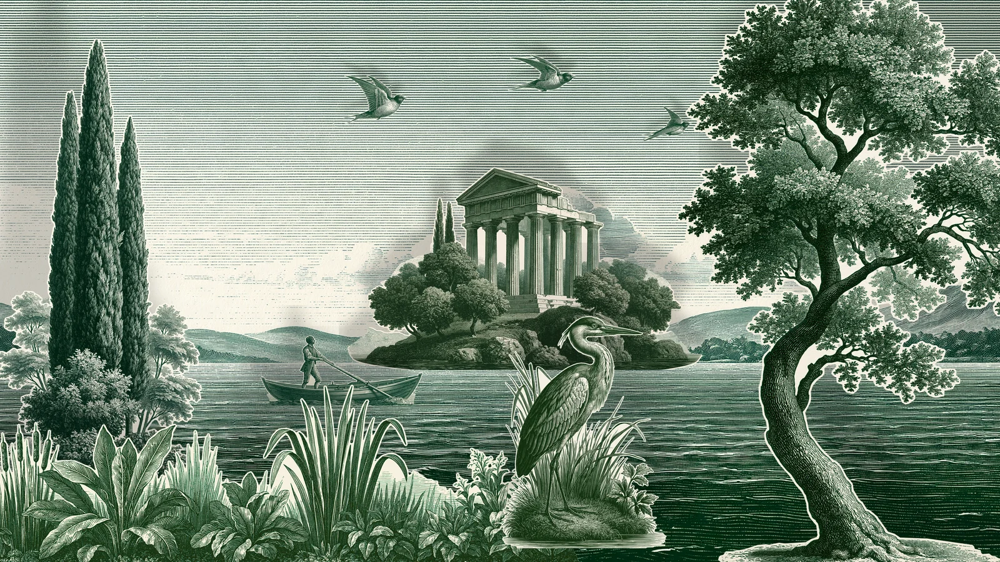

# paper-theatre

A Victorian toy theatre set in front of you as you scroll. The stage opens
empty, a bare back wall inside the proscenium. Then it is set the way the
paper theatres sold "a penny plain, twopence coloured" were set on a kitchen
table: the backcloth let down from the flies, the set piece (a ruined temple
on its island) slid on along its groove, a cypress wing pushed in from the
left and an oak wing from the right, three swallows lowered on threads, the
boatman and the heron pushed on, and the ground row of reeds raised from the
slot at the front. Every piece is a card cut out of an engraved sheet: absent
until its turn, it comes on from where a stagehand would bring it and stops
on its mark. Last the footlights come up, and each card throws its shadow up
and back onto the scene behind it, larger and softer the further it stands
in front of what it falls on. Scroll back and the stage is struck in reverse.
Move the pointer (or tilt the phone) and your eye moves: the near cards slide
against the far ones.

```html
<link rel="stylesheet" href="paper-theatre.css">
<section data-paper-theatre data-src="assets/stage.json">
  <div class="pt-stage">
    
  </div>
</section>
<script type="module" src="paper-theatre.js"></script>
```

You can also `import { paperTheatre } from './paper-theatre.js'` and call
`paperTheatre(section, { src, mode, runway })`. It returns `destroy()`.

## Options

| attribute     | option   | default  | what it does |
|---------------|----------|----------|--------------|
| `data-src`    | `src`    | required | The stage JSON: its size (2400 x 1350 units), the wall colour, the backcloth, the footlight (position and depth), and each piece's mark (`x`, `y`, `w`, `h`), depth `z` (0 the backcloth, 1 the front), how it comes on (`left`, `right`, `fly`, `rise`) and its `window` in the scroll. Images are named in it and sit beside it. |
| `data-mode`   | `mode`   | `scroll` | `scroll`: a pinned stage on a runway. `static`: the set stage. |
| `data-runway` | `runway` | `440`    | Section height in svh. The stage is pinned for `runway - 100` svh of travel. |

The schedule (fractions of the runway): the empty stage to 0.04, backcloth
0.04-0.16, temple 0.16-0.27, cypress 0.27-0.37, oak 0.37-0.47, swallows
0.47-0.58 (one after another), boat 0.58-0.68, heron 0.68-0.78, reeds
0.78-0.88, footlights 0.90-0.98. Each piece has its own turn, so on a phone
the camera can follow it.

Events (bubbling, for sound later): `paper-theatre:piece` with
`detail: { name, enter }` as each piece starts to come on while scrolling
forward, `paper-theatre:lamps` when the footlights come up, and
`paper-theatre:done` when the stage is set.

## The real thing

- **The sheets.** From about 1811 London printers (West, then Skelt, Webb and
  Pollock, the last in Hoxton) engraved the scenes and characters of the
  plays then running and sold them a penny plain, twopence coloured. The
  buyer cut them out, pasted them on card and stood them on a wooden stage.
  Ours are "penny plain": one ink, green, on cream.
- **How a stage is set.** The backcloth hangs at the back. Wings stand in
  grooves down each side, so the scene seems deeper than the stage is. Set
  pieces stand between them, a ground row hides the floor at the front, and
  the characters come on from the wings on slides or wires.
- **The cut.** A card cut out with scissors keeps a thin margin of the white
  paper round the printed line and is cut in short straight snips. Pockets
  of paper too small to bother with stay in.
- **Footlights.** A row of small lamps or candles along the front edge. A
  card's shadow is its outline projected from the lamp onto what stands
  behind it, so it is a little larger than the card and sits above it, and
  its edge is softer the larger the gap between the card and what the shadow
  falls on.

Simplified: every shadow is projected onto the backcloth's plane (drawn in
depth order it still darkens the cards behind, but with the cloth's
geometry); the lamps are one point light with a baked penumbra; the cards
stop dead on their marks (they don't rock in their grooves or swing on
their threads); no characters speak and nothing is coloured (a
"twopence coloured" ending was tried and taken out: the plain print reads
better; the script is kept in the kit).

## How it works

**Offline (Python, in `tools/watercolour-kit/paper-theatre/`; the full-size
cut flats are in `library/ornaments/midjourney/theatre/`).**

1. *The sheets.* Each flat was generated on Midjourney on its own sheet of
   plain paper with the master scene as a style reference, so every card
   shares one hand and one ink (prompts in `assets/credits.json`).
2. *The cut* (`cutout.py`). The paper colour is read from the sheet's
   edges and each pixel's optical density against it, `D = -ln(colour /
   paper)`, says what is ink. Strokes closer than about 9 px are joined into
   one shape (a morphological close), specks are dropped, enclosed paper
   smaller than 0.4% of the sheet stays, larger openings are cut out. The
   shape is grown by a 7 px paper margin, smoothed, traced, and simplified
   into short straight segments (the snips), then filled at 4x and
   downsampled for an anti-aliased edge. Pieces that stand in a groove get a
   straight base, cut where three quarters of their columns already end. A
   sheet with several pieces (the swallows) is split into one card each.
   Where Midjourney drew background in the same ink (hatched clouds and hills
   behind the temple; the reeds running off both ends of their sheet), a few
   hand-placed polygons leave it outside the cut, the way flower-border uses
   polygons for what its colour rule misses.
3. *The stage* (`export_theatre.py`). Each card is placed on a 2400 x 1350
   stage, scaled to 1.2x its drawn size (never above its source), and saved
   as RGBA WebP. Its shadow sprite is its silhouette at half size, blurred by
   a penumbra of `3 + 140 (k - 1)` stage px, where `k = Lz / (Lz - z)` is
   how much the lamp enlarges it. `stage.json` holds the marks and schedule,
   `scene.webp` the set stage drawn with the same geometry (the no-JS and
   reduced-motion picture).

**In the browser.** One Canvas 2D, no WebGL.

- Scroll is followed on a critically damped spring (quicker going back).
  Each piece's position is a pure function of that progress: absent before
  its window, then pushed along its path with an ease-in-out (a hand starts
  gently and slows onto the mark).
- Depth: the eye offset (pointer, or `tilt.js` on a phone) moves each layer
  by `(1 - z)`, so the backcloth moves most and the front ground row least
  against the proscenium. The backcloth is drawn 6% oversize so its edges
  never show.
- Shadows: before each card, its sprite is drawn scaled by `k` about the
  lamp's position and offset to match, at an opacity that rises when the
  footlights come up. The lamps also warm the bottom of the stage and dim
  the top a little.
- Camera: on a wide screen, the whole proscenium. On a phone (narrow and
  tall) it goes in until the opening fills about 60% of the screen height,
  pans sideways to the piece being set, and pulls back to 1.25x for the
  footlights. It is a function of scroll only, smoothed along it.
- Everything outside the opening is clipped, so a wing waiting in the wings
  is really offstage. The opening gets a fine double rule.

## Theming

| variable      | default         | used for |
|---------------|-----------------|----------|
| `--paper`     | `#f3f0e8`       | the page round the stage |
| `--pt-gutter` | `var(--gutter)` | side padding of the stage (the demo uses 5px on phones) |
| `--pt-runway` | set by the script | section height in scroll mode |

The back wall colour, the stage size and the lamp are in `stage.json`.

## Accessibility and motion

- Without JS, or with reduced motion, the set stage is an ``. The
  canvas is `aria-hidden`; the art is ornament (`alt=""`), credits are in
  `assets/credits.json`.
- If reduced motion is switched on mid-visit, the animation stops and the
  picture shows.
- Phone: the stage has `touch-action: pan-y`, a swipe always scrolls, and
  tilt moves the eye once iOS has asked (first tap).
- No UI and no captions on the page; the piece is driven by scroll.

## Cost

- Assets 3.45 MB: backcloth 1.2 MB, the oak 0.5 MB, the other cards
  0.01-0.3 MB each, shadows a few KB each, the picture 0.6 MB, JSON 3 KB.
  The cards are 1.2x their drawn size, which is sharp up to about a
  1,400 px wide stage at 2x; the Midjourney sheets (1,800-3,800 px) were not
  upscaled.
- One canvas, about twenty image draws a frame. A frame draws only while the
  scroll spring or the eye is moving and the section is on screen
  (IntersectionObserver); a phone with tilt active keeps drawing while the
  section is visible. DPR capped at 2.

## Credits

All the art is Connor's, generated on Midjourney (see `assets/credits.json`
for each prompt and job). The cutting, placing, shadows and runtime are ours.
`tilt.js` is the house helper.
