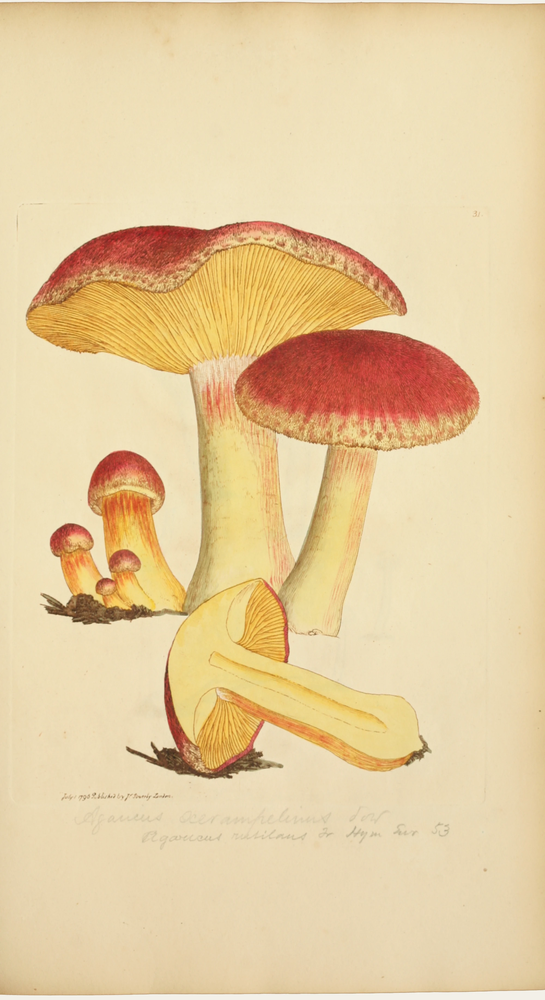

# plums-and-custard

James Sowerby's plate of the "plums and custard" fungus, made in front of you as you scroll, in the
order it was made in 1796. It starts as a bare leaf of the book. The inked copperplate is pulled
through the rolling press: a roller crosses the sheet top to bottom and the etched drawing comes up
behind it, crisp and black-brown, with the lettering and the plate mark, on paper still dark with the
damp it was printed on. Then the colourist works pigment by pigment over the whole sheet, the way a
hand colourist with one colour on the brush did: crimson on every cap (the big cap tipped up to show
its gills, the cap seen from above, the cut section, the knot of buttons), then chrome on every gill,
then straw on the stems and the cut flesh, then brown on the ground; the figures overlap in time,
each a little after the last. The washes are flat, with a wet front that creeps out from the brush,
is slowed by the engraved lines and stops at the outline, darker and glossy while wet, drying a
shade lighter with a rim. When they are dry the finishing touches go on all over, stroke by stroke,
the figures interleaved: deeper crimson in the scales, orange between the gills (laid round the fan,
gill by gill), pink in the striae of the stem. The whole leaf is in view the whole time: no zoom, no
camera. Much later a reader pencils the modern name
under the plate. The last frame is the scan, pixel for pixel. Scroll back and it un-makes.

It is a drop-in section: a portrait leaf (about 0.55:1) with its real top and bottom edges and a
tight shadow, on the page between two paragraphs. Nothing on it is a caption or a control.

```html
<link rel="stylesheet" href="plums-and-custard.css">
<section data-plums-and-custard data-src="assets/plate.json">
  <div class="pc-stage">
    
  </div>
</section>
<script type="module" src="plums-and-custard.js"></script>
```

You can also `import { plumsAndCustard } from './plums-and-custard.js'` and call
`plumsAndCustard(section, { src, mode, runway, webgl })`. It returns `destroy()` (which also has a
`destroy.seek(p)` for tools that want to set progress directly).

## Options

| attribute     | option   | default  | what it does |
|---------------|----------|----------|--------------|
| `data-src`    | `src`    | required | The plate's JSON (size, reference paper, the leaf's edge insets, stage timings). Beside it: `<name>.webp` (the scan), `-paper.webp` (the bare leaf), `-print.webp` (the uncoloured impression), `-wash.webp` (after the flat washes), `-mapa.webp` (lossless, half size: R wash arrival, G finishing arrival, B pencil arrival) and `-mapb.webp` (lossless, full size: R the leaf's real edge, G the pencil, B the engraved line). |
| `data-mode`   | `mode`   | `scroll` | `scroll`: a pinned stage on a runway. `static`: the finished plate as an image. |
| `data-runway` | `runway` | `560`    | Section height in svh. The stage is pinned for `runway - 100` svh of travel. |
| `data-webgl`  | `webgl`  | `on`     | `off` leaves the finished plate as an image. |

Stage timings are fractions of the runway, in the JSON's `stages`: the pull 0.035-0.115, colouring
0.15-0.865, the pencil 0.885-0.935, then the finished plate. Inside colouring (set in `s6_times.py`):
crimson 0-22% plus 4% per figure (big cap, cap from above, section, buttons), chrome 20-42%, straw
38-58%, ground 50-64%; finishing touches from 56% (+4% per figure) to 92-98%.

Events (bubbling, for sound later): `plums-and-custard:stage` with `detail: { stage }` as each pass
begins while scrolling forward (`print`, `colour`, `pencil`), and `plums-and-custard:done`.

## The real thing

The plate is tab. 31 of James Sowerby's *Coloured Figures of English Fungi or Mushrooms* (London,
published in numbers 1796-1815, 440 plates), imprinted "July 1 1796 Published by J. Sowerby London".
Sowerby named it *Agaricus xerampelinus*; Fries called it *Agaricus rutilans*; it is now
*Tricholomopsis rutilans*, plums and custard. The copy is the New York Botanical Garden's
(LuEsther T. Mertz Library), photographed for the Internet Archive.

What we modelled, from how such plates were made (intaglio printing; hand colouring from a pattern
copy; the house's notes in `hand-colouring/notes-real-thing.md`):

- **The pull.** An etched copperplate is inked, wiped, laid face up on the press bed under a sheet of
  dampened paper and run under the roller. The drawing comes up in one pass, behind the roller, with
  the plate mark round it. Fresh ink is a touch blacker and glossier; the damp leaf is a shade darker
  until it dries.
- **Washes, pigment by pigment.** Gum-water colours laid flat and led up to the line; the wet front
  creeps irregularly (uneven sizing), is held back by the raised ink of the engraved lines and stops
  at the outline. Wet paint is darker and glossy, with a bead at the moving edge; drying, it lightens,
  pulls a rim to its edge and settles into the tooth. The order (one pigment across all the figures,
  then the next) is ours, chosen the way a colourist with one colour loaded works; it is not
  documented for this sheet.
- **Finishing touches.** Once the washes are dry, the residual colour goes on as separate
  touches, wet-on-dry, each laid from one end; the gills' are laid round the fan from the stem.
- **The pencil.** "Agaricus xerampelinus Sow / Agaricus rutilans Fr Hym Eur 53" is a later reader's
  hand (Fries's *Hymenomycetes Europaei* is 1874). It is written last, left to right.

Simplified: the split into print, washes and finishing is computed from the finished plate, so it is a
reconstruction. One wash per area (no glazing). The plate mark and the old stains of the leaf come up
with the print (they are low and faint and the pull is the moment the leaf changes). The time is
compressed into scroll.

## How it works

**Offline** (Python, in the builder's scratch folder: `s1_sheet.py` … `s7_export.py`, about 390 lines;
numpy, scipy, scikit-image, scikit-learn, Pillow). All of it in linear-light optical density
`D = -ln(colour / reference paper)`, so layers add the way ink and transparent washes do.

1. *The leaf.* The Archive's raw camera frame (4368×2912, the book open on a cradle) is turned
   upright and cropped between the gutter and the fore-edge, keeping the leaf's real top and bottom
   edges as an alpha (2000×3665).
2. *The line.* A printed stroke darkens even the least-absorbed channel; a wash does not. That
   channel against its local mean and its local ground gives the line mask; it is inked warm
   black-brown (#28201a) on the leaf's own paper, never more than 0.45 darker than it ends.
3. *The bare leaf.* Figures, lines and pencil are inpainted from the paper around them (normalised
   convolution at growing scales), smoothed, and given the paper's own fine grain back (borrowed from
   unworked paper nearby). Everything else on the leaf comes up with the print.
4. *Wash areas.* Each coloured pixel gets a figure (hand-drawn outlines that follow the engraved
   lines) and a kind (crimson, chrome, straw, ground, from the colour of the wash under it); the
   connected pieces, with crumbs folded into neighbours, are the washes (33).
5. *The flat wash and the rest.* In each area the wash is half its median colour and half its colour
   smoothed inside the area (σ 18 px), at 55-85% of the density depending on the kind, scaled down
   per pixel so it never exceeds what is there. The finishing touches are what remains.
6. *Times.* Washes: a geodesic sweep from sources along the area's long axis, slowed by the engraved
   lines and by sizing noise, each area in its slot of its figure's window. Finishing: the residual is
   split by watershed into touches, ordered round the fan (gills) or top-down, each laid from one end.
   Pencil: left to right, upper line first.

**In the browser.** One quad, one fragment shader (WebGL2; WebGL1 without the wet blur or the phone
zoom). Per pixel `L1 = D(print) - D(paper)`, `L2 = D(wash) - D(print)`, `L3 = D(O) - D(wash)`, and the
shown density is `D(paper) + c1·L1' + c2·L2' + c3·L3'`, where `c` is each pass's arrival from its map
(the print from the roller's position) and the primes are the wet looks, which ease into the real
layer as each part dries. The colour is `O · exp(-(D - D(O)))`, which is `O` exactly when everything is
down and dry. The canvas draws the leaf itself, with its real edge and a tight shadow; no vignette.
Scroll is followed on a critically damped spring. The whole leaf is always in view, fitted to the
stage (on a phone it fills the width); there is no zoom and no camera.

## Theming

| variable      | default         | used for |
|---------------|-----------------|----------|
| `--paper`     | `#f3f0e8`       | the page around the leaf (read from the section's background) |
| `--pc-gutter` | `var(--gutter)` | side padding of the stage (the demo uses 5px on phones) |
| `--pc-runway` | set by the script | section height in scroll mode |

## Accessibility and motion

- Without JS, without WebGL, or with `data-webgl="off"`, the finished plate is an `` (page colour
  composited beyond the leaf's edges). The canvas is `aria-hidden`; the art is ornament (`alt=""`).
- Reduced motion: no runway, no canvas, the finished plate. If the setting changes mid-visit it
  settles on the finished plate.
- Nothing is interactive, so a swipe always scrolls. No UI, no caption.

## Cost

- Assets about 3.6 MB: scan 0.4 MB, print 0.7, wash 0.7, paper 0.08, maps 1.8 (lossless), JSON under 1 KB.
- One full-screen quad, about twelve texture reads per pixel. A frame is drawn only while the scroll
  spring moves and the section is on screen; nothing runs at rest, off screen or in a hidden tab.
  DPR capped at 2.

## Credits

James Sowerby, *Coloured Figures of English Fungi or Mushrooms*, tab. 31, *Agaricus xerampelinus*
(1 July 1796), etching with hand colouring. New York Botanical Garden, LuEsther T. Mertz Library copy,
digitised by the Internet Archive (`colouredfigureso00sowe`, raw leaf 0121); public domain. See
`assets/credits.json`. The separation into passes and the time maps are ours. No third-party code.

Sources for the essay: Glasgow University Library, "James Sowerby: Coloured Figures of English Fungi"
(the 440 drawings, the models, *English Botany*); the plate's own imprint and plate number; Camille
Sourget's bibliographic description (parts, plates, "hand-colored at the time").
