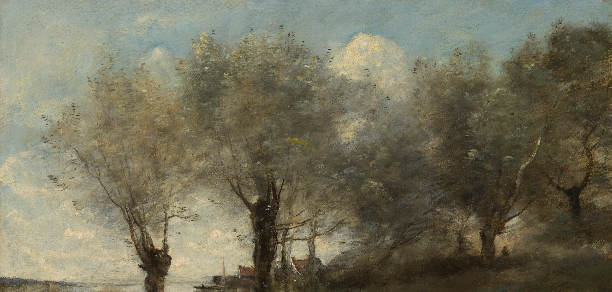

# rain-pond

A summer squall crossing Corot's willows, scrolled through as one weather
event, with the painting taking part. The painting is cut at its far
waterline: above it the bank is Corot's, below it the pond is made live, a
mirror of that bank seen at a glancing angle. Scroll, and:

1. **Calm.** A still mirror, in Corot's own slightly silvery colour.
2. **The squall comes in.** The light goes (the bright sky darkens first,
   contrast drops, the colour cools to a blue-green grey with the willows
   still olive) and a slanted grey wall of rain, with a ragged leading edge
   and darker streaks hanging from the cloud, advances across the far bank
   from the left, swallowing the willows. Its reflection comes with it.
3. **Wind and the first drops.** A gust: dark cat's paws race across the
   water (patches of fine ripples that kill the mirror where they pass) and
   the painted willows move, crowns swaying as masses, the light switches
   fluttering, the trunks still. The first fat drops land, with crowns and
   Worthington jets.
4. **Downpour.** Sheets of rain sweep across in waves, leaning with the wind;
   the far bank is half lost in haze; the surface is covered in small rings
   with splash points and little jets standing up, and near you drops bounce
   up as crowns; the reflection breaks into a grey shimmer.
5. **Clearing.** The rain eases from the left as the squall moves off to the
   right: half the pond calm, half still grey. Last drips fall from the
   willows.
6. **Sun.** A warm light passes across the bank, a glitter path opens on the
   water under the bright cloud, and the colour comes back fuller than it was
   at the start.

A finger or pointer drawn over the water leaves a wake; a tap lets a single
drop fall.

```html
<link rel="stylesheet" href="rain-pond.css">
<section data-rain-pond>
  <div class="rpd-stage">
    <figure class="rpd-pic"></figure>
  </div>
</section>
<script type="module" src="rain-pond.js"></script>
```

The section is the scroll runway (`480svh`); the stage inside it is pinned
while you scroll through, and the whole shower happens inside that runway.
The `` must be a picture of a bank **cut at its waterline** (the bottom
edge of the image is the line where bank meets water). The piece is a
full-bleed band: the stage's whole width and about 88% of its height, bank
above and water below. The painting covers the bank's area anchored at the
waterline, so on a wide screen its sky runs off above the band (it is kept in
the texture, for steep ripples to reflect) and on a phone it is cropped
around `data-focus`. Only the top (~8.5%, a long, quiet, slightly uneven
contour where the sky meets the paper) and the bottom (~5%) fade; every
other pixel is the painting and its reflection, sharp. Or call `rainPond(section, options)` yourself; it returns
`destroy()`. The section also gets `section.rainPond` with `destroy()`,
`drop(x, y, mm)` (fractions of the water, size in mm) and read-only
`progress` / `state`.

## Options

| attribute | option | default | |
|---|---|---|---|
| `data-seed` | `seed` | `11` | the shower is the same on every visit for one seed |
| `data-density` | `density` | `1` | scales the number of drops (and how grey the pond goes) |
| `data-strength` | `strength` | `1` | scales every drop and wake |
| `data-focus` | `focus` | `0.36` | 0-1 across the painting: the centre of the crop on narrow screens |
| `data-water` | `water` | by aspect | water height / bank height (0.56 landscape, 0.95 portrait) |
| `data-mono` | `mono` | `0.85` | the painting's colour at the start (1 = Corot's full colour); the storm cools and drains it to ~0.58, the sun brings it to 1.18 |

The options object wins over the attributes. `--rpd-runway` (CSS) sets the
runway length.

## Events

All bubble from the section, for sound to be wired to later.

| event | detail | when |
|---|---|---|
| `rain-pond:drop` | `{ size, x, y, kind }` | a drop lands. `size` in mm (0.4-4.5 for rain, 3.4 for a tap); `x`, `y` 0-1 across / down the water (0 = the far bank); `kind` is `rain`, `tap` or `droplet` (the secondary droplet a Worthington jet throws back). In the shower this fires 150-250 times a second: a sound layer should treat small sizes as a hiss, not one sample each |
| `rain-pond:drip` | `{ size, x, y }` | a fat drop (5-6.5 mm) from a branch tip lands near the bank |
| `rain-pond:rain` | `{ intensity }` | the shower's strength (0-1) changes by more than 0.05 |
| `rain-pond:gust` | `{ strength }` | the gust arrives (once each time it is scrolled into) |
| `rain-pond:sun` | `{ warmth }` | the sun breaks through (once each time) |

## Theming

| variable | default | |
|---|---|---|
| `--paper` / `--rpd-paper` | `#f3f0e8` | what the picture melts into at its edges |
| `--rpd-body` | the painting's lower third, darkened | the pond's own colour, seen where it does not reflect |
| `--rpd-sky` | the painting's top rows | what the steepest ripples reflect |
| `--rpd-mist` | a grey of the painting's mean | the veil of rain and the colour a rained-on pond goes |
| `--accent` | clay | keyboard focus ring |

## The real thing

What was modelled (notes in the brief, from Worthington's *A Study of
Splashes*, Pumphrey & Crum, Oguz & Prosperetti and Le Méhauté's work on
gravity-capillary rings):

- **Glancing view.** The far bank is 2.4 times further than the bottom of the
  frame; each row of the water grid is a strip of pond whose world width
  grows as 1/distance and depth as 1/distance². A ring is a flat ellipse
  (about 1:1.6 near you, about 1:4 under the bank) and crawls slower on
  screen the further away it is.
- **Reflection.** A mirror of the bank across the waterline. The surface
  slope toward or away from you tips the reflected ray up or down the bank by
  twice the slope (so a 2% slope moves the picture ~40 px, and a steep crest
  shows the open sky above the trees); a sideways slope shifts it by less
  (times the sine of the glancing angle), which is why reflections smear
  vertically. Fresnel (Schlick) with the facet's own tilt: the far water is a
  bright mirror, the near water shows more of its own dark body.
- **Rings.** The wave equation plus surface tension (short ripples outrun
  long ones, so a drop leaves a train of 3-5 crests, finest outside) and
  viscosity (short ripples die first); rings superpose and pass through each
  other; they fade within 1.5-2.5 s.
- **Drops.** A crater with a lip; drops over 1.2 mm rebound (the column
  springing back); over 2.3 mm a crown flashes for 60 ms and a Worthington jet
  rises and falls in 0.2 s, its reflection below it, and over 2.8 mm the jet
  usually pinches off a droplet that rises, falls back at ~0.35 s and makes
  its own small ring. A bright fleck marks each splash for ~0.1 s.
- **The shower.** Size sorting: the first drops are few and fat (mostly
  2.4-4.5 mm, simulated, with crowns and jets), the steady shower is many and
  small (0.4-1.6 mm: 300-450 a second on a desktop, two to three hundred
  rings alive at once, each a short train of crests with a bright splash
  point, gone in about half a second), the easing mixes both.
- **Small rings** are written straight into the slope field rather than
  simulated: a two-or-three-crest packet leaving the splash at ~25 cm/s,
  flattened by the same perspective, fading with a 0.28 s time constant. The
  grid (2 x 1.5 css px) is too coarse to carry millimetre drops' ripples
  without turning them into grid noise.
- **Grey.** Recent rain (a lagged measure, ~1 s up, ~1.5 s down) roughens the
  whole surface below the sim's scale: a fine field of slopes re-dealt ten
  times a second in place (no drift: there is no wind) that scatters each
  reflected ray by a few tens of px, so the trunks and gaps of sky still read
  as broken vertical patches; a little of a softened bank, a little sky, a
  grey veil and a slight darkening. The far shoreline loses its crisp edge.
  Rain streaks: thin, slightly slanted, of varied length, drawn so they only
  ever lighten what is behind them: visible against the trunks and dark
  water, lost against the sky, never over the paper.
- **Drips.** Nine fixed branch tips on the painting; each drips on its own
  beat, quick while the leaves run with water (every ~2 s), slower as they
  drain (every ~7 s), then not at all. The drop is seen falling, lands a
  little in front of the bank, and makes the biggest rings of all.

- **Squall and gust.** A rain shaft seen from afar is a grey, leaning
  curtain from the cloud base to the water, streaked by denser and thinner
  shafts; it brings a gust ahead of it. Cat's paws are patches of capillary
  ripples raised by the gust: they move with the wind (here ~260 css px/s
  near you, slower in perspective far off), and because they are rough they
  show the water's dark instead of the mirror.
- **Glitter path.** The sun's reflection on a rippled surface is a column of
  glints, each a facet tilted to send the sun to your eye: narrow and dense
  far out, wider and sparser toward you.

Simplified: the squall is drawn, not simulated (no real depth; the veil sits
on the bank's plane); the willows' sway is a displacement of the painting,
not a tree model, so the sky behind them drifts a little with it; the small rings are drawn a little larger and longer-lived than
a millimetre drop's (crests 4-8 px apart near you, so the slope texture can
carry them); the far pond's sub-pixel rain rings are represented by the
roughness field; the bank is one plane at one distance, so reflections of trees
nearer or further than the bank are mirrored at the same line; no bubbles
(only their sound would show), no wind.

## The weather

`weather(p)` in `rain-pond.js` gives, for scroll progress `p`, every
quantity the shader and the rain need: storm darkness, the squall veil's
leading and trailing edges (it moves left to right), haze, wind, gust, rain
sheets, where on the pond it is raining (another pair of edges), the sun's
warmth and the passing band of light, and the glitter. All of it is applied
in one function, `atmos()`, to a point of the bank, and the water reflects
the bank through the same function, so the veil, the storm light and the sun
appear in the reflection by themselves. The willows' movement is a
displacement of the bank texture (`sway()`), by height above the water:
nothing at the trunks, mass sway and flutter in the crowns.

Phases at a glance (p): calm 0-0.06, squall 0.06-0.27, wind and first drops
0.27-0.4, downpour 0.4-0.62, clearing 0.62-0.8, sun 0.8-1.

## How it works

- **Grid.** About 720 x 190 cells on a desktop (2 css px across, 1.5 down),
  stepped 72 times a second on the CPU, with viscosity and a
  hyperviscosity that takes out grid-scale ripples. Each row has its own Laplacian
  weights (1/width², 1/depth² of that strip of pond), which is all the
  perspective the physics needs. The sides and near edge absorb (the pond
  goes on); the far bank reflects.
- **Texture.** World slopes across and toward you, square-root encoded (fine
  steps near flat, still room for a crater) into an RGBA8 texture, plus the
  splash flecks. No float textures.
- **Shader.** One fragment shader draws the bank (1 texel per device px),
  the water (mirror sample displaced by the slope, blurred bank mixed in by
  roughness, Fresnel, body colour), the colour (desaturated until the rain
  clears) and the top and bottom fades (a mask built once per size).
- **Air.** A 2D canvas over it draws the streaks, crowns, jets, droplets and
  falling drips, masked by the same soft edge.
- **Schedule.** Intensity, the share of fat drops, drip beats and colour are
  functions of scroll progress; the drops themselves come from a seeded
  Poisson process in real time. Stop scrolling in the shower and it keeps
  raining; left alone for 40 s, the shower passes on its own and comes back
  when you scroll.

## Tuning

Constants at the top of `rain-pond.js`: `RATIO` (how far the bank is),
`GLANCE` (how flat the rings are), `SPEED` / `TENSION` / `VISCOSITY` / `HZ`
(ring speed and how much of a train each drop makes), `DECAY` (how long rings
last), `SLOPE` (encoding range), `PEAK` (drops a second in the shower),
`dropR` / `dropA` (simulated ring size and strength by drop size), `SMALL`, `RING_V`, `RING_T` (the analytic small rings), `DRIPS` (branch tips
as fractions of the painting; move them if you use another picture). The
shower's shape is `rateAt`, `fatAt`, `dripPeriod` and `satAt`.

Another painting works if it has a clear far waterline near its bottom edge
and some sky above the trees (the sky is what rings flash with). Crop it at
the waterline.

## Accessibility and reduced motion

- The painting is decorative (`alt=""`, `aria-hidden`), the canvases are
  `aria-hidden`.
- The figure is focusable: Enter or Space lets a drop fall, the left and
  right arrows draw a wake across. A visually hidden `aria-live` line names
  the phases as you scroll through them (the first drops, steady rain, the
  rain eases, drips from the willows, the mirror returns).
- `prefers-reduced-motion: reduce`: no runway and no rain. The scene just
  after the shower, in full colour, with four rings caught part way out.
  Nothing moves and touch does nothing.
- `touch-action: pan-y` on the figure: a vertical swipe always scrolls the
  page (a finger moving over the water as it scrolls leaves a wake); taps
  drop.
- Print shows the plain painting.

## Cost

- Nothing runs while the pond is still: at the start, after the weather has
  come to rest, off screen and in a hidden tab. Scrolling while the water is still only redraws when the colour
  changes.
- In the downpour, the heaviest moment: about 5.7 ms of script a frame on a
  laptop (measured: `section.rainPond.state.ms`, a running average), with
  small rings capped at 220 at once; one full-screen draw (about twenty
  texture reads a pixel on the water), a few hundred strokes on the air
  canvas. 60 fps.
- While the weather is moving (wind, the veil's drifting shafts, sheets, the
  glitter path) the loop runs; left alone for 40 s it all comes to rest
  (rain passes, wind drops, glitter fades) and the loop stops, until the
  next scroll.
- Canvas DPR capped at 2. The painting is 3775 px wide (1.2 MB webp): sharp
  at DPR 2 on a 1440-1920 px desktop and in the phone crop.
- Without WebGL or with a cross-origin image, the painting stays, its sky
  fading into the paper.

## Credits

- Camille Corot, *A Pond in Picardy*, ca. 1867. The Metropolitan Museum of
  Art, Open Access (CC0). See `assets/credits.json`.
- The height-field water is ripple-pool's (this repo), laid out in
  perspective.
