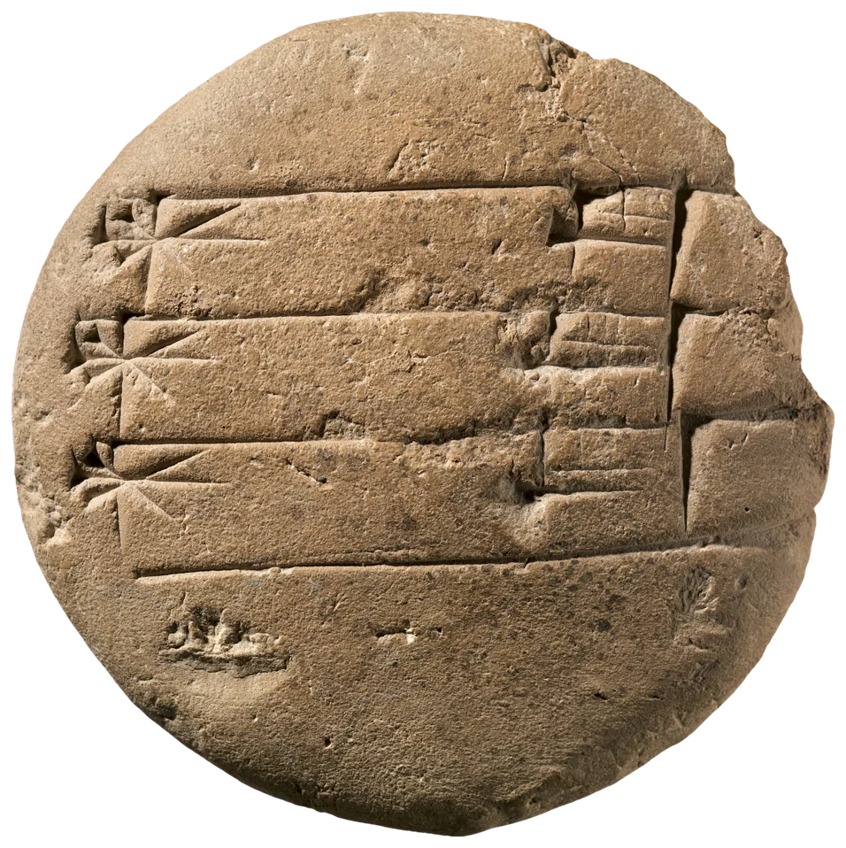
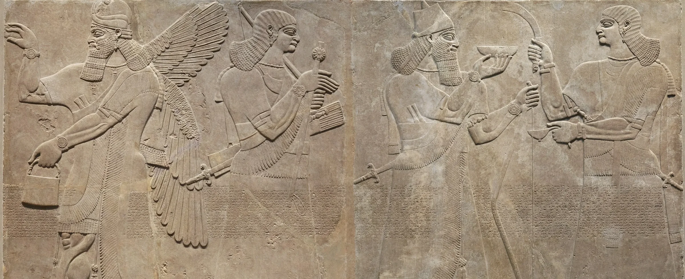

# raking-light

A carved surface relit by a low lamp. Epigraphers read worn inscriptions and
cuneiform by raking light: a lamp held nearly level with the surface and moved
around it, so every wedge and chisel cut throws a shadow and the marks leap
out. Here the pointer is that lamp (on a phone, the tilt of the phone and a
sideways drag), and a single museum photograph becomes a surface: a clay
tablet lying on the page throws its own long shadow across the paper and the
words, and the wedges of the script turn into small triangles of light and
black that change as the lamp goes round.

```html
<link rel="stylesheet" href="raking-light.css">

<!-- an object lying on the page (a cut-out): it throws a shadow on the paper -->
<figure data-raking-light data-height="63.74" data-material="clay"
        data-normal="assets/round-tablet-normal.png" data-albedo="assets/round-tablet-albedo.webp">
  
</figure>

<!-- a surface: a rectangle of wall, any crop (object-fit: cover is honoured) -->
<figure data-raking-light data-kind="surface" data-material="stone" data-height="32.33"
        data-ambient=".5" data-falloff="4.4" data-normal="assets/nimrud-relief-normal.png" data-albedo="assets/nimrud-relief-albedo.webp">
  
</figure>

<script type="module" src="raking-light.js"></script>
```

Or `import { rakingLight } from './raking-light.js'` and call
`rakingLight(figure, options)`; it returns `destroy()`.

The `` is the plain photograph and sets the size. It is what shows without
JS or WebGL, in print, and until the maps arrive. Each figure fetches its maps
only when it comes within 800 px of the viewport.

## Options

| attribute | option | default | |
|---|---|---|---|
| `data-normal` | `normal` | required | the normal/height map (PNG, lossless): r g = surface normal, b = height |
| `data-albedo` | `albedo` | required | the photo with its own studio light divided out (alpha = the cut-out) |
| `data-height` | `height` | `20` | the full range of the height channel, in texels of the map. Printed by the processing step |
| `data-kind` | `kind` | `object` | `object`: a cut-out lying on the page; the canvas reaches past it (up to its own size each side, never past the page's sides) for the shadow it throws on the paper. `surface`: a rectangle, no cast shadow |
| `data-material` | `material` | `clay` | `clay` (matte, faint sheen) or `stone` (a little more polish) |
| `data-light` | `light` | `-45 12` | where the lamp rests: azimuth and elevation in degrees. Azimuth is on the screen: `0` = from the top, `-90` = from the left, so `-45` rakes from the upper left |
| `data-cast` | `cast` | `0.6` | 0-1, how dark the shadow on the paper is |
| `data-relief` | `relief` | `1` | scales the heights (longer or shorter shadows) |
| `data-muted` | `muted` | `0.2` | 0-1, how far the colour of the object is muted toward grey |
| `data-reach` | `reach` | `6` | in object radii: past this distance the pointer stops being this object's lamp and the lamp drifts back to rest |
| `data-ambient` | `ambient` | `1` | scales the room's light. The demo's band uses `.5`: a dark room, so the lamp does the work |
| `data-falloff` | `falloff` | `2` | surfaces only: how fast the lamp's light dies across the band, `exp(falloff × along - .35)` with `along` = ±1 at the ends. The demo uses `4.4`: about 3× in brightness between the lamp's end and the far end at 25% |

The options object wins over the attributes.

## How the lamp moves

- **Desktop:** the pointer is the lamp. Its direction from the object's centre is
  the lamp's azimuth; its distance sets the elevation, from 21° when it is over
  the object down to 6° a couple of radii away. Near the very centre the lamp
  keeps the side it was on. Far away (past `reach`) it drifts back to rest.
  Leave the window and it goes back to rest. For a band, "radius" is half its
  height, so sweeping along the band runs the lamp low, high, low.
- **Phone:** turning the phone left or right swings the lamp up to ±100° round
  the object; tipping it toward you lowers it (`tilt.js`, shared, smoothed, its
  level drifting back over about 12 s). A sideways drag on any piece turns the
  lamp too (260° across the screen); a vertical swipe scrolls the page as usual
  (`touch-action: pan-y`). Six and a half seconds after the last touch the drag
  is let go and the lamp returns.
- **Keyboard:** each piece is focusable. Left and right arrows walk the lamp
  round by 20°, up and down raise and lower it by 3°; Escape sends it back.
- **Always low.** The elevation is clamped to 5°-25°. A frontal light would
  just give back the flat photograph.
- **A hand-held lamp.** It follows through a critically damped spring
  (`STIFF = 6.5`/s): a little lag, no overshoot, settled in about a second.

## How it works

**Offline (Python), from one evenly lit photograph:**

1. **Cut-out** (objects): a chroma threshold against the studio backdrop seeds
   GrabCut, the largest component is kept and its holes filled, the outline is
   smoothed and pulled in 2 px, and the alpha is a signed distance with about a
   pixel of anti-aliasing.
2. **Large form:** Depth Anything V2 Small
   (`depth-anything/Depth-Anything-V2-Small-hf`, run locally through
   `transformers`) at about 1000-1400 px. Its output is smoothed past its
   14 px patch grid (which otherwise shows as faint stripes under grazing
   light); for the wall the camera's perspective lean (a fitted plane) and the
   slowest swell are taken out. This gives the relief figures standing off the
   ground and the pillow of a tablet.
3. **Fine carving:** soft frontal light leaves the bottom of every cut darker
   than the open surface, so *dark is deep*. Log-luminance is band-passed at
   four scales (differences of Gaussians, 0.7-18 px) with per-object weights
   (the round tablet's wedges are big, so its finest bands are turned down; the
   fragment's script is fine, so they stay up). A soft knee keeps one dark crack
   from becoming a canyon, and **shrinkage** (soft-thresholding at 28-45% of the
   95th percentile) throws away faint mottle (stains, grain, sensor noise) that
   would otherwise read as orange peel under a low light, while strong marks
   keep their depth. Then **isolated blobs are taken out**: a grey closing by a
   line segment at 8 angles, keeping the minimum, fills any dark spot shorter
   than the segment whichever way it lies, while a carved stroke survives along
   its own direction (bright specks likewise, by opening). Segment 11 px for the
   round tablet (its pits are stains, not writing), 9 for the relief (the
   dressed stone between the figures reads smooth), 5 for the fine-script
   fragment. What is taken out of the height stays in the albedo, as a stain.
4. **Objects get a rim:** the height rolls down to the paper over about 7% of
   the object's size. The rim is built from a heavily blurred alpha, not a
   distance transform (whose staircase becomes a saw-tooth in the normals), and
   eased out so the dome has no knee.
5. **Normals** from the combined height (Sobel), and the height itself in the
   blue channel, normalised; its range in texels is the `data-height` value.
6. **Albedo:** the photo's own lighting is fitted (ambient + one soft light
   from the upper left against the recovered normals, least squares) and
   divided out (to the 0.85 power, so it is not flattened lifeless), with a
   broad correction for uneven studio light; a cavity term from the height
   divides out the occlusion that soft light leaves in pits, since the shader's
   shadows will put it back. At a cut-out's rim the colour is carried out from
   just inside, so a steep, badly explained edge cannot fringe.

Map sizes are about 1.3 texels per device pixel at DPR 2 for the tablets and
0.85-1 for the band. Normal maps are PNG; lossy compression would show as
blocks under raking light.

**In the shader (one full-screen pass per piece, only while the lamp moves):**

- **Diffuse:** `albedo × (ambient + lamp × (1 - e^(-1.25x)))`, with
  `x = N·L × shadow × falloff × 1.3 / sin(elevation)`: exposed for a low lamp,
  so flat clay under it reads near its own colour, faces turned to the lamp
  glow, and faces turned away fall to a dim, slightly cool ambient. A shoulder
  above 0.8 keeps the glow from clipping.
- **Shadows:** 26 steps of a height-field ray toward the lamp, growing
  geometrically from 0.6 to about 240 texels, so a wedge's own wall and a
  raised figure's long shadow both come from the same march. The penumbra
  widens with distance (a lamp has a size). Interleaved-gradient jitter on the
  first step turns step banding into fine grain. A shadow keeps 14% of the
  lamp (light back off the walls), and a **bounce** term proportional to the
  local lamp strength keeps grooves at the lit end dark rather than black,
  while the far end of a band still falls toward the dim ambient.
- **Falloff:** the lamp is a hand-held one, close. On an object, an inverse
  square from a point a little off its near edge; on a wall, exponential along
  the light (`data-falloff`), so the end of the room away from the lamp falls
  into shadow and the whole brightness gradient flips when the lamp moves:
  measured on the demo band at 25%, 2.5-3.1× between the lamp's quarter and
  the far quarter.
- **Sheen:** a faint Blinn-Phong highlight (clay 0.05 at 14, stone 0.1 at 34).
- **Shadow on the paper** (objects): the object's silhouette, softened (drawn at
  a quarter size and scaled up), is its height above the paper, about a sixth
  of its size. Each paper pixel looks toward the lamp (14 steps) for the
  steepest angle up to the object's top and compares it with the lamp's own
  elevation across the lamp's disc (13° wide): near the object the angle is
  steep and the shadow is dark and sharp; further out it sinks toward the
  lamp's height and the shadow thins and softens. Five dithered taps across the
  light widen its sides the same way. The room's light fills it in with
  distance, and it is followed out to about the object's own size, then fades
  to nothing. A narrow contact shadow grounds the edge from every side.
- Premultiplied output on a transparent canvas, so the cut-out's anti-aliased
  edge and the shadow composite cleanly over the page. WebGL2 where available
  (mipmapped maps, so an object drawn smaller than its maps keeps a clean
  edge); WebGL1 otherwise.

## Tuning

- In the processing: `FORM` (how tall the large form stands, px) and `DETAIL`
  (how deep the carving reads), the band weights, and the shrinkage. Too much
  detail or too little shrinkage gives a crumpled, gritty surface; too little
  and the marks go soft. Look at three lamp positions side by side before
  choosing.
- In the shader: `uExpo` (exposure for a low lamp), the falloff (`fall`), the
  shadow penumbra (`.1 * t + 1.1`), `uAmb`, `uLamp` (about 3400 K), and
  `MATERIALS`. `uThick` and `uCastLen` set the shadow on the paper.
- `STIFF` sets the lamp's lag.

## Theming

| variable | default | |
|---|---|---|
| `--rl-ground` | `--paper-2` | behind a surface while it loads |
| `--accent` | clay | keyboard focus ring |

The lamp and the room are not themed: the lamp is warm, the room dim. On a dark
page the shadow on the paper (near-black ink) will barely show; it is meant for
paper.

## Behaviour and cost

- **Nothing runs when the lamp is still.** The loop runs only while the lamp
  moves (pointer, drag, tilt, the spring settling) and stops once it has
  settled; off screen, in a hidden tab, or idle, nothing runs. Verified: 0
  frames in 2 s idle; a pointer move costs about 1.5 s of frames. On a phone
  held still the lamp still eases slowly home as `tilt.js` re-levels (about
  12 s), then stops.
- Canvas DPR capped at 2. A full-width band on a 1440 px screen is about
  3.4 Mpx a frame, 28 texture reads a pixel: fine on a laptop GPU while moving.
  An object's canvas is up to 3× its size each way (room for its shadow); its
  paper pixels cost 70 small texture reads while the lamp moves.
- **Weight:** the maps are the cost. The tablets: about 0.3 MB albedo + 0.8-0.9 MB
  normal each. The relief band: 0.8 MB albedo + 2.4 MB normal (2400 × 977,
  lossless). They load only as each piece nears the viewport.
- Without WebGL, `createImageBitmap`, or if a map fails to load, the ``
  stays. If the GPU drops the context, the img shows until it comes back.

## Accessibility and reduced motion

- The images are decorative (`alt=""`, `aria-hidden`); the canvas is
  `aria-hidden` and never takes input. Each piece is focusable with a default
  `aria-label` ("A carved surface under a low lamp. Arrow keys move the lamp
  around it.") unless you set your own; focus shows an accent ring.
- `prefers-reduced-motion: reduce`: the lamp rests raking from the upper left
  (the finished, beautiful state). Hovering does nothing and the phone's tilt
  is ignored; only a deliberate act moves it: pressing on a piece and dragging
  (mouse or finger), or the arrow keys. It then moves **instantly**, with no
  easing and no return to rest: direct manipulation, nothing animating by itself.
- Text under a cast shadow keeps its contrast (the shadow is at most about 35%).
- Print shows the plain photographs.

## Credits

- Photographs: The Metropolitan Museum of Art, Open Access (CC0): a student
  exercise tablet (Old Babylonian, 321878), a commentary on *Enuma Anu Enlil*
  (321874), and a relief panel from the Northwest Palace of Ashurnasirpal II at
  Nimrud (photograph DP-346-001, via the Met's Wikimedia Commons donation).
  Details in `assets/credits.json`.
- Depth: Depth Anything V2 Small (Yang et al., 2024; Apache-2.0), run offline;
  nothing of it ships.
- After the practice of raking-light photography and reflectance
  transformation imaging (Malzbender et al., HP Labs, 2001; Cultural Heritage
  Imaging). No third-party code in the component.
