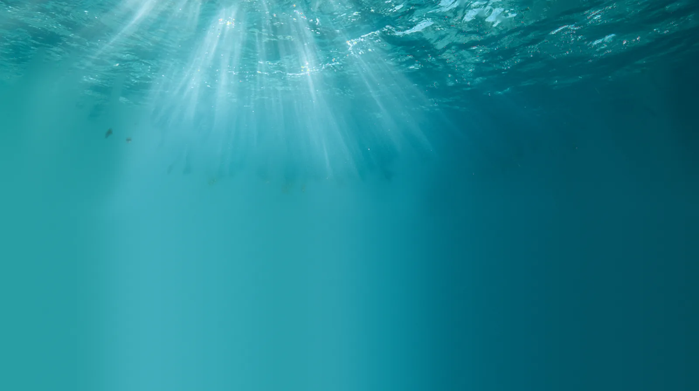

# seagrass-meadow

A hero band five metres down in a Mediterranean Posidonia meadow on a sunny
day. You lie on the pale sand and look along it: ribbons of leaf a centimetre
wide rise around you, lean and sway back with every swell, and every so often a
wave of bending rolls across the meadow as a vortex passes over the canopy.
A net of sunlight crawls over the sand and up the leaves, shafts hang in the
water, specks of marine snow drift back and forth with the surge, and the far
meadow fades into blue. Move your hand through it and the leaves part around
it and trail after it in the wake.

```html
<link rel="stylesheet" href="seagrass-meadow.css">
<figure data-seagrass-meadow>
  
</figure>
<script type="module" src="seagrass-meadow.js"></script>
<!-- optional: the sound toggle and the surge sound -->
<script type="module" src="sound.js"></script>
```

```js
import { seagrassMeadow } from './seagrass-meadow.js';
const destroy = seagrassMeadow(figure, { surge: 0.09, current: 0.12, species: 'zostera' });
destroy.pause();          // stop (the visitor's pause button does the same)
destroy.play();
await destroy.sweep();    // a hand swept through the meadow, left to right
destroy.advance(3);       // run the simulation 3 s ahead at once (tests, stills)
destroy.state;            // 'live' | 'paused' | 'idle' (offscreen, hidden tab) | 'still' (reduced motion)
destroy.renderer;         // 'webgl' or 'canvas'
destroy();                // remove everything, leave the plain figure
```

Without JS it is the ``: the open-water plate, sunlit from above.

## How it works

### The leaves

Each leaf near the camera (about 1000 on a desktop, 520 on a phone) is a chain of
eight segments rooted in the sand, simulated in SI units at 90 Hz with the forces
used for flexible seagrass by Luhar and Nepf (2011, 2016):

- **Buoyancy.** Posidonia leaves are full of air channels (aerenchyma), so the
  leaf is lighter than water and stands up in still water. Net lift per unit
  length is Δρ g b t, with Δρ = 300 kg/m³, width b of 8 to 10.5 mm and
  thickness t = 0.4 mm.
- **Bending stiffness.** EI = E b t³/12 with E = 0.45 GPa, about
  2.3 × 10⁻⁵ N m². Each joint is a couple: it swings the nodes either side of it
  back toward a straight line and the joint takes the reaction.
- **Drag** on the component of the relative flow *normal* to the leaf,
  ½ ρ C_D b |u_n| u_n with C_D = 1.95 (a flat plate), plus skin friction along
  it. Because only the normal flow pushes, a leaf that bends over sheds load:
  that is reconfiguration, and it is why the meadow leans into a current
  instead of snapping. The drag is integrated exactly (exponential relaxation
  toward the water's velocity), so a fast hand cannot make it unstable.
- **Added mass and inertia.** A leaf drags a cylinder of water with it
  (C_A ρ π b²/4 per metre), which dominates its mass, and the accelerating
  water of the swell pushes on it (the Morison inertia force).
- Segment lengths are held by a follow-the-leader projection from the root, and
  leaves cannot go through the sand, and are eased out of the hand. A little
  internal (tissue) damping between neighbouring nodes keeps the chain from
  zig-zagging when the hand drags it.

At the defaults a 0.6 m leaf has a buoyancy number B = Δρ g b t L³/EI ≈ 100 and
a Cauchy number Ca = ½ ρ C_D b U² L³/EI ≈ 650 in the swell, so drag wins and the
leaves lean well over at each peak. But the water's excursion each half wave,
A = U T / 2π ≈ 8 cm, is far shorter than the leaf, so the upper leaf mostly
rides back and forth with the water and the lower leaf stays put: the motion is
the characteristic swaying of a meadow in waves, not a flag in a wind.

Leaves grow in shoots of four to seven, fanned in one plane (distichous), the
outer ones oldest and longest. Each leaf turns its flat face to the flow and
bends about its weak axis, and twists a little along its length.

Beyond about 3 m, 6000 more leaves (3000 on a phone) are drawn by the GPU from
the steady answer of the same balance: the tip rides the orbital excursion of
the swell, and leans by drag against buoyancy in the local current.

### The water

The velocity at any point is the sum of three things.

1. **Swell.** Three linear waves with periods near 6.2 s and slightly different
   headings. Each one's wavenumber comes from the dispersion relation
   ω² = g k tanh(k h) at h = 5 m (wavelength about 40 m), and its near-bed
   orbital velocity U is set by `surge`. Their beating gives sets: every
   minute or so a few bigger waves come through. The phase k·x travels across
   the meadow at about 6 m/s, so each surge sweeps across rather than arriving
   everywhere at once. Inside the canopy it is damped by about a fifth.
2. **Current and monami.** A weak current flows above the canopy and much
   less within it (here 25 %), so there is a shear layer at the canopy top.
   Such a layer is unstable and rolls up into a row of Kelvin-Helmholtz
   vortices that travel at the mean of the two speeds (Ghisalberti and Nepf
   2002). It is modelled with Stuart's (1967) exact solution for a periodic row
   of vortices in a mixing layer: concentration ρ = 0 gives the plain tanh
   profile, and as ρ rises toward 1 the vorticity gathers into cores. Each
   vortex sweeps fast water down into the canopy on its leading side and
   lifts it on its trailing side, so the leaves under it bow and recover in
   turn: a wave of bending that travels with the vortices, which is what
   monami is. Wavelength 0.95 m. The vortices come in trains of three or
   four, their crests wobble across the meadow, and trains grow and fade.
3. **Your hand.** A sphere 10 cm across, its speed capped at a swimmer's 1 m/s. Around it, the potential-flow
   dipole of a moving sphere pushes water (and leaves) aside ahead and draws it
   in behind; leaves touching it are pushed out. Every 3 cm of travel it leaves
   a puff of momentum (0.4 of the hand's velocity) that spreads as it ages,
   decays in under a second and drifts with the swell, so leaves keep moving
   after the hand has gone.

Marine snow (a few hundred particles, 0.6 to 3 mm, sinking 1.2 mm/s) is moved
by the same water, which is the best way to see the swell is back and forth.

### The light

- **Caustics.** A periodic heightfield of ten gravity-capillary ripples
  (wavelengths 18 to 47 cm, slopes about 0.01 each, ω² = g k + (σ/ρ) k³), plus
  the slope of the long swell, which sways the whole net back and forth in time
  with the surge. A 88² grid of the surface refracts the sun (Snell, n = 1.333)
  down 5 m to the floor; each triangle's brightness is the ratio of its area
  before and after (after Evan Wallace's WebGL Water). The sun's disc, half a
  degree, blurs the net by about 4 cm at this depth, so it is never sampled
  finer than that.
- **Shafts.** The view ray is marched through the water and, at each step, the
  caustic net is looked up along the sun's direction: the shafts are the
  caustic beams themselves, so they flicker with the net and converge toward
  the sun. Henyey-Greenstein forward scattering (g = 0.72) makes them strongest
  looking toward the sun.
- **Sun.** 62° above the horizon in air; refracted, 69° under water, inside
  Snell's window, ahead and to the left like the plate's own rays. Its colour at
  5 m loses red fastest (diffuse attenuation 0.15, 0.05, 0.04 per metre), then
  is white-balanced the way the plate (and any diver's camera) is, so the
  leaves and sand sit in the photograph's colour rather than the eye's.
- **Distance.** Every surface is attenuated by Beer-Lambert per channel
  (0.42, 0.15, 0.13 per metre) and filled in by the water's colour, read from the
  plate at the horizon straight behind it, so the far meadow fades into the
  blue of the photograph rather than into a guessed colour.
- **Leaves.** Lit by the caustic sun (less of it deeper in the canopy), a sky
  and sand ambient, and light passing *through* the leaf, which comes out
  greener-yellow and is strongest looking toward the sun. Close up they show
  their parallel veins. They age from the tip: older (outer) leaves brown at
  the tip with a ragged boundary, carry a film of epiphytes toward the tip and
  small pink-white crusts of coralline algae. The base is the brown sheath.
- **Sand.** Pale carbonate sand with grain and mottling, darker with litter
  under the meadow, symmetric wave ripples in the open sand (crests across the
  surge, wavelength about 0.65 of the orbital diameter), the caustic net, and
  the leaves' own shadows projected along the sun and fading with height.

### The salema

The one Mediterranean fish that grazes Posidonia itself, *Sarpa salpa*, now
visits. A school of 34 (22 on a phone) comes in from one side about four
seconds after the meadow starts, cruises over the canopy, grazes for about
half a minute and leaves by the other side; the next visit comes 30 to 55 s
later. Each fish follows the three zones of Couzin et al. (2002): repulsion
under 15 cm, alignment to 60 cm, attraction to 1.5 m, plus the school's
heading; turning is rate-limited, speed eases, and the tail beats at
f ≈ U / 0.6 L (Bainbridge), faster and wider when bolting. While the school
grazes, a fish now and then drops to the nearest simulated leaf tip, pitches
head-down, takes three twisting bites (each bite tugs that leaf in the
simulation, so you see it pulled) and rises back. A hand moving faster than
0.25 m/s within 55 cm makes a fish bolt away from it, and the fright passes to
its neighbours a beat later. Nothing steers them toward the pointer.

Each fish is one real photographed salema (`assets/salema.webp`, cut out of
Diego Delso's photograph), drawn in the 3D scene as a vertical card along its
heading, so it foreshortens to a sliver as it turns toward you; the rear body
sweeps across the card's plane with each beat. It is lit like the leaves (the
caustic net crawls over its back), sunk into the water by the same
Beer-Lambert fog, and depth-tested against the leaves, so a grazing fish
disappears among them.

### The plate

The Midjourney image supplies the water column and the surface: the window of
sky, the bright surface, its rays and the blue distance. Its grass was masked
and inpainted out (only the water above the horizon is used) and the sand is
drawn in 3D, so that the caustics, shadows and leaves share one perspective. The
camera is matched to it: 52° vertical field, eye 30 cm above the sand, pitched
up so the floor's horizon falls on the plate's horizon. The surface in the plate
wobbles a little with the same ripples that make the caustics.

## In the page

The water is a crisp band, but the canvas rises above it by `--sm-rise` (30 %
of the band's height; 20 % on phones), so the leaves nearest you grow up past
the band's top edge onto the paper and sway there, behind the page's own text
(the canvas takes no pointer events; give the heading above `position:
relative; z-index: 1` and leave some space above the band). Only the leaves
leave the water: the plate, the fish and the marine snow stop at its edge, and
the risen leaves thin out at the canvas's sides and top instead of ending on a
cut line.

- **Your hand.** A mouse anywhere over the band or the risen leaves, or a
  finger dragged sideways on the band, is a hand in the water: the leaves part
  around it, trail after it and spring back with their own damping. A vertical
  swipe still scrolls.
- **Scroll is current.** The page's scroll speed stirs a current along the
  band (up to 0.16 m/s) that the near leaves and the far meadow lean into, and
  it slackens within a second of the page stopping.
- **The fish.** A pointer sweeping past a salema on screen (faster than about
  140 px/s, within a tenth of the band's width) sends it off into the blue;
  the fright spreads and the school closes up again. They never follow it.
- **Rest.** The sea is up while someone is here: when the band scrolls into
  view, while the page is scrolled, while a hand is in the water. After `idle`
  seconds (24) of none of that the swell dies away, the vortices stop rolling,
  the caustics and the specks of snow come to a stop, the school moves on, and
  once no leaf is moving the loop stops (`state` becomes `'resting'`). Any
  scroll or touch brings it back.

## Options

Data attributes, or the options object (which wins).

| Option | Attribute | Default | |
|---|---|---|---|
| `plate` | `data-plate` | the ``'s src, else `assets/meadow-plate.webp` | Background plate (water and surface; horizon at 55.4 % down, 16:9). |
| `species` | `data-species` | `posidonia` | `zostera`: narrower (3 to 5.5 mm), thinner, shorter leaves in shoots of three to five. |
| `blades` | `data-blades` | `0` (auto: 1000, phone 520, canvas 240) | Simulated leaves. |
| `far` | `data-far` | `0` (auto: 6000, phone 3000) | Quasi-static far leaves (WebGL only). |
| `snow` | `data-snow` | `0` (auto: 280, phone 160) | Marine snow particles. |
| `surge` | `data-surge` | `0.085` | Near-bed orbital velocity of the swell, m/s. 0 for a still day (monami only). |
| `period` | `data-period` | `6.2` | Dominant swell period, s. |
| `current` | `data-current` | `0.065` | Current above the canopy, m/s. Drives the lean and the monami. |
| `depth` | `data-depth` | `5` | Water depth, m (wave dispersion, caustic focus, light colour). |
| `heading` | `data-heading` | `18` | Swell direction, degrees from screen right toward the distance. Tilt turns it. |
| `paused` | `data-paused` | off | Start paused. |
| `label` | `data-label` | a description | Accessible name of the canvas. |
| `fish` | `data-fish` | auto: 34, phone 22 | Salema in the school; 0 for none. |
| `fishImg` | | `assets/salema.webp` | The fish cut-out. |
| `idle` | `data-idle` | `24` | Seconds without scroll or touch before the sea goes slack and the loop stops. |

Events (bubbling): `seagrass-meadow:surge` once per wave as the flow turns
shoreward, `detail.size` is `'big'` or `'small'`; `seagrass-meadow:swish` when the
hand moves fast. `sounds.json` plays a synthesised underwater surge on the first
and a soft swish on the second (off until the visitor turns sound on).

## Theming

| Variable | Default | |
|---|---|---|
| `--sm-aspect` | `21 / 9` | Band shape (the camera crops the plate to it). |
| `--sm-aspect-narrow` | `4 / 5` | Band shape at 640px and below. |
| `--sm-rise` / `--sm-rise-narrow` | `30%` / `20%` | How far above the band the leaves may grow (of the band's height). |
| `--sm-radius` | `0` | Corner radius. |
| `--sm-water` | `#1b6e78` | Colour behind everything before the plate loads. |
| `--sm-control` | pale aqua | The pause button's ink. |

## Accessibility

The canvas is `role="img"` with a description of the scene (`label`). The
pause button is a real `<button aria-pressed>` with a visually hidden label
("Pause the meadow" / "Play the meadow"), so the moving content can be stopped
(WCAG 2.2.2). It is invisible until focused from the keyboard, so nothing sits on the picture. The hand is pointer only: it is decoration, and nothing depends on
it. On touch, `touch-action: pan-y` means a vertical drag still scrolls the
page; a sideways drag is your hand.

## Reduced motion

With `prefers-reduced-motion: reduce` nothing moves and there is no animation
loop: the leaves are settled once into a frozen moment of the flow (leaning in
the current, caught at one phase of the swell), the caustics are computed once
and drawn still, the hand does nothing and the pause button is hidden. Turning
the preference off while the page is open starts the meadow.

## Performance

The loop runs only while the band is on screen, the tab is visible, the meadow
is not paused and motion is allowed; otherwise there is no `requestAnimationFrame`
at all. Physics is a few milliseconds a frame in JS (no allocation in the
inner loop); the GPU does five passes: caustics (256², 9 instanced copies of
the grid so the net tiles), leaf shadows (512²), the shafts (quarter resolution),
the background, then leaves with alpha-to-coverage so that leaves thinner than a
pixel thin out instead of shimmering. DPR is capped at 2. Without WebGL 2 it
falls back to a 2D canvas: the plate, a sand gradient and 240 simulated leaves
drawn as fogged strokes, no caustics.

## Tuning notes

- The look is most sensitive to `surge` and `current`. Above about 0.12 m/s of
  surge the leaves lie flat at each peak, as they do in a real swell; it reads
  as rough. Below 0.05 the meadow is nearly still apart from the monami.
- Monami speed is the mean of the current above and within the canopy, so with
  the default current it is slow (a crest every 20 s or so). Raise `current`
  for livelier waves, at the cost of a more combed-over meadow.
- The far leaves are not simulated; they share the flow but not the hand.
- `blades` costs CPU linearly; `far` costs only vertex work.

## Credits

No libraries. Background plate generated with Midjourney for Taste and
retouched; the salema is Diego Delso's photograph (Catania, 2025, CC BY-SA 4.0,
Wikimedia Commons), cut out (see `assets/credits.json`). Sounds synthesised in Python for this
component. Physics after Luhar and Nepf (2011, Limnol. Oceanogr. 56; 2016, J.
Fluids Struct. 61), Ghisalberti and Nepf (2002, J. Geophys. Res. 107), Stuart
(1967, J. Fluid Mech. 29); caustics after Evan Wallace's WebGL Water (2011).
