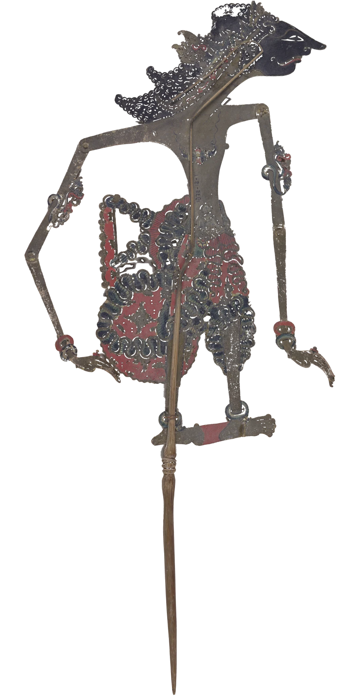

# shadow-puppet

Wayang kulit, seen from the shadow side. The element becomes the screen: warm
cotton lit from behind by an oil lamp, brightest where it looks into the flame
and falling off to orange at the edges, with a dyed red border along the top
and the shadow of the banana trunk along the foot. On it is the shadow of a real
puppet of punched buffalo hide (a Javanese figure from the Cooper Hewitt and a
Balinese fire kayon), the light coming through every hole. Scrolling draws the
puppet from the lamp to the screen: a huge, soft shadow that shrinks and
sharpens into a crisp lace. Drag moves it, and it leans behind the move and
settles back, as a puppet on a horn rod does. The flame flickers, so the shadow
breathes, and when the puppet is drawn back it trembles.

```html
<link rel="stylesheet" href="shadow-puppet.css">

<section id="scene" style="height:300svh">          <!-- the scroll that brings it in -->
  <div style="position:sticky;top:0;height:100svh;display:grid;place-items:center">
    <figure class="sp" data-shadow-puppet data-src="assets/figure.webp" data-scroll="#scene"
            data-height="1.12" data-top=".09" data-at=".42"
            style="width:90vw;height:70svh;--sp-height:1.12;--sp-top:.09;--sp-at:.42">
      
    </figure>
  </div>
</section>

<script type="module" src="shadow-puppet.js"></script>
```

Or call it yourself:

```js
import { shadowPuppet } from './shadow-puppet.js';
const sp = shadowPuppet(el, { src: 'assets/kayon.webp', distance: .5 });
sp.set({ distance: 0 });   // fixed distance, 0 = at the screen, 1 = as far as `far`
sp.state;                  // { distance, magnification, lean, grip, flame, live, running }
sp();                      // destroy: canvas, GL, listeners, observers, loop
```

Give the element a size; the canvas fills it. The `` is
what shows without JS or WebGL: the same image turned black by a CSS filter,
holes and all, on a warm gradient panel with the bands. Set the `--sp-*`
variables to the same numbers as the data attributes so it stands where the
live shadow will.

## Options

On the element (`data-*`) or in the options object, which wins.

| attribute | option | default | |
|---|---|---|---|
| `data-src` | `src` | the inner img | the puppet: an RGBA image, alpha = hide, holes transparent, as seen from the audience (mirrored). Same origin |
| `data-height` | `height` | `1` | the image's height at the screen, in screen heights (it includes the rod) |
| `data-top` | `top` | `.06` | where its top sits at the screen, of the screen's height |
| `data-at` | `at` | `.5` | across, of the screen's width |
| `data-grip` | `grip` | `.5 1` | the rod's end in the image (u v): the hand, and the pivot of the lean |
| `data-scroll` | `scroll` | none | a selector (an ancestor or any element) whose scroll-through draws the puppet in. Without it, it arrives as the screen's middle reaches the middle of the view |
| `data-reach` | `reach` | `.78` | the share of that scroll it takes to reach the screen (then it stays) |
| `data-far` | `far` | `.62` | how far back toward the lamp it starts, as a share of the lamp's distance. Capped on narrow screens so the shadow stays about the screen's width |
| `data-lamp` | `lamp` | `.5 .3` | the foot of the flame on the screen |
| `data-depth` | `depth` | `1.15` | lamp to screen, in screen heights |
| `data-flame` | `flame` | `.05` | the flame's width, in screen heights (the penumbra scales with it) |
| `data-glow` | `glow` | `.05` | how much lamplight the hide lets through, tinted by the paint |
| `data-flicker` | `flicker` | `1` | 0 = a perfectly steady flame |
| `data-sway` | `sway` | `1` | how much it leans behind a quick move |
| `data-seams` | `seams` | `.34 .69` | where the cotton widths are sewn (fractions of the width); `0 0` for none |
| `data-seed` | `seed` | `3` | the weave and the flame's rhythm |

## How it works

- **Projection.** The lamp is a small flame at distance `D` behind the screen;
  the puppet is flat, parallel to it, at distance `d` from the screen. A puppet
  point `P` lands at `s = L + (P − L)·M` with `M = D / (D − d)`, so the shadow
  grows about the foot of the lamp, not about the puppet. Each pixel runs this
  backwards, then undoes the puppet's lean about the grip, and reads the puppet.
- **Penumbra.** A flame of width `F` blurs every edge by `F·d / (D − d)`: zero
  at the screen, wider than a hand when the puppet is held back. The flame is
  half again as tall as it is wide, so the blur is too, and vertical edges stay
  sharper than horizontal ones. The blur is a stack: the alpha, then blurred
  by ellipses of radius 1, 2, 4 … 64 texels (64-tap Vogel spirals, each level
  from the last), packed four to an RGBA texture. A pixel interpolates the two
  levels around its radius, plus half a device pixel of footprint so the crisp
  lace never aliases. The drag also follows the projection: the hand moves
  `1/M` as far as the finger, so the shadow stays under it.
- **Light.** The screen's brightness is the cos³ fall-off of a point source,
  `(D² / (D² + r²))^1.5`, plus a hot spot where the cloth looks into the flame,
  times a coconut-oil flame's colour (about 1900 K), through a filmic shoulder
  `1 − e^(−2.15x)`, so the centre goes pale gold and the edges deep orange.
- **Hide.** The puppet is rawhide scraped thin, so a little light gets through
  it: the paint's colour, read from a blurred mip of the image (blurred
  further so the photograph's own lighting stays out), adds `glow` × colour
  inside the shadow.
- **Holes blaze.** The hide is opaque, so the half-tones the downsampled
  texture leaves in small punches are pushed back to open while the shadow is
  crisp: each hole passes the lamp undimmed, as bright as the open cloth beside
  it. A hair of bloom (the stack read two css px wider) lets the light spill
  round them, so the lace sparkles at the hot spot.
- **Cloth.** A fine, even over-and-under weave about a css pixel apart (laid
  out in device pixels so it never beats with them, 2.6% contrast, its threads
  wandering a little), now and then a slub thread running thick and a little
  darker for a long way, a cloudy density in three scales, a little sag, two
  seams with a fold of light, red dyed bands at
  top and bottom lit through, the frame's shadow at the sides and the banana
  trunk's shadow at the foot, where the rod disappears as rods do.
- **Flame.** Four octaves of smooth noise for brightness, size and a sway of
  the flame's position, and every 4-10 s a draught that lays it over for a
  second or two. Moving the flame by `δ` moves the shadow by `δ·(1 − M)`: still
  at the screen, a tremble when held back. Brightness, softness and the hot
  spot all breathe with it.
- **The hand.** The grip follows its target on a stiff critically damped
  spring; its acceleration drives a damped spring for the lean
  (ω 6.2 rad/s, ζ 0.26), so the puppet's top lags a quick move, swings past,
  and settles. When nothing is held, the hand drifts by a fraction of a
  percent and the puppet is never quite still.

## The images

Each puppet is one RGBA image, 1024 × 2048 (power-of-two, for the paint's
mipmaps), mirrored, with the rod's end at the bottom centre. They were cut out
of museum photographs at full resolution (the script is not part of the
component): the figure lies flat on white paper, so the backdrop is bright and
grey and the holes show the dark paper in the puppet's own contact shadow,
darker than any paint; the kayon stands against a wall, so wall and holes are
told from the copper hide by blue over red, and broad glare patches that read
as holes are refilled. A 5-7 px median cleans the outline. The kayon's rod
leaves the photograph, so it is carried on in its own colour.

## Theming

The screen has no theme colours: it is lamplight on cotton. Style the element's
size, frame and margins freely (the demo gives it a wooden frame with
`box-shadow`). `--sp-at`, `--sp-top`, `--sp-height` place the no-script still;
`--accent` colours the focus ring. Keep the room around it warm and not black:
the demo uses a dusk paper tone with a glow.

## Accessibility and reduced motion

- The element is focusable with a label (yours if you give one); arrow keys
  move the puppet (Shift for bigger steps). The canvas is `aria-hidden`; the
  images are decorative.
- `touch-action: pan-y`: on a phone a vertical swipe scrolls the page and a
  sideways drag moves the puppet. With a mouse, drag moves it both ways.
- `prefers-reduced-motion: reduce`: a still frame with the puppet at the
  screen, crisp, and the flame at rest. Nothing moves by itself; dragging still
  works (it redraws once per move, no sway). The demo drops its tall scroll
  sections.

## Cost

- One full-canvas draw at 30 fps while the screen is on screen (the flame always
  moves); nothing off screen (IntersectionObserver) or in a hidden tab.
- DPR capped at 2, and 4.6 Mpx a frame at most. Per pixel: two stack reads, one
  mip read, a little noise for the cloth.
- Once per puppet: eight full-texture blur passes on the GPU (about 128 Mtap,
  a few tens of ms), three 8 MB textures kept.
- Assets: 205 KB figure, 253 KB kayon, 176 KB painted figure for the essay.
- If the GPU drops the context the canvas goes and the still shows until it
  comes back.

## Credits

- Shadow puppet (wayang kulit), Java, 19th century. Cooper Hewitt, Smithsonian
  Design Museum, 1935-15-1. Smithsonian Open Access, CC0.
- Fire Kayon, wayang kulit, Bali. Museu do Oriente, Lisbon; photograph by
  Daderot, Wikimedia Commons, CC0.
- Details in `assets/credits.json`. No third-party code.
