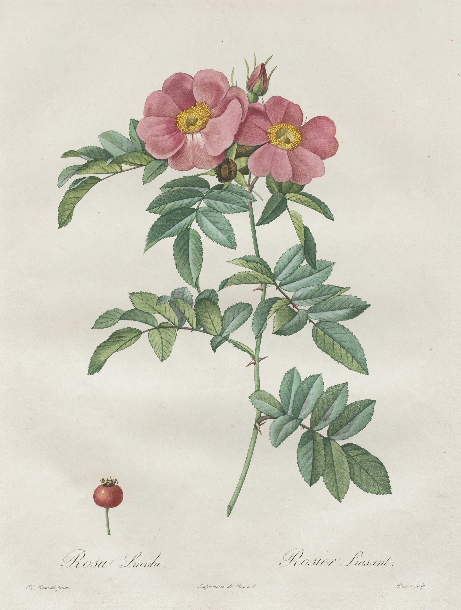

# stipple-rose

A plate from Redouté's *Les Roses* (Paris, 1817-24), *Rosa lucida*, made in front of
you as you scroll, in the order it was really made. It opens close up on the engraved
copper: tens of thousands of tiny pits in polished metal, the rose the wrong way round,
lit from one side so each pit shows a bright wall and a dark one. The view pulls back to
the whole plate. Then it is inked à la poupée: rose madder dabbed into the flowers with a
rag dolly in soft round dabs a little past the petals, green over the foliage, yellow
into the stamens, black into the lettering, each colour wiped off the surface behind the
dolly in curved tarlatan strokes, so the colour stays only down in the dots with a faint
plate tone left on the copper. The dampened sheet is laid on from its lower edge and
lowered over a bend, the press passes down it once as a travelling band of compression (the image shows through the damp sheet
and the plate's edge is pressed into it), and the sheet is peeled back from its left edge
and turned over to the right, beside the plate: the print, the right way round, pale and
flat. Last, the colourist's watercolour: the leaves greened passage by passage, the hip,
the bud, the flowers glazed petal by petal from the base outward, the stamens, and the
deep flush of the petals laid last and slowest. Wet glaze is darker and glossy and dries
lighter and matte, with pigment at the rim and settled in the tooth. The last frame is
the scan of the real plate, pixel for pixel. Scroll back and it all un-makes.

```html
<link rel="stylesheet" href="stipple-rose.css">
<section data-stipple-rose data-src="assets/rose.json">
  <div class="sr-stage">
    
  </div>
</section>
<script type="module" src="stipple-rose.js"></script>
```

Or `import { stippleRose } from './stipple-rose.js'` and call
`stippleRose(section, { src, mode, runway, webgl })`; it returns `destroy()`.

## Options

| attribute     | option   | default  | what it does |
|---------------|----------|----------|--------------|
| `data-src`    | `src`    | required | The plate's JSON (sizes, the poupée groups with their camera tracks, the wash areas). Beside it: `<name>.webp` (the plate), `-wash.webp` (the watercolour layer as a transmittance, half size), `-paper.webp` (the sheet's own paper, quarter size), `-dots.webp` (lossless: the engraved dots, one byte per 3-source-px cell), `-ink.webp` (lossless: poupée group, dab arrival, wipe, dab edge) and `-wmap.webp` (lossless: wash area, wet-front arrival, distance to edge). |
| `data-mode`   | `mode`   | `scroll` | `scroll`: a pinned stage on a runway. `static`: the finished plate as an image. |
| `data-runway` | `runway` | `380`    | Section height in svh. The stage is pinned for `runway - 100` svh of travel. |
| `data-webgl`  | `webgl`  | `on`     | `off` leaves the finished plate as an image. (WebGL2 is required; without it, the image.) |

The timeline, as fractions of the runway (`ST` and `INKWIN` at the top of the JS): the
close-up 0-0.115 (held, then pulled back), inking 0.11-0.37 (flowers, hip, leaves,
stamens, lettering; each colour's wipe follows its dabs), the paper laid on 0.375-0.426,
the press 0.426-0.462, the peel 0.466-0.535, the plate taken away 0.528-0.565, the
watercolour 0.565-0.95, then the finished plate.

Events (bubbling, for sound later): `stipple-rose:stage` with `detail: { stage }` as
each stage begins while scrolling forward (`ink`, `pull`, `press`, `peel`, `finish`),
`stipple-rose:dab` with `detail: { group, kind }` as each colour goes on, and
`stipple-rose:done` when the last wash is dry.

## The real thing

What we read and modelled (dealer and museum notes on *Les Roses* from Shapero, Camille
Sourget, Christie's and George Glazer; technique notes on stipple engraving from the
Oxford History of Science Museum, Russborough and Elizabeth Harvey-Lee; the Cleveland
Museum's record of this impression). Notes in the builder's scratch folder.

- **The copper.** Stipple: an etching ground on polished copper, the drawing pricked
  through it as dots with needles and a roulette, bitten in acid, the ground cleaned off,
  the palest tones added with the stipple graver. Contours as dots or the faintest line.
  The plate carries the image mirror-wise. Here the dots are the real dots of this
  impression, found one by one in the Cleveland Museum's 400 dpi scan, drawn as round
  (not quite round) pits in copper, each lit from the upper left, with the lit lip of the
  pit just outside it. Polished copper, a warm orange-brown, reflects a studio window:
  a crisp bright pane and a crisp dark band across a mid-toned room, their edges wavering
  a little because a plate is never quite flat. The reflection is fixed to the screen, so
  it slides over the metal as the plate moves. Fine polishing scratches run one way and
  catch the window; the margins are tarnished by handling; the narrow bevel catches a
  bright line on its upper and left sides. A pit scatters light: dark against the bright
  metal, a little lighter than the dark band, as a real plate does.
- **Inking à la poupée.** Stiff inks of several colours on one plate, each worked into
  its area with a dolly of rolled rag: soft round dabs, landing a little past the area;
  the warm plate wiped with tarlatan in circles and finished with the palm, so the surface
  is clean copper and the colour is left in the dots. Here each dab is a disc that spreads
  from its centre with a ragged edge, thicker in the middle, with a raised lip that
  catches the light on the side facing it and the print of the rag's weave where the
  cloth bore down; the film is stiff, tacky and glossy, the window breaking up on its
  lumps. The wipe follows the dabs in curved strokes (arcs about a point off the plate):
  the film clears stroke by stroke, and a faint streaked plate tone stays on the copper.
- **The pull.** Damp paper laid face down, one pass of the press, the sheet peeled off.
  Here the sheet's lower edge touches first and the rest is lowered over a bend (the
  part still in the air foreshortened, lit a little more, a touch larger as it is nearer
  the eye, shading the plate below it); then a darker band of compression travels down
  it once with a faint raised wave ahead of it; behind it the image shows faintly through the damp back and the
  plate mark is pressed in; then the sheet is lifted at its left edge and rolled over a
  curl to the right. Turned over that way, the printed face is the right way round, so
  the print is revealed true beside the mirrored plate (the geometry of the turn is exact:
  the sheet lands where the finished plate stays).
- **Hand finishing.** Transparent watercolour over the printed colour. Modelled as in
  `hand-colouring`: each wash spreads as a wet front from where the brush went down,
  slowed by the engraved outlines; wet is darker and glossy; drying goes edge first with
  pigment drawn to the rim and settling in the tooth. The flowers are laid petal by petal
  (split along the engraved outlines, taken round the flower, each from its base outward)
  and glazed twice: a first glaze, then the deep flush.

Simplified: the press's roller and blankets are not drawn (only its band of compression); the palm's final wipe is not a separate pass;
the printer's order of colours and the colourist's order of washes are ours; the poupée
areas come from the print's colours, so a dab never strays into a neighbour's colour; the
split of the scan into print and watercolour is a reconstruction (below); body-colour
highlights are not separated (this scan shows few).

## How it works

**Offline (Python, scripts in the builder's scratch folder).** In linear-light optical
density, against the sheet's own paper:

1. *The paper.* The engraved area is where the stipple's fine-scale energy is (paper
   fibres are isolated specks); the paper under it is filled from around it (normalised
   convolution at growing scales), so the toning of the old sheet stays paper.
2. *Print and watercolour.* `D = Dp + Dw`. Between the dots the paper carries only
   watercolour, so `Dw` is the floor of the density: a small grey opening (the gaps
   between dots), then a larger one, which moves everything finer than about 1.5 mm
   (contours, vein shading, lettering) into the print. `Dp = D - Dw` is the ink on the
   dots. `paper · exp(-Dp)` is the pull: a pale, flat, grainy colour print.
3. *The dots.* Local peaks of the print layer at full resolution (230,000 of them), with
   sub-pixel centres, packed one per 3 px cell (4 bits x, 4 bits y). Their size comes, in
   the shader, from the print's tone where they sit.
4. *Poupée groups.* The print's ink colour (the direction of its density vector):
   rose, green, yellow, black (lettering). Dab centres are spread over each area,
   ordered in serpentine bands along its axis; each pixel stores the first dab to reach
   it and how far it is from that dab's centre; the wipe is the dab order, smoothed, with
   a swirl.
5. *Wash areas.* The watercolour layer's colour: the flowers (split at the stamens), bud,
   hip, stamens, the small last touches, and the foliage cut into leaflets along the
   engraved outlines (watershed) and grouped into ten passages. Arrival is geodesic
   (scikit-image `MCP_Geometric`) along a brush path, slowed on the print's dark lines;
   the flowers petal by petal. The petals' first glaze is their density up to its 40th
   percentile; the flush is the rest.

**In the browser.** One quad, one fragment shader (WebGL2). World coordinates are sheet
units; the finished sheet is at `[0,1]²` and the plate and paper lie to its left, offset
by one sheet width plus half the curl's circumference, so the turned sheet lands exactly
on it. The copper draws the print density as a tone when the dots are smaller than a
pixel and the real dots, analytically (a 3x3 cell search, anti-aliased by the pixel's
footprint), when the view is close; the two blend between 0.75 and 1.5 source px per
device px. The watercolour stage computes `O · exp(Dw - D)` where `D` is the washes laid
so far (wet looks easing into the real layer as each part dries); when every wash is dry
`D = Dw` and the pixel is `O`, the scan.

- The plate's picture is resampled to about the size it is shown and mipmapped; the maps
  go up exact (unpremultiplied ImageBitmaps) and are sampled nearest.
- Scroll is followed on a critically damped spring (quicker going back).
- Camera (a function of scroll only, smoothed along it): the close-up is about 0.42
  source px per device px (6x on desktop, 16x on a phone), held, then pulled back in log
  space with the point under the glass kept still. On a narrow screen the view zooms in
  (up to 1.7x) and follows the dolly and the brush; during the peel it keeps the plate and
  the turned sheet in view and settles on the sheet; it pulls back to the whole sheet
  before the end.

## Theming

| variable      | default         | used for |
|---------------|-----------------|----------|
| `--paper`     | `#f3f0e8`       | the page around the plate and the sheet (read from the section's background) |
| `--sr-gutter` | `var(--gutter)` | side padding of the stage (the demo uses 5px on phones so the sheet fills the width) |
| `--sr-runway` | set by the script | section height in scroll mode |

## Accessibility and motion

- Without JS, without WebGL2, or with `data-webgl="off"`, the finished plate is an
  ``. The canvas is `aria-hidden`. The art is ornament (`alt=""`); credits are in
  `assets/credits.json`.
- Reduced motion: no runway and no canvas, the finished plate, still. If the setting
  changes mid-visit it settles on the finished plate.
- Phone: nothing is interactive, so a swipe always scrolls.

## Cost

- Assets 1.8 MB: plate 1.0 MB, dots 0.31 MB, ink map 0.27 MB, wash map 0.16 MB (all
  three lossless), watercolour 48 KB, paper 8 KB, JSON 8 KB.
- One full-screen quad. Most pixels do a handful of texture reads; close up on the copper
  a pixel reads its 3x3 dot cells. A frame draws only while the scroll spring moves and
  the section is on screen (IntersectionObserver); nothing runs when the scroll is still,
  off screen or in a hidden tab. DPR capped at 2.

## Making another plate

Scripts in the builder's scratch folder: `s1_split.py` (paper, print and watercolour
split, full resolution), `s2_dots.py` and `s2d_grid1.py` (the dots), `s3_layers.py`
(output size), `s5_class.py` (ink and wash colours), `s6_groups.py` (poupée groups,
dabs, wipe, wash areas, petals, arrival), `s7_export.py`. A plate needs a scan where the
stipple is resolved (about 400 dpi); look at the print layer and the wash layer at full
size before going on, and at the group maps.

## Credits

*Les Roses: Rosa Lucida*, P. J. Redouté pinx., Bessin sculp., Imprimerie de Rémond,
1817-24, stipple and line engraving printed in colour and finished by hand. The
Cleveland Museum of Art, Mr. and Mrs. Charles G. Prasse Collection, 1965.290, Open Access
(CC0). The separation into print and watercolour, the dots, and the maps are ours. No
third-party code.
