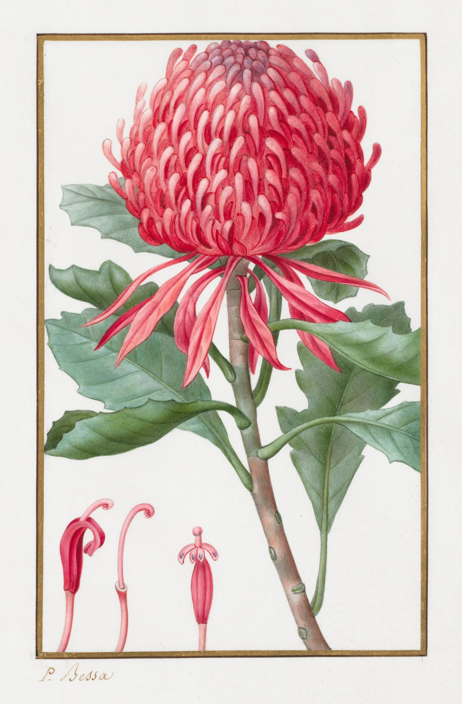

# vellum-study

Pancrace Bessa's waratah, a botanical watercolour on vellum from about 1830,
painted in front of you as you scroll, in the order the Paris flower painters
worked on calfskin. It starts as a sheet of bare vellum with a graphite
underdrawing on it: the outline of the head, every floret, the edge of each leaf,
and the frame ruled round the sheet. Then thin transparent washes go on, many small
ones, leaves first and the red head last (one little pool per floret and bract). On vellum the water stands on the skin
instead of sinking in, so each wash is a glossy pool with a hard, beaded edge
that creeps across the drawing, and dries with its pigment pooled at the rim. The
graphite shows through. Next come the lights in body colour, opaque touches of
lead white and pigment laid over the wash (the pale tips of the florets, the bloom
on the leaves), dab by dab. Each is darker and wet for a moment and dries pale and
matte. Then the miniaturist's finish: strokes along the curve of each form appear
all over it at once, stroke on stroke, broad ones first and hair-fine ones after,
so each region comes into focus like a photograph: the leaves and stem first, then
the bracts, and the head last and slowest, until the pooled washes have turned
into a flower. Last, the gold
frame is ruled round the sheet and the signature is written under it. The final
frame is the painting, pixel for pixel. Scroll back and it un-paints.

```html
<link rel="stylesheet" href="vellum-study.css">
<section data-vellum-study data-src="assets/waratah.json">
  <div class="vs-stage">
    
  </div>
</section>
<script type="module" src="vellum-study.js"></script>
```

You can also `import { vellumStudy } from './vellum-study.js'` and call
`vellumStudy(section, { src, mode, runway, webgl })`. It returns `destroy()`.

## Options

| attribute     | option   | default   | what it does |
|---------------|----------|-----------|--------------|
| `data-src`    | `src`    | required  | The painting's JSON (size, vellum colour, stage windows, camera track). Beside it go `<name>.webp` (the painting), `-bare.webp` (the vellum with no paint), `-wash.webp` (the first washes, dried), `-body.webp` (the washes with the body colour on them), `-model.webp` (the modelling the broad strokes lay in), `-lines.webp` (lossless, full size: R graphite, G body-colour opacity, B when the hair-fine strokes arrive) and `-map.webp` (lossless, half size: when the wash, the body-colour dabs, the broad strokes and the gold reach each point). |
| `data-mode`   | `mode`   | `scroll`  | `scroll`: a pinned stage on a runway. `static`: the finished painting as an image. |
| `data-runway` | `runway` | JSON, 380 | Section height in svh. The stage is pinned for `runway - 100` svh of travel. |
| `data-webgl`  | `webgl`  | `on`      | `off` leaves the finished painting as an image. |

The stage windows (fractions of the runway, in the JSON's `stages`): washes
0.03-0.33, body colour 0.34-0.48, fine strokes 0.49-0.92 (the head alone takes
0.77-0.92), gold 0.93-0.97, then the finished sheet. The schedule is laid out in
svh of travel offline: a big wash takes 12-18svh with two or three wet at once, and
the head's strokes take about 43svh.

Events (bubbling, so a sound can be wired to them later):
`vellum-study:stage` with `detail: { stage }` as each layer begins while
scrolling forward (`wash`, `body`, `hatch`, `gold`), and `vellum-study:done` when
the signature is written.

## The real thing

What we modelled, from the general record of how the *vélins du roi* and other
florilegium vellums were painted, the miniature painters' practice of hatching and
stippling, the Cleveland Museum of Art's record for this sheet (pencil and
watercolour on parchment) and what the scan itself shows at full size: graphite
contours still visible at the petal edges, transparent washes, opaque pale
touches over them, and fine strokes everywhere. We found no technical study of this
sheet. The watercolour transients follow Curtis et al., *Computer-Generated
Watercolor*, SIGGRAPH 1997:

- **The skin.** Vellum is calfskin limed, scraped, stretched and pounced with
  pumice and chalk. It does not absorb. Paint dries on top of it, stays brilliant
  and stays soluble: a wet brush over a dry wash lifts it.
- **Graphite first.** A hard, light pencil outline of every form, here grey and
  slightly cool, catching on the grain. It stays visible through the transparent
  washes, disappears under body colour, and is worked over by the strokes.
- **Washes that stand on the surface.** A thin transparent wash per small area:
  each floret and bract of the head is its own little pool, a leaf is one, laid in
  the order of a sweep through the object. The wet front
  advances unevenly with a hard meniscus at its edge (the bead, darker), the
  standing water is darker and glossy, and as it dries, edges first and the
  middle last in islands, the pigment is drawn to the rim. A dried wash pools: darker toward
  the lower and outer edge of its area, lighter where the brush lifted, with a fine
  dark tide line at its rim and, in a few places, a cauliflower bloom (a pale lobe
  with a dark frilled edge). Because a second wash would lift the first, there is one.
- **Body colour for the lights.** Pigment with lead white, opaque. It is laid in
  touches, dab by dab (short elongated strokes along the form), over the dry wash: the pale tips of the
  florets, the lights of the bracts, the bloom on the leaves. Wet gouache is
  darker and more saturated and dries paler and matte.
- **The miniaturist's finish.** All the modelling is built with the tip of a
  small brush, nearly dry, in strokes laid along the form, all over the form at
  once and stroke on stroke: broader strokes lay in the modelling, finer ones
  sharpen it, so the whole region comes into focus together, region by region. Each stroke is a shade
  darker for an instant while wet. This is where the colour gets its depth and
  the flower its roundness, so it is the slowest pass.
- **Gold and signature last.** The frame is ruled in gold round the four sides,
  then the signature written under it.

Simplified: time is compressed into scroll. One first wash per area, where a
painter might lay two or three very thin ones. Strokes are revealed from the
finished painting along a flow field taken from its own brushwork (see below), so
they lie where Bessa's strokes do, but they are not his strokes one for one, nor in
his order. The
order of objects is a plausible working order, not documented for this sheet.
The gold is laid as one pass, without the mordant and burnishing.

## How it works

**Offline (Python, scripts kept in the builder's scratch folder, not in the
component).** All in linear-light optical density, `D = -ln(colour / vellum)`.

1. *Masks and objects.* The paint is separated from the vellum by density and
   chroma, and the gold frame and signature by hue inside a band. The plant is
   split by colour (red, green, other) and then into fourteen objects (head, two
   groups of bracts, seven leaves, stem, three dissections) by a marker watershed
   on the colour gradient, each colour group on its own, with stray islands
   folded into the object round them (or, for a red piece cut off by a leaf
   lying over it, into the nearest red object).
2. *Bare vellum.* Under the paint, the vellum is filled from the bare skin around
   it (normalised convolution at three scales) plus the skin's real texture
   (a mirrored tile of the scan's high frequencies). The faint halo the scan has
   for about 25px round the paint is taken out, and comes back when the paint
   next to it is finished.
3. *Flat.* The hatching is removed (median, then bilateral twice) and the forms
   kept. It is used to place the washes, the body colour and the pencil.
4. *First wash.* The head, bracts and dissections are cut into small areas that
   follow the painting's own forms (a watershed of the flat image's gradient from
   its h-minima: each floret tip, each dark gap, each bract); a leaf or the stem is
   one area (split only where a different colour lies in it). Each area's tone is
   half its median and half the flat colour diffused inside that area only (a
   barrier at every border, so nothing blurs across an edge), at about 56% of the
   density. Then it pools: x(0.84 + 0.22·depth down the area + 0.24·nearness to
   its rim + fBm), a 0.85px dark tide line at every border, and a frilly
   cauliflower bloom in about one area in eleven.
5. *Body colour.* Where the flat image is lighter than its neighbourhood (a median
   over ~70px) and lighter than the wash beneath, it can only be opaque paint on
   top. The wash under each touch is carried on from the wash around it (the
   floret was washed whole), the touch is given a crisp 1px edge, and it is split
   into dabs: ellipses 12-20px long and 4-7px wide along the brushwork's direction,
   ordered down the touch.
6. *Graphite.* Canny edges of the flat image at half size, plus the object
   outlines, skeletonised, pruned, and drawn as a soft line about 2.5px wide (full
   size) whose pressure wanders. The frame is ruled as four straight lines.
7. *Time maps.* The wash arrives along a geodesic sweep through each object
   (scikit-image `MCP_Geometric` over a noisy speed field) from its start. Body
   touches go in the order of that sweep, each brushed from its upper end. The
   fine strokes: a structure tensor of the painting's own luminance gives the
   direction of the brushwork. White noise is integrated along it (line-integral
   Two sets of strokes are traced along it from jittered seeds and kept inside
   their object: broad ones (half size, ~20px long, 3px wide) and hair-fine ones
   (full size, ~22px long, 3px wide, 240,000 of them). Each stroke gets its own
   random moment: 0.2 x the object's sweep + 0.8 x a random draw (broad strokes in
   the first 72% of the object's window, fine ones from 18% on), drawn so that the
   earliest stroke over any pixel is uniformly spread. A pixel's time is that of the
   earliest stroke over it, softened by ~0.8px. Pixels off the
   plant take the time of the nearest paint (their pencil goes with it). The
   gold runs clockwise round the frame, then the signature left to right. A
   camera track (the centroid of whatever is active) goes in the JSON.

**In the browser.** One quad, one fragment shader (WebGL2, or WebGL1 without the
mip blur and the phone zoom). Per pixel, in density, the layers nest:
`D = mix(mix(mix(mix(D_bare, W', cw), B', cb), D_M, cl), D_O, max(cf, cg))`, where
`cw`, `cb`, `cl`, `cf` and `cg` are the wash, body-colour, broad-stroke, fine-stroke
and gold coverage from the time maps, `D_M` is the body-colour stage plus the
painting's modelling softened by 3.5px, and the primes are the wet looks (wash: blurred by a mip bias, darker, a
beaded front, a transient rim as it dries, islands; body colour: darker until it
dries, then a hair proud of the skin, lit on its upper left edge; strokes: a shade
darker for an instant). The colour is `O · exp(-(D - D_O))`. When every layer is down and dry this
is exactly `O`, the painting. The graphite is multiplied on top and goes as the
paint covers it.

- Images are resampled on the CPU to the size they are shown at, then mipmapped.
  The time map and the lines are uploaded exact (unpremultiplied ImageBitmaps)
  and sampled linearly (the lines mipmapped).
- Scroll is followed on a critically damped spring (quicker going back).
- The canvas draws the sheet itself: its edge sharp and anti-aliased, wandering
  by a hair, with a tight shadow that lifts a little in places where the skin
  cockles. No vignette. The scan is cropped inside the sheet, so the edge is
  drawn, not the original's.
- On a narrow screen (under 760px) the sheet fills the width. From the first
  wash the view goes a little closer (up to 1.4x), and for the fine strokes about
  2.15x, following the active region. It pulls back to the whole sheet before
  the gold. The camera is a function of scroll only.

## Theming

| variable      | default         | used for |
|---------------|-----------------|----------|
| `--paper`     | `#f3f0e8`       | the page around the sheet (read from the section's background) |
| `--vs-gutter` | `var(--gutter)` | side padding of the stage (the demo uses 6px on phones so the sheet fills the width) |
| `--vs-runway` | set by the script | section height in scroll mode |

The sheet keeps the vellum's own colour, a cool white a shade off the page.

## Accessibility and motion

- Without JS, without WebGL, or with `data-webgl="off"`, the finished painting is
  an ``. The canvas is `aria-hidden`. The art is ornament (`alt=""`), and the
  credits are in `assets/credits.json`.
- Reduced motion: no runway and no canvas, only the finished painting. If the
  setting changes mid-visit, it settles on the finished painting.
- Phone: nothing is interactive, so a swipe always scrolls (tested on the
  pinned stage).
- There is no UI and no caption. The piece is driven by scroll alone.

## Cost

- Assets 3.2 MB: lines 1.6 MB (lossless: graphite, body opacity and the fine
  strokes' times), painting 0.59 MB, time map 0.37 MB (lossless, half size), model
  0.22 MB, body 0.19 MB, wash 0.17 MB, bare 0.05 MB, JSON 12 KB.
- One full-screen quad, about fifteen texture reads per pixel. A frame draws
  only while the scroll spring is moving and the section is on screen
  (IntersectionObserver). Nothing runs when the scroll is still, off screen or in
  a hidden tab. DPR is capped at 2.

## Making another painting

The scripts (`s1_mask.py` paint, gold and vellum colour; `s2_classes.py` colour
groups; `s3_objects.py` objects from marker lines; `s4_layers.py` bare vellum,
flat, the small pooled washes; `s5_body.py` body colour and its dabs; `s6_times.py` graphite, time maps,
schedule, camera and export) live in the builder's scratch folder. A new sheet
needs its own marker lines per object, the gold band, and a plain patch of
vellum for the texture tile. Look at the bare vellum (contrast-stretched), the
first wash and the body colour at full size before exporting. The mistakes show
there: ghosts of the plant in the bare skin, blotchy tones, touches on the wrong
object.

## Credits

Pancrace Bessa, untitled study of a waratah (*Telopea speciosissima*),
1828–1835, pencil and watercolour on vellum. The Cleveland Museum of Art, Gift of
The Print Club of Cleveland in honor of Mrs. William G. Mather, 1955.484. Open
Access, CC0. The separation into layers, the graphite drawing and the time maps
are ours. No third-party code.
