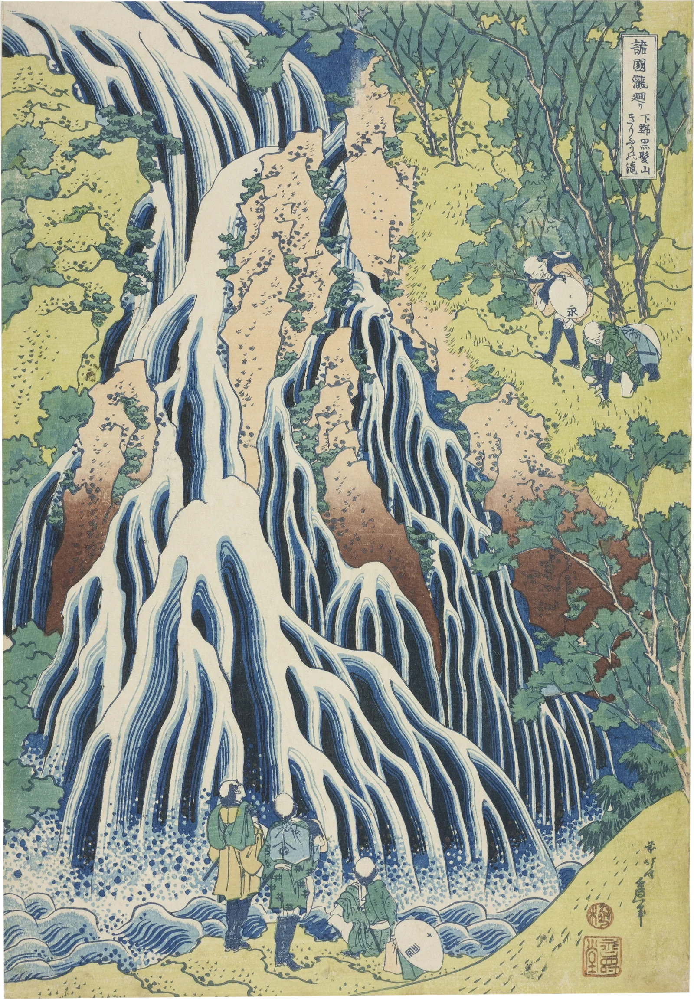

# waterfall-print

A descent down a Hokusai waterfall, with his painted water pouring. Each print
is a section that pins a full-height stage. As you scroll, a camera travels
down the falls with the water:

1. It starts close on the lip (zoomed as far as the print stays sharp, up to
   2.5x), where the water is glassy and slow.
2. It follows the strands down as they speed up and split into Hokusai's
   fingers, with threads and highlights racing in pulses.
3. It reaches the foot, where his foam dots boil outward.
4. It pulls back to the whole sheet while spray haze rises off the foot and
   drifts out over the page and the essay below, then slowly clears. This is
   the one moment the piece breaks its frame.

Two prints, two kinds of water:

- **Kirifuri** (*Kurokami-yama*) clings to the rock in fingers.
- **Amida** pours from a round pool. The pool's rings turn in a slow vortex,
  and the water goes over the lip as one rope.

Rocks, trees, people and paper are the print's own pixels and stay still.
Only the water and the air move. A finger held in the water quietly parts the
strands below it.

```html
<link rel="stylesheet" href="waterfall-print.css">

<section class="wf-section" data-waterfall-print data-maps="assets/kirifuri.json">
  <div class="wf-stage">
    <figure class="wf">
      
    </figure>
  </div>
</section>

<script type="module" src="waterfall-print.js"></script>
```

Without JS or WebGL, or with reduced motion, each section is just the print,
fitted to one screen. Live, the `` is hidden and keeps the layout, and a
fixed canvas (`pointer-events: none`) draws the print through the camera at
full resolution (the `print` named in the maps JSON).

```js
import { waterfallPrint } from './waterfall-print.js';
const fall = waterfallPrint(section, { maps: 'assets/amida.json', runway: 4.4 });
fall.state;   // { running, visible, rate, time, progress, zoom, spray }
fall();       // destroy: canvas, listeners, observer, loop
```

## Options

On the element (`data-*`) or in the options object, which wins.

| attribute | option | default | |
|---|---|---|---|
| `data-maps` | `maps` | (required) | JSON naming the baked maps (`print`, `flow`, `streaks`, `air`), the print's size, `vmax`, the camera `path`, and optionally `plunge` (boiling foam) and `swirl` (a rotating pool) |
| `data-descent` | `descent` | `true` | pin the stage and travel down the falls with the scroll; `false` shows the whole print, flowing |
| `data-runway` | `runway` | `5.2` | section height in screen-heights: 70% of it is the descent, 20% the pull back, 10% a hold |
| `data-zoom` | `zoom` | `2.5` | closest zoom. It is capped where a texel would cover more than 1.12 device px (on a 1440×900 desktop at DPR 2 that is about 2.1×) |
| `data-spray` | `spray` | `1` | the haze that leaves the print over the page at the foot |
| `data-speed` | `speed` | `1` | scales the clock. The clock also runs faster as the camera pulls back, so the water reads as the same speed at every zoom |
| `data-threads` | `threads` | `1` | threads and highlights |
| `data-sway` | `sway` | `1` | how far his lines slide along themselves |
| `data-mist` | `mist` | `1` | the grey haze over the foot |
| `data-deepen` | `deepen` | `1` | how much the Prussian blue deepens as the water comes up to speed |
| `data-fps` | `fps` | `30` | frame cap |
| `data-part` | `part` | `true` | a finger in the water parts it, quietly |

The camera path is a list of `[x, y, zoom]`. `x` is in print widths. `y` runs
from 0 to 1 down the travel the frame allows at that zoom, so the descent uses
the whole sheet on any screen. Zoom runs from 0 (whole sheet) to 1 (the
closest). The path is a Catmull-Rom spline. Its last point is where the
camera pulls back to.

## Events

| event | when | detail |
|---|---|---|
| `waterfall-print:part` | a finger or pointer comes down in the falling water (bubbles) | `{ x, y }` in 0-1 of the print |

## The real thing

What someone watching a fall like Kirifuri sees, and what is modelled:

- **Acceleration.** Free water falls at `v = sqrt(2gh)`: about 4.4 m/s one
  metre below the lip, 14 m/s ten metres down. Water clinging to rock, as at
  Kirifuri, is slowed by friction but still speeds up the lower it gets.
  Modelled: flow speed is `vmax * sqrt((y + h0) / (H + h0))`. `h0` is about
  half the sheet's height, because the fall begins above the top of the print.
  Threads near the top move at about 0.56 of their speed at the foot, and they
  stretch as they fall.
- **Streaks, not shapes.** In a cascade the large forms stand still, because
  the rock sets them: the fingers, the lobes where the water spills over a
  ledge, the gaps between strands. What travels is the texture on them, the
  streaks of aerated water. So Hokusai's drawing stays where it is and only
  slides a little along its own lines, while fine threads run along those lines
  at full speed. The threads are strongest beside his blue strokes.
- **Breaking up.** A thinning sheet splits into fingers and threads (the
  Rayleigh-Taylor and Plateau-Rayleigh instabilities), and Hokusai has drawn
  that. The threads take their direction from his strokes, so they part where
  his strands part and run together where they meet.
- **The plunge and the mist.** At the foot the water slows sharply (×0.45 in
  the spray, ×0.15 in the pool) and the threads die out in the spray. Spray
  haze rises off the foam: thickest just above the plunge, over the pilgrims'
  feet, thinning about a fifth of the way up the print. A taller plume leans
  up the right side of the cliff, where the strands fall clear. It is a grey
  veil that lifts the dark blue toward grey and leaves the white paper white.
  Its texture is fibrous and slowly curling (domain-warped noise stretched
  upward) and it rises at about 17 css px a second.
- **A finger in a falling sheet.** The response is kept small. The strands
  round the finger brighten (water heaped against it) and part below it in a
  V a few px wide, which closes within about 34 css px. The V has no dark
  fill: its edges are his fine light-Prussian line and its inside is a pale
  blue. A small cluster of foam dots in the flat inks of the foam at the foot
  (blue on white, white on blue) spits off just below the finger and is
  carried down, and the mist thickens a little there. When the finger lifts,
  the V heals from the top at the local water speed.
- **Simplified.** The lip, smooth and glassy, is above the print and not shown.
  The print's own spray dots stay as he cut them, and the pool does not churn.
  Speed depends on height alone, not on each stream's true path.

## How it works

Offline (Python, kept outside the component; the steps are here):

Both prints go through the same steps. Kirifuri is described here, and Amida's
differences are noted at the end.

1. **The sheet.** The Art Institute's photograph includes the museum mount. The
   four sheet edges are found row by row and column by column, fitted as lines
   (the sheet sits about 0.25° off square, and that is kept), and cut out with a
   one-pixel soft alpha. The result is saved at 2413, 1600 and 1100 px wide for
   `srcset`.
2. **The water mask.** k-means on the print's colours gives twelve inks. Five
   of them are water (the dark Prussian, the middle blue, the pale blue, the
   grey-blue and the bare paper). Their local density over 15 px is
   thresholded, and the result is then limited by a hand-drawn polygon around
   the falls, with the five pilgrims and the hat cut out by hand (their faces
   and the hat are the same paper as the water). Small holes are filled and
   small islands dropped; the bushes and rock outcrops inside the falls stay
   out.
3. **The flow.** The structure tensor of the luminance, with derivatives at
   σ 1.2 and integration at σ 5 at half size, gives the stroke direction at
   every pixel. The doubled-angle vectors are smoothed, weighted by coherence
   and normalised within the mask (σ 14, or σ 42 where the paper is blank).
   The direction is then oriented downhill against a prior: down; down and to
   the right in the top-left curtain; outward from the plunge in the pool.
   Speed comes from the height (see above). The result is
   `kirifuri-flow.webp`, at quarter size and lossless RGB: (vx, vy) × speed /
   vmax, and the mask.
4. **The threads.** A line-integral convolution of sparse single-pixel spots
   along that field (±70 steps, a Hann window) gives hairline streaks that lie
   exactly along Hokusai's strokes and fan out with the fingers. The bake is at
   three-quarter size, so a ridge is about one texel wide. Where the direction
   field turns sharply (the few critical points at lobe tops) the threads are
   faded out, because there they would draw small rings. The result is
   `kirifuri-streaks.webp`, a grey image.
5. **The air.** Covers the whole sheet, not only the water. The foam (water
   below the spray line, closed so that it runs under the pilgrims) is smeared
   upward with an exponential tail of 210 px. A second plume, with a 700 px
   tail leaning right, rises from the right-hand foam. The two are blurred
   into the mist density and saved with the spray weight in
   `kirifuri-air.webp`.
6. **Amida.**
   - The mask comes from a hand polygon (the rope and the round pool) minus
     everything ochre or green (the pines over the rope are cut out).
   - Inside the pool the flow is a clockwise vortex at 34 s a turn at the rim.
     Below the lip, speed is `sqrt` of the drop from the lip (y 930) on a short
     run-up.
   - The air map has only a haze where the rope leaves the bottom of the sheet.
   - Its `swirl` (centre, radius, rad/s) is in `amida.json`. Kirifuri's
     `plunge` (where the water lands) is in `kirifuri.json`.

The maps are lossless RGB with no alpha. A browser may premultiply an image
with alpha before WebGL sees it, and that would destroy the flow values
wherever the mask is 0.

At runtime there is one WebGL1 pass over the whole viewport.

- **The canvas.** It is fixed and never takes input. The `` is hidden
  but keeps the layout.
- **The camera.** `camera()` reads the pinned stage's box and the section's
  scroll progress `p`:
  - for `p` up to 0.7 it follows the `path` spline (Catmull-Rom) from the lip
    to the foot, at the closest sharp zoom;
  - from 0.7 to 0.9 it eases back to the whole sheet;
  - after that it holds.
  The camera gives the print's origin and size in css px. The shader maps
  each screen pixel to the print's uv, so the zoom always samples the
  full-size print (`print` in the JSON) and is never a scaled-up bitmap.
- **The paper.** Outside the sheet the shader draws only the sheet's soft
  shadow and the spray. Inside, rock, trees and people are the print's pixels
  unchanged. Only where `mask > 0` (the water) or the air map says so does
  anything move.

Inside the water:

- **Sliding stripes (Valve, *Water Flow in Portal 2*, 2010).** The print is
  sampled at `uv - d·(φ - ½)` for two phases half a cycle apart (1.25 s) and
  cross-faded, with `d` the flow at that point times `sway`. Centring the
  displacement on zero means that each layer reaches full weight exactly when
  it is undisplaced, so the drawing never drifts. A smooth noise offsets the
  phase from place to place, so the cross-fade never pulses as one.
- **Finger tips** sway sideways across the flow (a few px, each tip on its own
  phase) in the lower part of the falls.
- **Plunge (Kirifuri).** Around `plunge`, the foam and the pool are resampled
  outward from the landing point in two 1.3 s phases, with a small noise
  jitter. His foam dots boil and spread in their own flat inks.
- **Swirl (Amida).** Inside the round pool the print is rotated about the
  centre by two phases of a 1.5 s cycle, faster at the rim, and cross-faded.
  Samples that would rotate in from outside the pool are dropped, so its rings
  turn and its rim stays put.
- **Pulses.** A slow noise field carried down the flow (1.9 s cycles) scales
  the threads from 0.45× to 1.6×, so the water surges.
- **Threads and highlights.** The same two-phase scheme reads the streak map, but at the full
  speed of the water (0.6 s cycles). Each phase looks upstream along the
  curving streamline in four steps rather than in a straight line, so a thread
  keeps to its line through bends. A narrow threshold (`smoothstep(.5, .62)`)
  keeps only the ridge cores, as crisp hairlines.
  - They are weighted toward his blue stroke edges: two print taps 3.5 css px
    either side across the flow measure the local contrast, and in open white
    the threads drop to 18%.
  - On white they are his key blue; on blue they are bright paper, the
    highlights. They fade out in the spray, and appear only where the water
    is falling.
- **Speed at every zoom.** The clock runs faster as the camera pulls back, by
  √(zoom max / zoom), so the threads read as the same speed whether the
  camera is close or far.
- **Mist.** A domain warp at a quarter of the print's width curls a fibrous
  three-octave noise stretched about 5:1 upward. The whole field rises and
  drifts slightly left. The veil is `max(colour, grey)`, 20% desaturated, at
  up to 70% where the air map is densest. The noise texture holds 16 bits per
  field (hi and lo bytes, which stays exact under linear filtering); an 8-bit
  field terraced, and the warp turned the terraces into contour rings.
- **The finger** works in css px about the touch point, along and across the
  flow there. A branch on a uniform skips it entirely when nothing is held.
- **Spray over the page.** Once the camera passes 70% of the descent, a
  haze rises over about 1.2 s from the sheet's bottom edge at the plunge. It
  is a soft billow field: domain-warped noise in rounded cells wider than
  tall, rising and drifting outward on each side. It spreads sideways over
  the paper and down over the first lines of the essay, thickest at the foot,
  at most 50% grey. When the camera leaves the foot it clears with a 1.1 s
  time constant (gone in about 3 to 4 s).
- **Sharpness.** The full-size print is sampled with a four-tap box sized to
  the minification (zero at 1:1 or closer), and the zoom is capped at 1.12
  device px per texel, so the water is never softer than the woodcut around
  it.

## Tuning

- **Speed.** The bake sets `VMAX` (Kirifuri 700 px/s of the full-size print at
  the foot; Amida 700) and the start height `h0` (Kirifuri 10% of the sheet,
  so the lip is slow and glassy). Pulses (1.9 s), sway (1.25 s), threads
  (0.6 s), the boil (1.3 s) and the swirl (1.5 s phases, 34 s a turn at the
  rim) are cycles in the shader and in `start()`.
- **Threads and highlights.** These are the `smoothstep(.5, .62)` core, the
  edge weighting, and `surge` (0.45 to 1.6× in the pulses). They appear only
  where the water is falling (`fdl.y > .45`), so they never curl over lobe
  tops.
- **Camera.** The `path` in each JSON, the 0.7 / 0.9 phases in `camera()`, and
  `zoom`.
- **Spray over the page.** `pageSpray()` and `billows()`: the width, how far
  it reaches down and up, the billow scales, and the 0.5 cap. It rises with a
  1.2 s time constant once the camera reaches 70% of the descent, and clears
  with 1.1 s.
- **Finger.** The V's half-width (2.6 css px), its length (34 px), and the dot
  cluster.

## Theming

| variable | default | |
|---|---|---|
| `--wf-margin` | `clamp(16px, 4vw, 56px)` | margin round the whole sheet at full view |
| `--wf-runway` | set from `runway` | section height while live |
| `--wf-z` | `4` | z-index of the fixed canvas |

The canvas draws the sheet's soft shadow on the page itself. The ``
fallback has a `drop-shadow` filter.

## Cost

- **One full-viewport fragment pass**, at 30 fps by default, while a section is
  within 10% of the viewport or its spray is still clearing.
  - A water pixel takes about 30 to 40 texture reads (print taps, the 4-step
    upstream look-up, streaks, noise, and the boil or the swirl where they
    apply).
  - Paper and rock pixels take 6 to 8.
  - Off-print pixels take 2 to 8 (the shadow, and the spray while it lasts).
- The canvas is the viewport at DPR up to 3, capped at 5 Mpx (a 1440×900
  desktop at DPR 2 is 5.2 Mpx and is drawn at about DPR 1.96).
- **Nothing runs** once the section and its spray are off screen, in a hidden
  tab, or with reduced motion. The camera redraws on scroll even when the loop
  is idle.
- Downloads per print: the full-size print (1.3 to 1.5 MB), which is needed
  for the zoomed descent, plus about 0.3 to 0.8 MB of maps. The ``
  fallback loads its own `srcset` size.

## Accessibility and reduced motion

- The print is decoration: `alt=""` and `aria-hidden` on the ``, and the
  canvas is `aria-hidden` with `pointer-events: none`. Nothing is focusable.
- With `prefers-reduced-motion: reduce` there is no descent: each print is
  shown whole and still, with the mist frozen where it lies. There is no
  loop, no spray over the page and no finger.
- Outside the water and the mist the canvas draws the print's own pixels
  unchanged.
- `touch-action: pan-y`: a vertical swipe that starts on the water still
  scrolls the page. A finger that brushes past parts the water for a moment as
  it goes.
- Print hides the canvas.

## Credits

- Katsushika Hokusai, *Kirifuri Falls*, from *Tour of the Waterfalls in Various
  Provinces* (Shokoku taki meguri), about 1833. The Art Institute of Chicago,
  Clarence Buckingham Collection, 1925.3390. CC0. Details in
  `assets/credits.json`.
- Katsushika Hokusai, *Amida Falls in the Far Reaches of the Kisokaido*, same
  series, about 1833. The Art Institute of Chicago, Clarence Buckingham
  Collection, 1925.3394. CC0. The AIC photograph was used
  (same mount and lighting as Kirifuri) rather than the library's Met copy.
- The flow-map method is after Alex Vlachos, *Water Flow in Portal 2* (Valve,
  SIGGRAPH 2010). Line-integral convolution is after Cabral and Leedom (1993).
  No third-party code.
