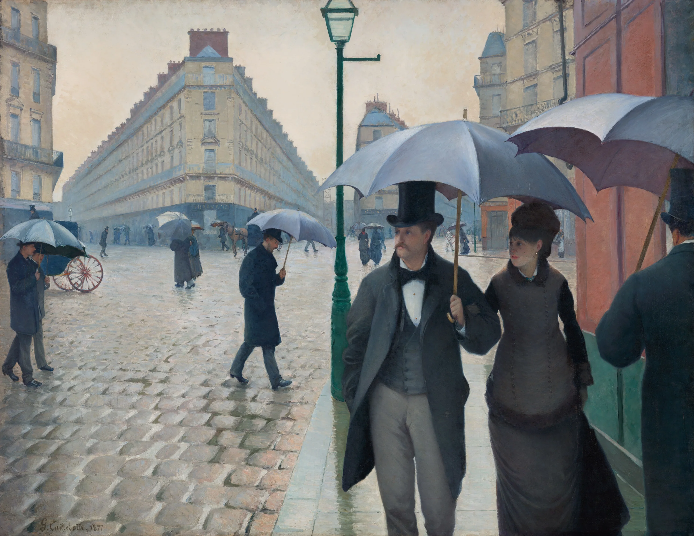

# window-pane

A painting seen through a cold window on a wet day. The inside of the glass is
misted with condensation, a luminous grey that turns the street into soft
shapes of light; rain sits on the outside in drops, each a little lens holding
the street upside down, and now and then a heavy one lets go, stops, slips
again and runs down, gathering the small ones. Press and drag (or, on a phone,
stroke sideways, or hold still a moment and then draw) and your finger wipes a
clear streak with a ragged edge and a line of pushed-up droplets; the street is
sharp behind it, still behind the rain. Over twenty seconds or so the cold
takes it back, from the edges in, and leaves a ghost of what you wrote. The
glass has been used before: a broad diagonal sweep someone made to look out,
a finger dragged off its edge, drips run down from it, half fogged back.

```html
<link rel="stylesheet" href="window-pane.css">
<figure data-window-pane class="wp-bleed">
  
</figure>
<script type="module" src="window-pane.js"></script>
```

The `` sizes the pane. Leave it at its natural ratio, or give the figure a
height and the img `object-fit: cover` (and any `object-position`); the glass
takes exactly the same crop. `class="wp-bleed"` makes a full-bleed band
(`92svh`, or `72svh` on a portrait screen, so a landscape picture keeps about
half its width in view). Or call `windowPane(figure, options)` yourself; it returns
`destroy()`. The module also exports `cursive(word, x, y, xHeight, perPoint)`,
joined handwriting (letters h, e, l, o) as an array of points: handy for
tests, and for `data-writing`.

## Options

| attribute | option | default | |
|---|---|---|---|
| `data-mist` | `mist` | `0.85` | 0-1, how thick the condensation is |
| `data-rain` | `rain` | `0.5` | 0-1, how hard it is raining: new drops and drizzle |
| `data-refog` | `refog` | `22` | seconds for a wipe to fog over again; `0` = never |
| `data-wiped` | `wiped` | `1` | a broad wipe made earlier, half fogged back, with drips; `0` for clean mist |
| `data-writing` | `writing` | `""` | a word already written there too, half fogged over (h e l o only) |
| `data-seed` | `seed` | `3` | the rain and the grain of the mist |

The options object wins over the attributes.

## Theming

| variable | default | |
|---|---|---|
| `--wp-floor` | `#b9b6b0` | behind the image while it loads |
| `--wp-cursor` | `default` | the cursor over the glass |

There is no colour to set: the mist is made from the painting's own light,
greyed, so it suits whatever is behind it. Pick a smooth, finished picture (a
townscape, a harbour, a street): behind a wipe it is seen nearly 1:1, where
heavy impasto reads as paint, not as a view. Strong darks and a pale sky show
the drops best.

## How it works

One WebGL2 context, three kinds of water.

- **The street.** The painting is cropped to the canvas (object-fit honoured)
  at one texel per device pixel, with mipmaps, and read through a wipe with half a
  level of mip bias at DPR 2 (the street through glass, not the weave of the
  canvas). Three blurred copies are made
  once, on the GPU, with a separable 25-tap Gaussian: sigma 0.15% and 0.46% of
  the pane's width (at least 1.5 and 4 px), so the street keeps its big shapes
  through the mist, and 80 px for the colour of the veil.
- **Mist** is a density map on the CPU, about one cell per 3 css px, four
  channels uploaded as one RGBA texture: mist, the rim of droplets pushed up
  by a finger, the wet film it leaves (dries in ~5 s), and the oily trace it
  leaves for good. The density seen is the map times a base that is thicker at
  the bottom and sides and drifts slowly (two noise layers moving with time).
  Light through it is the physics of a scattering layer: a fraction
  `exp(-6.5 · density)` comes through unscattered and sharp, the rest is the
  blur; then a veil (the 80 px blur, greyed and lifted) for light
  scattered back toward the eye. Up close it is droplets: a 512² wrapping tile
  of a few thousand non-overlapping circles (a breath figure), each a tiny
  normal-mapped lens that catches light above it and darkens at its edge, with
  larger beads low on the pane, on oily traces and along a wipe's rim. The
  tile's gaps let a little more of the sharp street through, which is the grain
  you see.
- **Wiping** stamps a capsule along the pointer path (coalesced events, a stamp
  per 0.8 cells) with a fingertip radius that wanders a little along the
  stroke. Mist inside goes, a thin ring outside takes what was pushed (in
  proportion to how foggy it was there), and the shader roughens the border at
  the droplets' own scale. Refog is two terms: haze nucleating everywhere at
  a mottled rate (slow at first, then thickening), and fog creeping in from
  the edges (it grows only toward its neighbours' level). Only the changing
  region is updated.
- **Ghosts.** The oily trace makes later fog thinner and coarser, so writing
  comes back as a ghost after it refogs, as it does on a real window.
- **Rain** follows Lucas Bebber's *Rain & Water Effect* (Codrops, 2015),
  rewritten in css px: drops land with a size distribution skewed small; heavy
  ones get random kicks of momentum (stick, slip) and wander as they run (a
  random walk plus a pull toward the biggest droplet just below, which they
  swallow), leave beads of uneven size at uneven intervals (exponential
  spacing, a third skipped) that slowly dry away so old trails break into
  gaps, merge with what they
  touch (area conserved, bigger one moves toward the smaller) and get a kick
  from it, and clear the fine drizzle in a track that the drizzle refills.
  Drops and drizzle (a few thousand) are drawn each frame as instanced quads
  into a mipmapped texture: normal, height, cover. Running drops stretch and
  their trailing top narrows; still ones have slightly irregular outlines.
- **A drop** samples the sharp painting at `uv - normal · reach` (reach is a
  fifth of the short side), so it shows the street inverted and minified, and
  the mip level the GPU picks from that steep gradient keeps tiny drops from
  sparkling. Then a dark rim, light gathered into its lower inner edge, a
  highlight, and a soft shadow under it from a blurred mip of the cover.
  Through the mist, a drop 4 mm behind it is softened only a little (its own
  mip level 1-3), unlike the street 40 m behind it.
- **Drips.** A fresh wipe longer than ~60 px sends one or two drips down from
  its lowest edge after a moment: a bead that runs in stops and starts for
  20-110 px, carving a narrow channel through the fog, and slowly shrinks.
  A few old runs are already on the glass at the bottom of the pane.

## Tuning

Mist look: `base`, the transmission `exp(-6.5 · densL)` and the veil mix in
the `COMP` shader. Rain: `minR`/`maxR` (3 and 15 css px, scaled by pane size)
in `layout()`, spawn rates and the slip threshold (`maxR · 0.45`) in
`stepRain()`. Refog: `U` (nucleation) and `Gr` (edge creep) in `refog()`.
Fingertip: `finger` in `layout()` (9-15 px for a mouse) and `tip` in
`strokeStart()` (12-16 px for a finger). The earlier wipe (its sweep, the two
finger streaks and the drips) and how far it has fogged back are in
`prepare()`; it refogs at 7% of the normal rate until someone wipes over it.

## Behaviour and cost

- A loop draws about 30 frames a second while the pane is on screen (the rain
  is always moving). Off screen or in a hidden tab, nothing runs.
- Startup is one long task of about 0.3 s on a laptop (blurs, droplet tile, and
  20 s of rain simulated unseen so the glass is already wet). A frame costs one
  instanced draw of a few thousand quads, a mipmap of it, and one full-screen
  pass of about fifteen texture reads; CPU work is under 2 ms.
- Canvas DPR is capped at 2. The image should be at least twice the pane's css
  width (the demo's is 2968 px).
- Without WebGL2, or if the image is cross-origin (WebGL refuses it), the
  `` simply stays. If the GPU drops the context the img shows until it
  comes back. A resize rebuilds the glass (a phone toolbar sliding away does
  not).

## Accessibility, touch and reduced motion

- The image is decorative (`alt=""`), the canvas `aria-hidden`; nothing is
  focusable, so keyboard users simply move past it.
- Touch never traps the page: the figure is `touch-action: pan-y`. A vertical
  swipe scrolls. A sideways stroke wipes at once. A press held still for
  250 ms enters free drawing in any direction for that touch only, and only
  then are its moves kept from scrolling. Long-press callouts are off.
- `prefers-reduced-motion: reduce`: a still frame of misted glass with drops
  and the half-fogged earlier wipe. Wiping still works (it is direct manipulation) and
  stays; nothing refogs, drips or rains.
- Print shows the plain image.

## Credits

- Gustave Caillebotte, *Paris Street; Rainy Day*, 1877. The Art Institute of
  Chicago, public domain (CC0 image), via its IIIF server. Details in
  `assets/credits.json`.
- Rain after Lucas Bebber's *Rain & Water Effect* (Codrops, 2015); no code
  from it is used.
