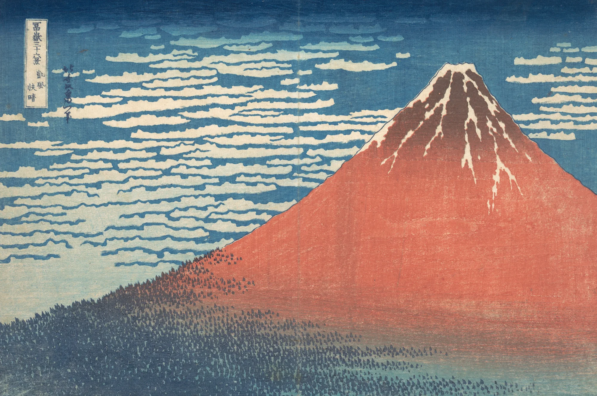

# woodblock-print

A real Japanese colour woodblock print, printed in front of you as you
scroll. The sheet starts as blank washi on the page, and the picture arrives
the way it did in a printer's shop in Edo: the key block first, the outline
in sumi, then each colour block in turn, palest first and darkest last. Every
impression is rubbed in by a baren: for a moment the ink lies in swirled,
uneven patches with the grain of the cherry block running through it, then a
second pass evens it out. The block's relief is pressed into the paper, ink
pools a little at the edges of shapes, and each block lands a pixel or two
out of register and settles into the marks. Scroll back and the print
un-prints. The demo prints Hokusai's *Red Fuji* (six blocks) and Hiroshige's
*Sudden Shower over Shin-Ōhashi* (twelve, ending with the two rain blocks).

```html
<link rel="stylesheet" href="woodblock-print.css">
<section data-woodblock-print data-src="assets/red-fuji.json">
  <div class="wb-stage">
    
  </div>
</section>
<script type="module" src="woodblock-print.js"></script>
```

Or `import { woodblockPrint } from './woodblock-print.js'` and call
`woodblockPrint(section, { src, mode, runway, margin, light })`; it returns
`destroy()`.

## Options

| attribute      | option   | default    | what it does |
|----------------|----------|------------|--------------|
| `data-src`     | `src`    | required   | The print's JSON: size, paper colour, and per block its ink (optical density at full coverage), bounding box and flags. |
| `data-atlas`   | `atlas`  | `<src>-blocks.webp` | The coverage maps, one greyscale strip (columns of layers if tall). |
| `data-mode`    | `mode`   | `scroll`   | `scroll`: a pinned stage on a runway, one impression per stretch of scroll. `static`: the finished print in the flow. |
| `data-runway`  | `runway` | `72`       | Scroll length per impression, in svh (plus 90svh of lead-in and run-out). The Hiroshige uses `60`: it has twelve blocks. |
| `data-margin`  | `margin` | `.085`     | Sheet margin as a fraction of the print's short side (the bottom margin is 1.55x, for the kento). The Hiroshige crop already carries its own margin and seals, so it uses `.035`. |
| `data-light`   | `light`  | `pointer`  | `pointer`: a raking light that swings toward a mouse over the sheet (touch leaves it alone). `fixed`: light from the upper left. |
| `data-webgl`   | `webgl`  | `on`       | `off` forces the 2D fallback (for testing). |

Block flags in the JSON: `bokashi` (0-1, how strongly the wiping streaks of
the cloth show in the graded part while it arrives) and `depth` (how deep the
block presses into the paper; key defaults to 1.6, others 1).

## How it works

**Separation (offline, Python).** The print is turned into optical density
relative to its paper, `OD = -ln(I / paper)`, in the sRGB-encoded values (sRGB
is close enough to a power law that products survive the encoding, so the
shader can multiply encoded colours directly). In OD, inks add, and one ink at
any strength is one direction: a bokashi is one block whose density varies,
not a stack of blocks.

- *Thin dark structures first.* A morphological top-hat (OD minus its grey
  opening with a 3px disc) isolates lines. Rain is found by rotating that map
  through 2-17° and opening along the vertical with a 61px line: long straight
  strokes survive; each stroke's median angle sorts it into one of the two rain
  blocks (they cut at about 6° and 12°). Short strokes with the same lean are
  caught by their shape (moments of each component). What is left that is thin
  and sumi-coloured is the key block; cartouche and signature boxes use a 6px
  disc so whole strokes come away.
- *Broad fields.* The remainder is unmixed per pixel onto a small set of ink
  directions (Prussian blue and bengara red for Hokusai; sumi, two blues,
  yellow, red and green for Hiroshige), choosing the best single ink, pair or
  triple by non-negative least squares. Inks are allowed only where they
  belong (no red in Hiroshige's sky; paper toning outside the image is not
  ink).
- *Blocks.* Each ink is split into the blocks a carver would cut: the same
  blue is the sky, the forest and the shadow on the summit; the same sumi is
  the dusk bokashi, the far shore and the piers. Region weights are feathered,
  so the split never shows in the composite. Each block's ink vector is then
  refit by least squares (others held), three rounds.
- The composite of all blocks on the paper reproduces the original to a mean
  error of about 3.7/255 after webp encoding (1.6 before, for Hiroshige).
  Blocks are normalised to their 99.95th percentile and saved as one greyscale
  webp strip; the JSON holds each block's ink at full coverage.

**Printing order.** Key first, as Edo printers did it: the outline goes down on
the clean sheet and every colour block, cut from proofs of it, registers to it.
It also reads best here: a drawing appears, then colour fills it. Then light to
dark: yellow, red, green, the pale river, the sky tint, the far shore, the
piers, the deep water, the sumi dusk, and the rain last.

**Front end.** One quad, one fragment shader (generated for the number of
blocks): coverage for up to 12 blocks in three RGBA textures, packed on load
from the strip at about the displayed resolution (so no mipmaps are needed and
nothing aliases on a phone). Per pixel: `paper × exp(-Σ coverage × density × ink)`.

- *The baren.* Pressure reaches each part of the block in turn, roughly top to
  bottom and across, with the hand's unevenness in it (two scales of
  low-frequency noise), so the front is a wide, ragged band and never a shape.
  Where it has reached, the ink is taken fibre by fibre: a paper-tooth map
  (fine speckle plus the kozo fibres) is thresholded against the pressure, so
  the partial state is goma-zuri, a crisp speckle of bare flecks that fills in
  as the density rises. Faint baren tracks (thin, irregular loops along the
  rows) press a little harder where they pass and show only as slightly
  denser speckle inside the printed area.
- *Wood grain.* Fine, slightly wavy parallel lines (period at least 3 CSS px,
  so nothing aliases on a phone), drawn crisp: they take the ink first while it
  is thin and stay as a whisper once it is full (the original's own grain is
  in the coverage maps).
- *Bokashi.* Graded blocks carry the horizontal streaks of the wiping cloth in
  their mid-tones while they arrive.
- *Pooling.* Coverage minus its 4-tap neighbourhood adds a slightly darker rim
  inside every edge, a little stronger while the ink is wet.
- *Emboss.* Each printed block's footprint is a depression in the paper; its
  gradient (the same four taps) is lit from the upper left, or from the
  pointer's side. The kento (an L-shaped kagi at the lower left and a straight
  hikitsuke along the bottom) are blind grooves in the bottom margin, pressed
  with the first impression.
- *Misregistration.* The block being printed is sampled from an offset of one or
  two CSS pixels that settles to zero over the first three quarters of its
  impression.
- *Paper.* A 1024² tileable texture made once in JS: long kozo fibres (curved
  strokes, mostly lighter), formation clouds, fine grain, and the wood streaks.
  The deckle wanders a little at two scales, thins and turns translucent in its
  last few pixels, with loose fibres beyond it; the shadow is faint and tight.
  The sheet is a few percent darker (damp) until the last impression is done.
- Scroll is followed on a critically damped spring, so a fast flick still
  shows the print being made and nothing overshoots.

## Theming

| variable     | default                  | used for |
|--------------|--------------------------|----------|
| `--paper`    | `#f3f0e8`                | the page around the sheet |
| `--wb-runway`| set by the script        | section height in scroll mode |
| `--gutter`   | `clamp(16px, 3vw, 32px)` | side padding of the stage |

The sheet takes the print's own paper colour from its JSON (the aged cream of
the impression), so the finished print matches the original.

## Making a new print

Scripts live outside the component (the separation is per print and needs
looking at). The recipe: crop inside the sheet, resize to ~2000px on the long
side, take paper from the brightest unprinted area, sample a few pure patches
for the ink directions, check the residual of a pair/triple unmix (anything
large means a missing ink), cut blocks by region, refit, then view every block
alone and the reconstruction beside the original at full size before
exporting.

## Accessibility and motion

- Without JS (or if loading fails) the original print stays as an ``
  dressed as a sheet; the canvas is `aria-hidden`. The art is ornament
  (`alt=""`), credits are in `assets/credits.json`.
- Reduced motion: no runway; the finished print, still. The raking light
  still follows a mouse (direct manipulation).
- Phone: the stage fits the width; everything is driven by scroll; the canvas
  is `touch-action: pan-y`, so a vertical swipe always scrolls.

## Cost

- Assets: Red Fuji 1.1 MB of blocks + 0.6 MB fallback; Sudden Shower 2.3 MB +
  0.8 MB. Packing on load: one `getImageData` per block at display size.
- A frame draws only while the scroll spring or the light is moving and the
  section is on screen (IntersectionObserver); nothing runs when idle or in a
  hidden tab. DPR capped at 2. The baren's loop only runs for the one block
  being printed; finished blocks cost ~5 texture reads each, shared noise
  included.
- Without WebGL, a 2D canvas multiplies each block in as a still layer
  (`exp(-c × ink)` baked per block) and fades it in with the scroll.

## Credits

Both prints: The Metropolitan Museum of Art, Open Access (CC0).
Katsushika Hokusai, *South Wind, Clear Sky* (Red Fuji), ca. 1830–32, JP2960;
Utagawa Hiroshige, *Sudden Shower over Shin-Ōhashi Bridge and Atake*, 1857,
JP2522. The block separations are ours. See `assets/credits.json`. No
third-party code.
